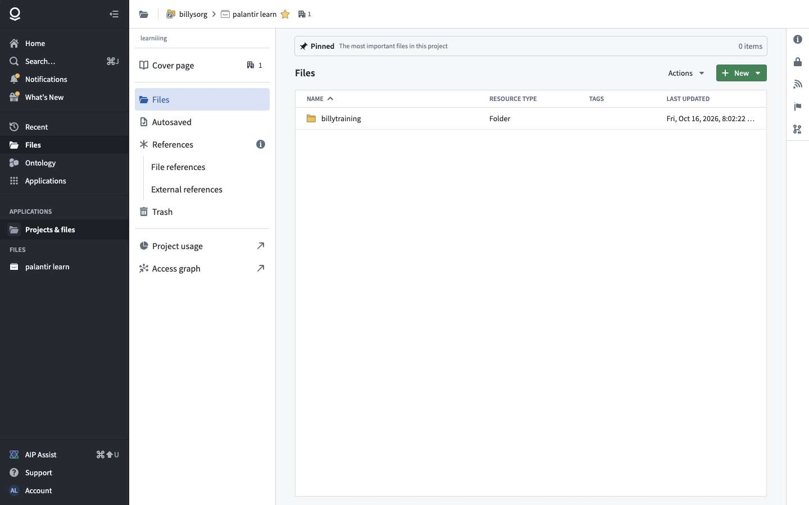
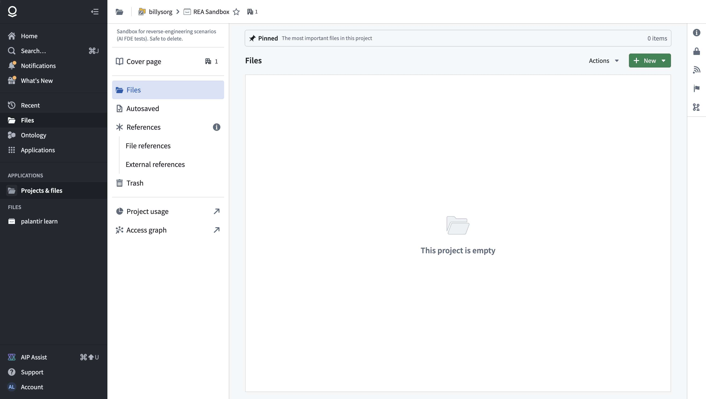
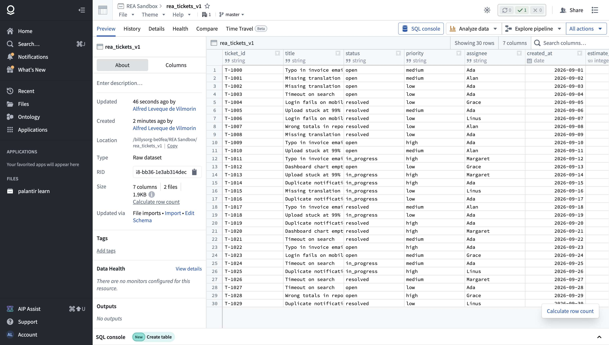
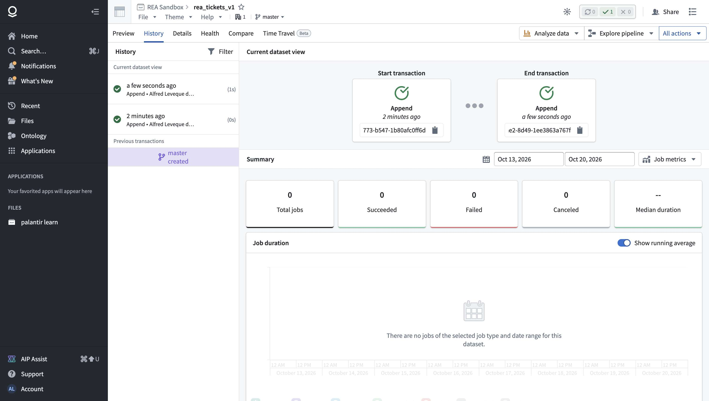
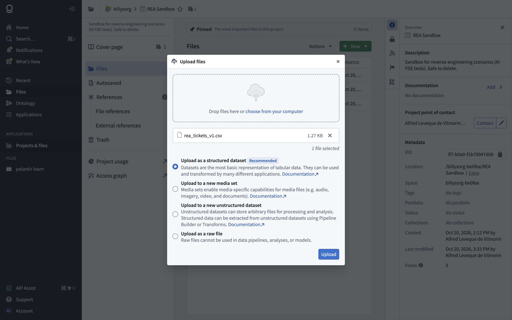

# Chapter 1 — Projects, files and datasets

> **Status:** v0.1 (2026-10-21)
> **Sources:** click-only crawls of Projects & files (`/workspace/compass`) and of a dataset view (`all_orders`); recorded flows in REA Sandbox: **project creation**, **CSV upload** (U1) and **append of a second file** (U2) with the synthetic `rea_tickets_v1/v2.csv`. Raw data: `crawl/out-shapes/compass/`, `crawl/out-a/`, `crawl/out-scenarios/U1-upload`, `U2-append`.
> **Legend:** 🟢 observed · 🟡 inferred · 🔵 design choice for our version.

---

## 1. What it is for

Two foundations every other module sits on:

- **Projects & files** ("Compass"): the file system. Spaces → projects → folders → resources (datasets, pipelines, modules, object types…), with permissions, search, trash, references between projects.
- **Datasets**: versioned tables. Data is never overwritten in place: every write is a **transaction** (append, snapshot…), and a dataset's current content is a **view** over a range of transactions. Branches let pipelines write without affecting `master`.

## 2. Projects & files

### 2.1 Structure 🟢

| Level | Example | Notes |
|---|---|---|
| Organization | billysorg | Users, groups, markings |
| **Space** | billysorg-be0fea | Namespace of projects; Global Branches live here |
| **Project** | palantir learn, REA Sandbox | Unit of permissions, usage tracking, imports |
| Folder | billytraining | Nesting inside a project |
| Resource | all_orders (dataset), An Order (object type), Order Inbox (module) | Every resource has a **RID**, e.g. `ri.compass.main.folder.527ea5fb-…`, `ri.foundry.main.dataset.251e0fdf-…` |

RID pattern: `ri.<service>.<instance>.<type>.<uuid>`. The service prefix says who owns the resource (`compass`, `foundry` = datasets, `eddie` = Pipeline Builder, `workshop`, `ontology`, `actions`, `branch`…).



### 2.2 Screens 🟢

- **Home**: tabs *All files · Shared with you · Data Catalog · Trash*; filters Types, Status, Portfolios, Tags, Organizations; "View all (10)" project types.
- **Project view**: left menu *Cover page · Files · Autosaved · References (File references, External references) · Trash · Project usage · Access graph*; file table (Name · Resource type · Tags · Last updated); **New** menu (all resource types, grouped by app: Folder, Web link, **Upload files…**, Action type, AIP Logic, Code repository, Dataset, Pipeline Builder, Module…); **Actions** menu (Copy link, Copy RID, Request access, View in access graph, Add tags, Move to trash).
- **Right panel**: *Overview* (description, documentation, point of contact, metadata: RID, location, space, tags, portfolio, status, collections, created, modified, views), *Access* (roles, "View more access details", "Check access"), *Activity* feed, *Resource queues* (compute), *Branch protection*.



### 2.3 Creating a project 🟢

New → New project → choose a **template**: *Production project* (separate groups for owners, builders and users) or *Sandbox project* ("Everyone will be able to access and modify it"). Then name, optional description, Advanced (space, roles). Result: an empty project where everyone in the org gets the Owner role (sandbox template).

### 2.4 References between projects 🟢

A project can only read resources it has **imported**: AI FDE had to call `add_missing_project_imports` before its pipeline in REA Sandbox could read `all_orders` from *palantir learn* (chapter 3). Imports appear under *References → External references*. This is a cheap but strong permission model: a project's inputs are explicit.

### 2.5 API 🟢

`compass/api`: `folders/home`, `folders/{rid}/children`, `resources/{rid}`, `batch/resources`, `search`, `hierarchy/v2/batch/…`, `projects/imports/{rid}`, `projects/previews/batch-get`, `resources/{folder}/checkNames` (name conflict check; returns availability for `name`, `name (1)` … `name (9)`), `registry/uploaders`, `registry/actions`, `linked-items/{rid}`, `collections`, `categories`. Permissions: `multipass/api/authz/batch/operations`, `authz/operations/{rid}`, `me/groups`, `administration/principals`, `authz/markings/usable`.

## 3. Datasets

### 3.1 Screens 🟢

Tabs: **Preview** (table, column stats, "Calculate row count", column filter), **History** (transactions list; "Current dataset view" = start transaction → end transaction; job metrics: total, succeeded, failed, canceled, median duration), **Details** (schema, tags, data health, inputs and outputs in the lineage, custom metadata), **Health** (checks, monitoring, rules, related schedules), **Compare**, **Time Travel** (Beta: versions, *Bisect*, *Rollback dataset*, *Explore history*). Top bar: branch selector (`master`), job status counters, Share. Actions: *Analyze data* (AIP Analyst, Contour, Jupyter), *Explore pipeline*, *Create object type*, *Create new pipeline*, *Create restricted view*, *Download as CSV*, *Manage schedules*, *Scan for sensitive data*, *SQL console*.




### 3.2 Uploading a file (U1) 🟢

1. Project → New → **Upload files…** → drop zone → choose type: **structured dataset** (recommended, tabular), media set, unstructured dataset (arbitrary files, structured later by a pipeline), raw file.
2. `GET compass/api/registry/uploaders` (upload endpoints per type) → `POST compass/api/resources/{folder}/checkNames` (pick a free name) → **`POST blobster/api/foundry`** (multipart upload; the backend creates the dataset, its first transaction, and infers the schema).
3. "Upload finished — Successfully created 1 resource".



### 3.3 Adding data: the transaction protocol (U2) 🟢

Dropping a second CSV on the dataset page opens *Upload… → Select import type*:
- **Add** → an **APPEND** transaction ("the uploaded files must have the same schema"),
- **Replace** → a **SNAPSHOT** transaction,
- option *Keep existing schema*.

Recorded sequence after "Import and validate":

| # | Call | Role |
|---|---|---|
| 1 | `POST foundry-catalog/api/catalog/datasets/{ds}/transactions` `{branchId, record}` | **open** a transaction → `{rid, type, status: OPEN, startTime, attribution{userId,time}, filePathType}` |
| 2 | `POST …/transactions/{tx}` (body: the type) | set APPEND |
| 3 | `POST foundry-data-proxy/api/dataproxy/datasets/{ds}/transactions/{tx}/putFile` | write the file into the transaction |
| 4 | `POST …/transactions/{tx}/commit` | **commit** → the new view is visible |
| 5 | `POST foundry-metadata/api/schemas/datasets/{ds}/branches/master` | save the schema → `{transactionRid, versionId}` |
| 6 | `POST foundry-schema-inference/api/datasets/{ds}/branches/master/validate` | parse with the schema → `{status, successCount, failureCount, successRows, failedRows}` |
| 7 | `contour/api/dataset-preview/v2/{ds}/branches/master/async` + `poll/{id}` | preview computed asynchronously |

### 3.4 Data model 🟢

```ts
interface Transaction {
  rid: Rid; datasetRid: Rid;
  type: 'APPEND' | 'SNAPSHOT' | 'UPDATE' | 'DELETE';    // 🟢 APPEND/SNAPSHOT seen; 🟡 UPDATE/DELETE from Foundry's model
  status: 'OPEN' | 'COMMITTED' | 'ABORTED';
  startTime: DateTime; closeTime: DateTime | null;
  attribution: { userId: Uuid; time: DateTime };
  metadata: { fileCount; totalFileSize; hiddenFileCount; totalHiddenFileSize } | null;
  filePathType: string; permissionPath: string; provenance: unknown | null;
  isDataDeleted: boolean;
}
interface DatasetFile {          // views2/{branch}/files: the files visible in the current view
  logicalPath: string; physicalPath: string; transactionRid: Rid;
  fileMetadata: { length: number }; isOpen: boolean; timeModified: DateTime;
}
interface Schema {               // per branch, versioned (versionId)
  fieldSchemaList: { name: string; type: 'STRING' | 'INTEGER' | 'DATE' | /*…*/ string; nullable: boolean | null;
                     precision; scale; arraySubtype; mapKeyType; mapValueType; subSchemas; customMetadata }[];
  primaryKey: unknown | null;
  dataFrameReaderClass: string;  // how to read the files (CSV parser here)
  customMetadata: { textParserParams: { parser; charsetName; fieldDelimiter; recordDelimiter; quoteCharacter; dateFormat; … };
                    options: { addRowNumber } };
}
```

**View rule** 🟡: the current view of a branch = the files of the last SNAPSHOT transaction plus every later APPEND (minus DELETEs). The History tab's "start transaction → end transaction" displays exactly that range.

## 4. Feature list and verdicts

| # | Feature | Verdict | Why |
|---|---|---|---|
| P1 | Spaces → projects → folders → resources, with RIDs | **Must** | Everything lives somewhere |
| P2 | Project roles (owner / editor / viewer) | **Must** (simple) | Permissions start at the project |
| P3 | Search, recent files, trash (soft delete) | **Must** | |
| P4 | Project imports (explicit cross-project inputs) | **Must** | Cheap, keeps lineage and permissions sane |
| P5 | Project templates | Later | |
| P6 | Tags, portfolios, collections, cover pages, activity feed | Later | |
| P7 | Resource queues, usage, access graph, markings | Later / Drop | Enterprise |
| D1 | Upload CSV / Parquet / XLSX as a structured dataset, with schema inference | **Must** | Entry point of the slice |
| D2 | Transactions: APPEND and SNAPSHOT, open → write files → commit; abort on failure | **Must** | The core of versioned data |
| D3 | View = last snapshot + later appends; history list | **Must** | |
| D4 | Schema per branch + parse validation (success / failed rows) | **Must** | Users must see bad rows |
| D5 | Preview with paging and column stats | **Must** (basic) | |
| D6 | Branches on datasets | **Must** for pipelines (chapter 5); simple version first | Pipelines write to branches |
| D7 | Time travel: view at version, rollback | Later | Cheap once D2/D3 exist |
| D8 | Health checks, schedules, compare | Later | |
| D9 | Media sets, unstructured datasets | Drop for now | |

## 5. Pseudo-code for the must-haves 🔵

### 5.1 Storage layout

```
object store (S3-like):  datasets/{datasetId}/{transactionId}/{logicalPath}      // immutable files
metadata DB:
  datasets(id, folderId, name, createdBy, createdAt)
  branches(datasetId, name, headTransactionId)
  transactions(id, datasetId, branch, type, status, parentId, startedAt, committedAt, userId, fileCount, bytes)
  files(transactionId, logicalPath, physicalKey, size)
  schemas(datasetId, branch, versionId, transactionId, fields JSON, parser JSON)
```

### 5.2 Transactions (D2, D3)

```
function startTransaction(datasetId, branch, type):          // type: APPEND | SNAPSHOT
    require no OPEN transaction on (datasetId, branch)         // one writer per branch
    return insert transactions {type, status: OPEN, parentId: branch.head}

function putFile(tx, logicalPath, stream):
    require tx.status == OPEN
    key = f"datasets/{tx.datasetId}/{tx.id}/{logicalPath}"; objectStore.put(key, stream)
    upsert files {tx.id, logicalPath, key, size}

function commit(tx):
    transaction (DB):
        require tx.status == OPEN and branch.head == tx.parentId   // otherwise conflict → abort
        tx.status = COMMITTED; tx.committedAt = now(); branch.head = tx.id
    emit DatasetUpdated(datasetId, branch, tx.id)                 // triggers schema validation, indexing (ch. 2), downstream builds (ch. 5)

function currentView(datasetId, branch):
    chain = walk parents from branch.head back to (and including) the last SNAPSHOT
    files = {}
    for tx in chain oldest → newest: for f in tx.files: files[f.logicalPath] = f   // later appends win on same path
    return files.values()
```

### 5.3 Upload with schema inference (D1, D4)

```
function uploadCsv(folderId, filename, stream):
    name = firstFreeName(folderId, stripExt(filename))        // "x", "x (1)", …
    ds = createDataset(folderId, name)
    tx = startTransaction(ds, "master", SNAPSHOT); putFile(tx, filename, stream); commit(tx)
    sample = readHead(ds, rows = 1000)
    schema = inferSchema(sample)                               // types per column; delimiter, quote, date format
    saveSchema(ds, "master", schema, tx)
    report = validate(ds, schema)                              // parse all rows: success / failed rows (first N kept)
    return {ds, schema, report}

function appendCsv(ds, filename, stream, keepSchema):
    tx = startTransaction(ds, "master", APPEND); putFile(tx, filename, stream)
    if not keepSchema and schemaOf(stream) != currentSchema(ds): abort(tx); error("schema mismatch")
    commit(tx); validate(ds, currentSchema(ds))
```

## 6. Coverage and unknowns

| Question | Status | Next step |
|---|---|---|
| Upload and append protocol | ✅ Observed | — |
| Transaction, file and schema models | ✅ Observed | — |
| Snapshot replace, update / delete transactions | ⚠️ Model only | Not exercised |
| Branching of datasets | ⚠️ Partial | Seen via the pipeline output on a branch (ch. 3); chapter 5 |
| Time travel / rollback | ⚠️ Screens only | Not exercised (it would change data) |
| Project permissions in practice | ⚠️ Screens only | Single-user org |

**Created during this chapter** (REA Sandbox): project **REA Sandbox**; dataset **rea_tickets_v1** (synthetic, 2 APPEND transactions: 20 + 10 rows).
