# Chapter 2 — Ontology Manager

> **Status:** v0.3 (2026-10-21): §7bis write flows, create wizard and successful action run
> **Sources:** click-only crawl of `/workspace/ontology` (4 runs, ~500 clicks, 57 screen kinds, 74 screenshots, 72 API endpoints with payload shapes). Digest: [data/ontology-manager-digest.md](data/ontology-manager-digest.md).
> **Legend:** 🟢 observed (seen on screen or in API traffic) · 🟡 inferred (deduced from observations) · 🔵 design choice for our version.

---

## 1. What it is for

Ontology Manager is where you define the **semantic layer** on top of raw datasets. You turn tables into business objects (*Order*, *Flight*, *Carrier*), connect them (*a Flight belongs to a Carrier*), and declare how users are allowed to change them (*Assign Order*, *Close Alert*). Every other app (Workshop, Object Explorer, Automate, AIP Logic, AI FDE) consumes these definitions, which is why it ranks first in the feature book.

It manages **definitions, not data**. Objects themselves live in an index fed by datasets. Ontology Manager only configures that mapping.

## 2. Core concepts and data model

### 2.1 Entities 🟢

| Entity | What it is | Seen in |
|---|---|---|
| **Ontology** | The container. One per org here ("billysorg Ontology"), with roles and branches | Ontology configuration, branch selector "Main" |
| **Object type** | A business entity backed by one or more datasets. Has a primary key, a title property and properties | Object types list, object type page |
| **Property** | A typed column of an object type, mapped to a dataset column | Properties tab, Column mapping |
| **Shared property** | A property definition reused across object types | "Convert to a shared property", Shared properties list (0 here) |
| **Link type** | A relationship between two object types: one-to-many or many-to-many | Link types list, link type page |
| **Action type** | A typed, permissioned way to create, modify or delete objects | Action types list, action type page |
| **Interface** | An abstract shape that several object types implement | Interfaces list (0 here) |
| **Value type** | A semantic type on top of a primitive (e.g. email) | Value types list (0 here) |
| **Type group** | A folder-like grouping of entities | Groups list (0 here) |
| **Function** | Code or model functions usable by actions (427 here, mostly LLM models) | Functions list |

Every entity has a **status** (`Active`, `Experimental`, `Example`, `Deprecated`; Functions add `Promoted`), and object types and properties have a **visibility** (`Normal`, `Hidden`, `Prominent`).

### 2.2 Schema, from API payload shapes 🟢 + 🟡

These are the shapes Foundry actually returns (`POST /ontology-metadata/api/ontology/ontology/bulkLoadEntities` and `POST /ontology-metadata/api/ontology/linkTypesForObjectTypes`), simplified. Field names are Foundry's. The comments are inferences.

```ts
// 🟢 observed in bulkLoadEntities.response.objectTypes[]
interface ObjectTypeEntry {
  objectType: ObjectType;
  datasources: Datasource[];
  entityMetadata: unknown;           // not expanded in the crawl
  ontologyRid: Rid; ontologyVersion: Uuid; resolvedBranch: unknown;
  schemaMigrations: unknown;
}

interface ObjectType {
  rid: Rid; id: string; apiName: string;           // e.g. "AnOrder"
  displayMetadata: { displayName; pluralDisplayName; description; icon: { type; blueprint: { color; locator } };
                     visibility: 'NORMAL' | 'HIDDEN' | 'PROMINENT'; groupDisplayName };
  primaryKeys: Rid[];                               // property rids
  titlePropertyTypeRid: Rid;
  propertyTypes: Record<Rid, PropertyType>;
  status: { type: 'active' | 'experimental' | 'example' | 'deprecated' };
  traits: { timeSeriesMetadata?; sensorTrait?; eventMetadata?; actionLogMetadata?; peeringMetadata?; workflowObjectTypeTraits? };
  implementsInterfaces: Rid[]; typeGroups: Rid[];
  editPolicies: unknown | null;
}

interface PropertyType {
  rid: Rid; id: string; apiName: string;           // e.g. "order_id"
  displayMetadata: { displayName; description; visibility };
  type: { type: 'string' | 'long' | 'double' | 'date' | 'timestamp' | 'boolean' | 'geopoint' | 'attachment' | /* … */ string;
          string?: { isLongText: boolean; supportsExactMatching: boolean } };
  indexedForSearch: boolean;
  typeClasses: { kind: string; name: string }[];   // 🟡 render hints: identifier, low cardinality, keywords…
  baseFormatter: object | null; ruleSetBinding: object | null;  // 🟡 display formatting / conditional formatting
  sharedPropertyTypeRid: Rid | null; valueType: Rid | null; dataConstraints: object | null;
}

interface Datasource {
  rid: Rid;
  datasource: { type: 'dataset' | 'timeSeries' | string;
                dataset?: { datasetRid: Rid; branchId: string; propertyMapping: Record<Rid, string /* column */>; writebackDatasetRid: Rid | null };
                timeSeries?: { timeSeriesSyncRid: Rid; properties: Rid[] } };
  editsConfiguration: { onlyAllowPrivilegedEdits: boolean };
}

// 🟢 observed in linkTypesForObjectTypes.response.linkTypes[objectTypeRid][]
interface LinkType {
  rid: Rid; id: string; status;
  definition:
    | { type: 'oneToMany'; oneToMany: {
          objectTypeRidOneSide: Rid; objectTypeRidManySide: Rid;
          oneSidePrimaryKeyToManySidePropertyMapping: Record<Rid, Rid>;   // the foreign key
          cardinalityHint: string;
          oneToManyLinkMetadata: LinkSideMetadata; manyToOneLinkMetadata: LinkSideMetadata } }
    | { type: 'manyToMany'; manyToMany: {
          objectTypeRidA: Rid; objectTypeRidB: Rid;
          objectTypeAPrimaryKeyPropertyMapping: Record<Rid, Rid>;
          objectTypeBPrimaryKeyPropertyMapping: Record<Rid, Rid>;          // 🟡 via a join dataset
          objectTypeAToBLinkMetadata: LinkSideMetadata; objectTypeBToALinkMetadata: LinkSideMetadata } };
}
interface LinkSideMetadata { apiName: string; displayMetadata: { displayName; pluralDisplayName; visibility } }

// 🟢 observed in modification/history/entity
interface HistoryItem { ontologyVersion: Uuid; attribution: { date: DateTime; author: Uuid }; modificationType: string; description: string }
```

**Action types** came through `graphql-gateway/api/bulk`, whose responses weren't captured (see §8). Their model is reconstructed from the screens 🟡:

```ts
interface ActionType {
  rid: Rid; apiName: string; displayName: string; status;
  rules: ActionRule[];                       // ordered: "1. Create object [Example] Explainer"
  parameters: Parameter[]; sections: FormSection[];
  submissionCriteria: Condition[];           // e.g. "Title is not null", user/group checks
  ui: { submitButtonLabel?; successMessage?; applyingMessage?; allowRevert: boolean };
  capabilities: { externalCalls: 'only-without' | 'all' | 'disabled'; retryOnTransientErrors: boolean };
  roles: RoleGrant[];                        // Owner / Editor / Viewer / Discoverer
}
type ActionRule =
  | { kind: 'createObject'; objectType: Rid; mapping: Record<PropertyRid, ParamRef | Static> }
  | { kind: 'modifyObject'; target: ParamRef; mapping: Record<PropertyRid, ParamRef | Static> }
  | { kind: 'createOrModifyObject'; /* … */ } | { kind: 'deleteObject'; target: ParamRef }
  | { kind: 'function'; functionRid: Rid };  // "function-backed action"
interface Parameter {
  id: string; displayName: string;
  type: 'boolean' | 'string' | 'integer' | 'long' | 'double' | 'date' | 'timestamp' | 'objectReference' | 'objectSet' | /* … */ string;
  objectType?: Rid; allowMultiple: boolean; required: boolean; visible: boolean; disabled: boolean;
  defaultValue?: unknown; constraints?: unknown;
  overrides: { when: Condition; set: Partial<Pick<Parameter, 'visible' | 'disabled' | 'required' | 'defaultValue'>> }[];
}
```

### 2.3 Editing model: the working state 🟢

This is the most important behavior to reproduce, and we learned it the hard way:

- Every change (on any entity page) is applied to a **local draft**, not saved. The header shows **"N edits · Save"**.
- The draft is stored in the browser's `localStorage` (`@foundry/ontology/vv/13/workingState`). It survives reloads and is shared by every tab.
- **Save** opens a **review screen** with tabs *All changes · Warnings · Errors · Migrations · Conflicts*. Each change is shown as a diff ("Submission criteria order changed: ~~old~~ → new"). Validation errors block the save ("Left value of comparison is missing or invalid"), and so do warnings that need review ("No condition in the submission criteria checks the user's identity…").
- **Save to ontology…** commits everything at once, creating a new ontology version (🟡 `ontologyVersion` uuid in history). **Discard** asks for confirmation and clears the draft.
- **Branches / Proposals** (🟢 "Main" selector, "Create branch", tabs *Your proposals · Assigned to you · In review · Merged · Closed*): changes can go to a branch and be reviewed like a pull request.

## 3. Screen map

### 3.1 Home (left menu) 🟢

| Section | Route | Contents |
|---|---|---|
| Discover | `/home/discover` | Recently viewed object types (cards: name, object count, dependents, description), customizable homepage sections |
| Proposals | `/home/proposals` | Branch-based change requests with review states |
| History | `/home/history` | Ontology-wide edit log ("An Order Created"), filterable, "Navigate to" entity |
| Object types | `/home/object-type` | Table: Name · Status · Groups · Number of objects; filters Status, Visibility |
| Properties | `/home/properties` | All properties across types: Name · Status · Visibility · Backing column; filters by property type and render hints |
| Shared properties | — | (empty) |
| Link types | `/home/link-type` | Name · Status; filters Status, Storage backend, Cardinality, Permission model |
| Action types | `/home/action-type` | Name · Rules · Status; filter by rule (Create / Modify / Create-or-modify / Delete object) |
| Groups, Interfaces, Value types | `/home/type-groups`, `/home/interfaces`, `/home/value-types` | Lists (all empty here) |
| Functions | `/home/function` | Name · Source · Owning project · Status · Published date |
| Health issues | `/home/health-issues` | Index failed · Data issue · Unregistered · Deindexed |
| Cleanup | `/home/cleanup` | Flags unused entities (usage-based settings) |
| Ontology configuration | `/home/advanced` | Ontology roles, project-permission migration |

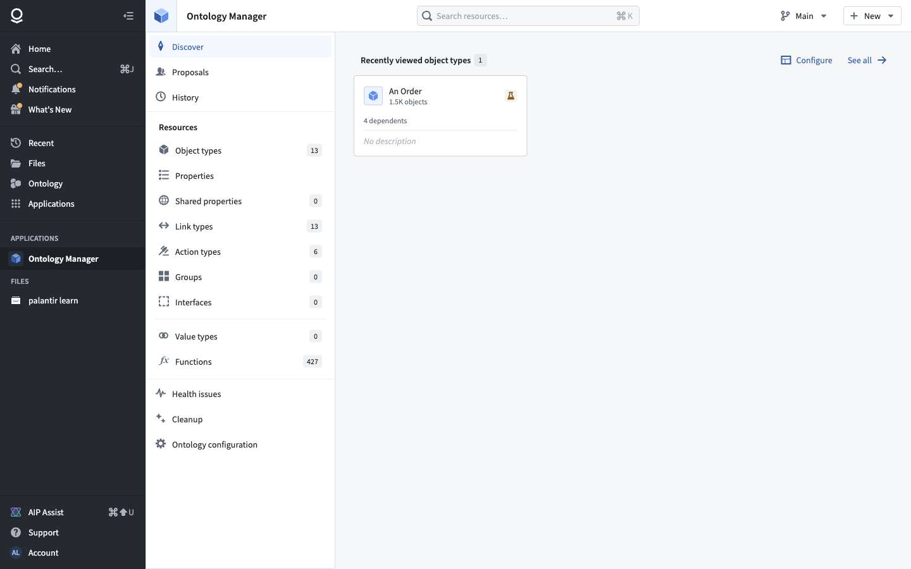
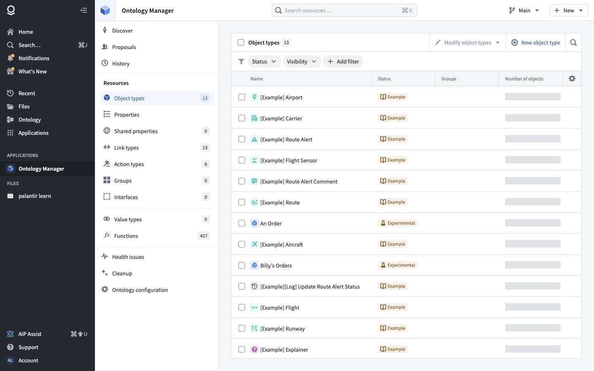

### 3.2 Object type page — `/object-type/{id}/…` 🟢

| Tab | Contents |
|---|---|
| **Overview** | Plural name, description, aliases, location (project folder), point of contact, contributors, API name · Status, Visibility, Index status, Edits (enabled/disabled), Branch protection, ID, RID · panels: Properties, Action types, Links graph, Interfaces, Automations, dependents ("Object View 3, Workshop 5…") · SQL console / object preview at the bottom |
| **Properties** | List with *Column mapping* ("11 of 11 columns mapped") · property detail tabs: *General · Source · Display · Interaction · Dependents* · value type, requiredness, "Convert to a shared property", delete |
| **Security** | *Object type* vs *Object instances* · ontology roles · security policies (name, type, applies to, access summary) · "Object instances are secured by their datasource" |
| **Datasources** | Backing dataset (columns → properties), storage backend (Object Storage V1/V2), indexing metadata, index status ("Index failed"), Replace / Add backing datasource, Edits |
| **Observability** | Monitoring of the object type |
| **Capabilities** | Optional traits: Time series, Media reference, Measures, Event, Geospatial, Vertex (graph) |
| **Object views** | Full view / Panel view of an object, list/grid preview, "View in Object Explorer" |
| **Interfaces** | Implemented interfaces |
| **Materializations** | Object datasets (writeback output), rebuild Automatic / Periodic |
| **Automations** | Automations triggered by this type |
| **Usage** | Reads & writes per day, by user and by client app (e.g. `workshop-app`) |
| **History** | Edits to this entity |

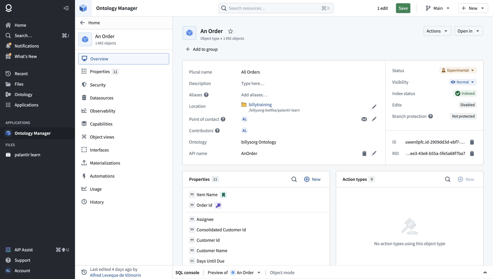
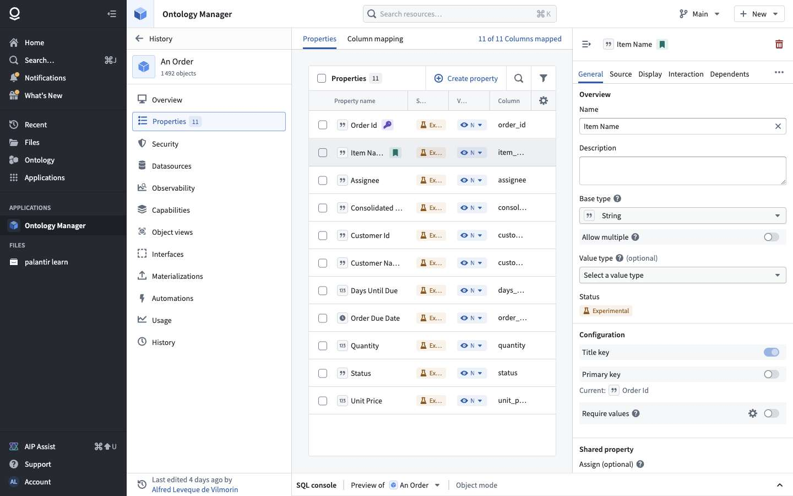
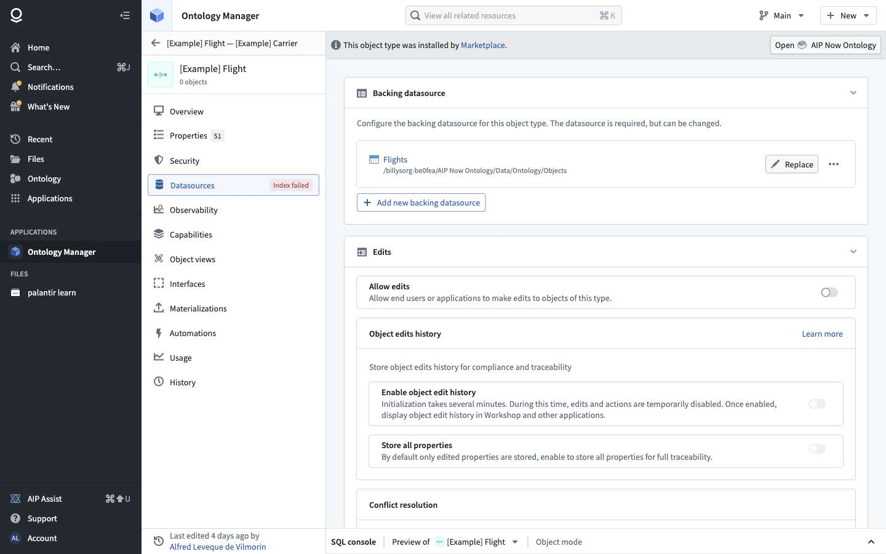
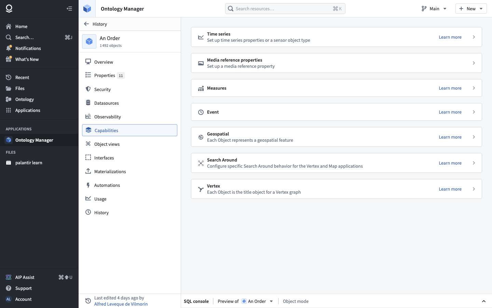

### 3.3 Link type page — `/link-type/{x}/overview` 🟢

Header "Flights ⟷ Carriers · Many-to-one link type". Configuration: **join method**, one of *Foreign key · Dataset · Object type*. For a foreign key, you pick the property on each side ("Airline Id" → "Airline Id", primary key marked with a key icon, a swap button). Then *Link type names* for each direction. Tabs: *Overview · Security · Datasources · Observability · Usage · History*.

Creation is a 4-step wizard: **1 Relationship type → 2 Link resources → 3 Link type names → 4 Save location**.

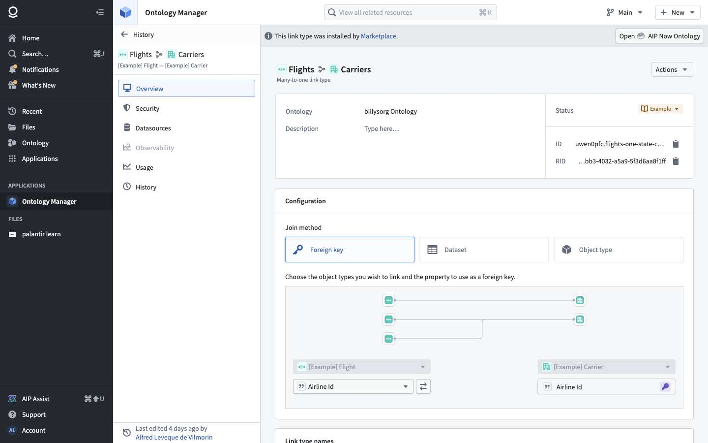
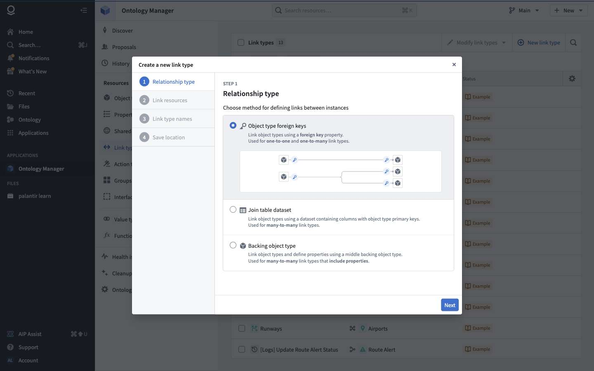

### 3.4 Action type page — `/action-type/{rid}/…` 🟢

| Tab | Contents |
|---|---|
| **Overview** | Description, "agent tool description" (Markdown, explains the action to AI agents), dependents (Workshop 1, Automation 0…), Duplicate / Delete |
| **Rules** | Ordered rules ("1. Create object [Example] Explainer") mapping each **property → parameter** · "Add new rule" · **Convert to Function Code**: generated TypeScript v1 / Python / TypeScript v2 starting code |
| **Parameters** | Form builder: parameters grouped in sections, per parameter *Value · Display · Overrides · Details* (visible, disabled, required, allow multiple values, default value, conditional overrides) · live **Preview** and **Test run** (fill the form, Submit) |
| **User interface** | Submit button text, success message ("Edits successfully applied."), applying message, "Allow revert after action submission" |
| **Capabilities** | External calls: *Only actions without external calls / All actions / Disabled* · Retry mode on transient errors |
| **Security & Submission Criteria** | Roles (Owner / Editor / Viewer / Discoverer) · conditions with logical operators ("Title is not null"), copy/paste criteria · warning when no condition checks the user's identity |
| **Automations**, **History**, **Observability** | Metrics, request log with failure reasons (authentication, conflict, invalid parameter, function failure…), filters by user, time range |

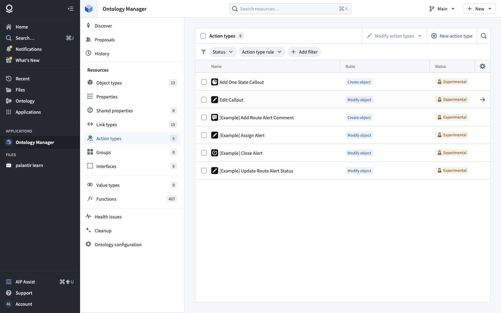
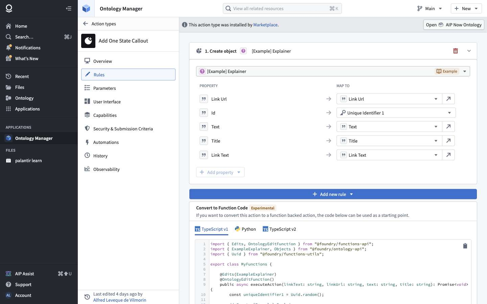
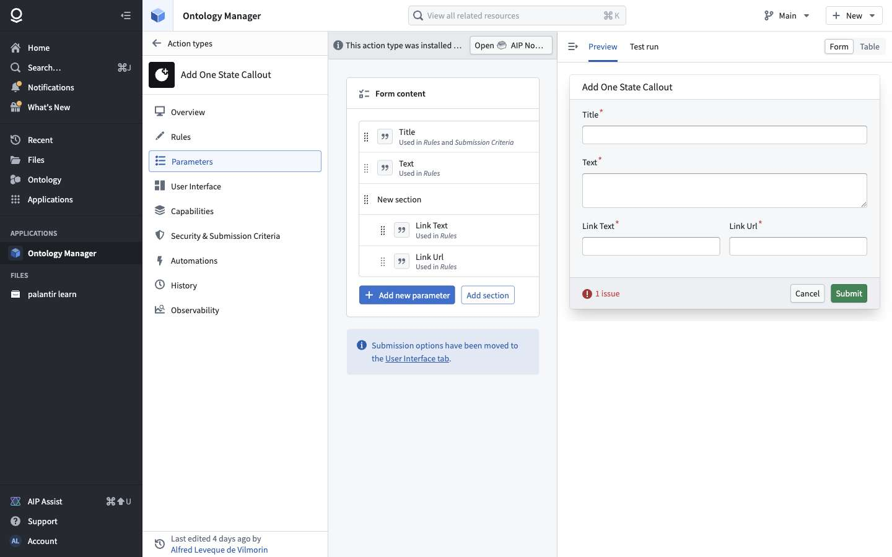
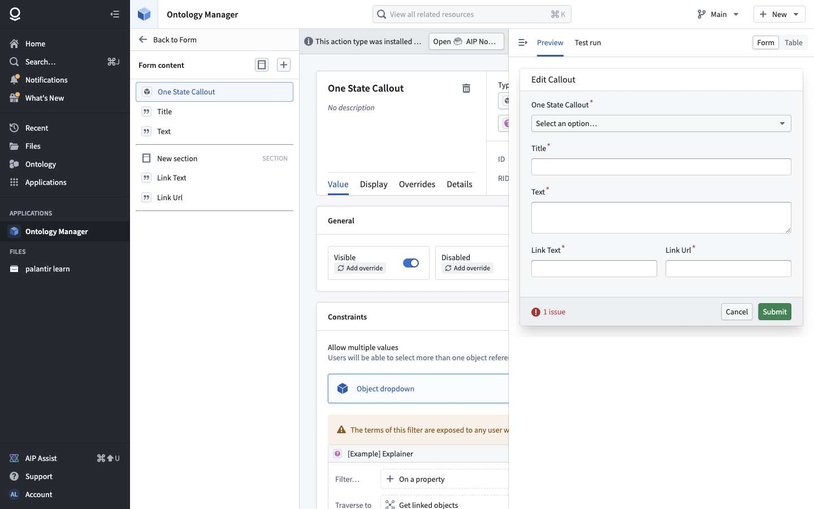
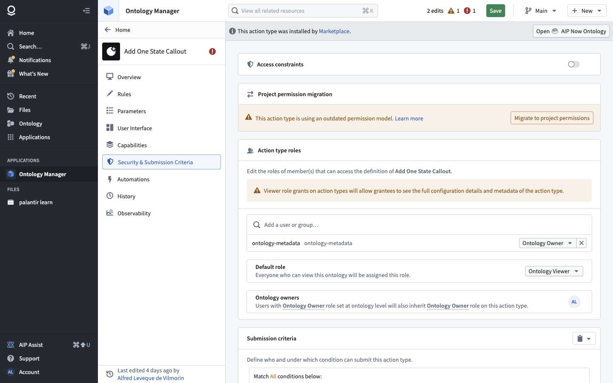

## 4. Feature list and verdicts for the minimal version

| # | Feature | Foundry | Verdict | Why |
|---|---|---|---|---|
| F1 | Create an object type from a dataset (pick PK, title, columns → properties) | 🟢 "New object type", Datasources, Column mapping | **Must** | The core of the product |
| F2 | Property types, display name, API name, description, visibility | 🟢 | **Must** | Needed by every consumer |
| F3 | List and search object types, properties, link types, action types | 🟢 home lists, filters | **Must** | Navigation |
| F4 | Link types: foreign key (1→N) | 🟢 join method "Foreign key" | **Must** | Most links are FKs |
| F5 | Link types: many-to-many via a join dataset | 🟢 join method "Dataset" | **Must** (simple) | Common in real data |
| F6 | Action types with Create / Modify / Delete rules, property ← parameter mapping | 🟢 Rules tab | **Must** | Turns read-only data into an operational app |
| F7 | Action parameters: basic types + object reference, required, default | 🟢 Parameters tab | **Must** | Needed by F6 |
| F8 | Submission criteria: simple conditions (param not null, user in group) | 🟢 Security & Submission Criteria | **Must** (simple) | Minimal permission model for writes |
| F9 | **Draft → review → save** with validation errors and diff | 🟢 working state, review screen | **Must** | Prevents half-edited ontologies; cheap to build |
| F10 | Entity history (who changed what, when, version) | 🟢 History | **Must** | Cheap once F9 exists |
| F11 | Indexing status (indexed / failed) | 🟢 Index status, Health issues | **Must** (basic) | Users need to know when data didn't load |
| F12 | Action form preview + test run | 🟢 Preview / Test run | Later | Great UX, not essential |
| F13 | Parameter sections and conditional overrides | 🟢 | Later | Form polish |
| F14 | Action UI messages, allow revert | 🟢 User interface tab | Later | Polish; revert needs edit history |
| F15 | Function-backed actions (code) + "Convert to function code" | 🟢 | Later | Needs a functions runtime |
| F16 | Branches and proposals (review like PRs) | 🟢 Proposals | Later | Big feature; F9 covers single-user safety |
| F17 | Shared properties, interfaces, value types, groups | 🟢 | Later | Modeling refinements |
| F18 | Object views (default display of an object) | 🟢 | Later | Workshop and Explorer can use a generic view |
| F19 | Capabilities: time series, geospatial, media, events | 🟢 | Later | Specialized |
| F20 | Usage analytics, observability, request logs | 🟢 | Later | Ops tooling |
| F21 | Row/object-level security policies, markings | 🟢 | Later | Datasource-level permissions first |
| F22 | Materializations / writeback datasets | 🟢 | Later | Needed only if edits must flow back into pipelines |
| F23 | Agent tool description on actions | 🟢 | Later, **but plan for it** | Cheap, and it's what lets AI FDE / AIP Analyst use actions |
| F24 | Cleanup, project-permission migration, Marketplace installs, conditional formatting | 🟢 | Drop | Vendor-specific or niche |

## 5. Main user journeys

**J1: Model a dataset as objects** (F1, F2, F11)
1. New object type → choose the backing dataset → choose the primary key and title columns.
2. Review the auto-mapped properties (types inferred from the dataset schema), rename, hide some.
3. Save (review screen) → the indexer loads rows as objects → "Index status: Indexed", "1 492 objects".

**J2: Link two object types** (F4, F5)
1. New link type → wizard: relationship type → the two object types and the key properties → names for both directions → save location.
2. Save → the link appears in both object types' link graphs.

**J3: Define an action** (F6–F8, F23)
1. New action type → add a rule ("Modify object: Order") → map properties to parameters ("Assignee ← param assignee").
2. Configure parameters (types, required) → add a submission criterion ("current user in group Ops").
3. Save → the action becomes usable in Workshop, by API, and by agents.

**J4: Safe editing** (F9, F10)
Any change → "N edits" counter → Save → review screen (changes, warnings, errors) → commit as a new ontology version, logged in History. Or Discard.

## 6. API surface

### 6.1 What Foundry calls 🟢 (72 endpoints, read-only crawl)

| Area | Main endpoints |
|---|---|
| Ontology metadata | `POST ontology-metadata/api/ontology/v2/load/all` · `POST …/ontology/load/{rid}/summary` · `POST …/load/{rid}/{uuid}/loadAllObjectTypes` · `POST …/ontology/bulkLoadEntities` · `POST …/linkTypesForObjectTypes(V2)` · `PUT …/actionTypesForObjectTypes` · `POST …/actions/types/load/all/{rid}/{uuid}` · `POST …/ontology/load/datasources` |
| History and usage | `POST …/v2/modification/history/entity` · `POST …/v2/{rid}/modification/history` · `PUT …/usage/search/getUsage` |
| Permissions | `PUT …/permissions/objectTypes`, `…/linkTypes`, `…/actionTypes` · `multipass/api/authz/batch/operations` · `multipass/api/roles/v2/roleSets` |
| Object index (phonograph) | `POST phonograph2/api/objects/registry/bulk/objectTypes/metadata` · `…/relations/metadata` · `…/usageMetadata` · `POST objects-data-funnel/api/status/object-type` (index status) |
| Objects and previews | `PUT object-set-service/api/objectSets/objects/top/initial` · `POST object-set-service/api/sql-endpoint/v1/queries/query` (SQL console) · `POST objects-data-funnel/api/view/currentV4` |
| Actions | `POST actions/api/actions/validatePreview` (form preview / test run validation) |
| Datasets | `foundry-metadata/api/schemas/batch/schemas` · `foundry-catalog/api/catalog/batch/latest-transactions2` · `foundry-stats/api/computed-stats-v2/get-v2` (column stats) |
| Everything else | `graphql-gateway/api/bulk` (used by most screens, responses not captured) |

Note the split: **ontology-metadata** stores definitions, **phonograph / objects-data-funnel** indexes and serves objects, **actions** validates and applies edits. A minimal version can keep the same three modules in one service.

### 6.2 Proposed minimal API 🔵

```
GET    /ontology                              → summary: counts, version, branch
GET    /ontology/object-types?q=&status=      → list
GET    /ontology/object-types/{apiName}       → full definition (+ datasources, links, actions)
GET    /ontology/link-types?objectType=
GET    /ontology/action-types?objectType=
GET    /ontology/history?entity=&cursor=

POST   /ontology/drafts                       → create a draft (per user)
PATCH  /ontology/drafts/{id}                  → add/replace entity changes (JSON patch per entity)
POST   /ontology/drafts/{id}/validate         → { changes, warnings, errors }
POST   /ontology/drafts/{id}/commit           → new ontology version (atomic)
DELETE /ontology/drafts/{id}                  → discard

GET    /objects/{objectType}?filter=&sort=&page=
GET    /objects/{objectType}/{pk}/links/{linkApiName}
POST   /actions/{actionApiName}/validate      → per-parameter errors, criteria result
POST   /actions/{actionApiName}/apply         → applies rules in one transaction, returns edits
GET    /index/status?objectType=
```

Storing the draft **server-side** (not in `localStorage` like Foundry) is a deliberate choice: it survives browser changes, and agents (AI FDE) can propose edits through the same draft and review flow.

## 7. Pseudo-code for the must-have features 🔵

Our own design, written from the observed behavior.

### 7.1 Draft, validate, commit (F9, F10)

```
function applyToDraft(draft, change):            // change = {entityKind, entityId, op: create|update|delete, value}
    draft.changes[entityKey(change)] = merge(draft.changes[entityKey(change)], change)
    draft.updatedAt = now()

function validate(draft):
    view = overlay(currentOntology(draft.baseVersion), draft.changes)
    errors, warnings = [], []
    for ot in view.objectTypes:
        require ot.apiName unique and identifier-safe                       → error
        require ot.primaryKey references an existing property              → error
        for p in ot.properties: require mapped column exists in datasource schema and type compatible → error
    for lt in view.linkTypes:
        require both object types exist; FK properties exist and types match → error
    for at in view.actionTypes:
        for rule in at.rules: every mapped parameter exists; target type exists → error
        for c in at.submissionCriteria: c.left, c.operator, c.right all set     → error   // "Left value … missing"
        if not any(c checks currentUser or group): warning("anyone can submit this action")
    if currentVersion() != draft.baseVersion: conflicts = diffConflicts(draft)  // "Conflicts" tab
    return {changes: diff(draft), warnings, errors, conflicts}

function commit(draft, user):
    report = validate(draft)
    if report.errors or report.conflicts: reject(report)
    transaction:
        newVersion = uuid()
        writeDefinitions(draft.changes, version=newVersion)
        for change in draft.changes: history.append({entity, type: change.op, author: user, date: now(), version: newVersion})
        delete draft
    enqueueReindex(affectedObjectTypes(draft.changes))    // F11
    return newVersion
```

### 7.2 Create an object type from a dataset (F1, F2)

```
function proposeObjectType(datasetId):
    schema = datasets.schema(datasetId)                    // columns + types
    props = for col in schema.columns:
        { apiName: snake(col.name), displayName: title(col.name), type: mapType(col.type),
          column: col.name, visibility: NORMAL }
    pk = guessPrimaryKey(schema, stats(datasetId))          // unique, non-null column, name like *_id
    return { apiName: pascal(dataset.name), displayName, pluralDisplayName: pluralize(displayName),
             primaryKey: pk, titleProperty: guessTitle(props), properties: props,
             datasource: { datasetId, propertyMapping: {p.apiName: p.column} },
             status: EXPERIMENTAL }
// The user edits the proposal in the UI; each edit goes through applyToDraft; commit() saves it.
```

### 7.3 Index objects (F11)

```
on commit or dataset new transaction (datasetId):
    for ot in objectTypesBackedBy(datasetId):
        job = startIndexJob(ot)
        try:
            rows = datasets.read(datasetId, latestTransaction)
            for batch in rows.chunks(10_000):
                objects = for r in batch: { pk: r[ot.pkColumn], props: {p.apiName: cast(r[p.column], p.type)} }
                if duplicatePks(objects): fail("primary key not unique")      // → Health issue "Index failed"
                objectStore.upsert(ot, objects)
            objectStore.deleteMissing(ot, keysOf(rows))
            setIndexStatus(ot, INDEXED, count=rows.count)
        except e: setIndexStatus(ot, FAILED, reason=e)
```

### 7.4 Traverse links (F4, F5)

```
function linked(objectType, pk, linkApiName):
    lt, side = linkTypes.find(objectType, linkApiName)
    match lt.kind:
        FOREIGN_KEY:
            if side == ONE:   return objectStore.query(lt.manySide, where lt.fkProperty == pk)
            else:             fk = objectStore.get(objectType, pk)[lt.fkProperty]
                              return [objectStore.get(lt.oneSide, fk)]
        JOIN_DATASET:
            otherKeys = joinIndex(lt).lookup(side, pk)
            return objectStore.getMany(lt.other(side), otherKeys)
```

### 7.5 Validate and apply an action (F6–F8)

```
function applyAction(actionApiName, params, user):
    at = actionTypes.get(actionApiName)
    errors = {}
    for p in at.parameters:
        v = params[p.id] ?? p.defaultValue
        if p.required and v is empty: errors[p.id] = "required"
        elif not typeMatches(v, p.type): errors[p.id] = "invalid type"
        elif p.type == OBJECT_REFERENCE and not objectStore.exists(p.objectType, v): errors[p.id] = "not found"
    if errors: return {ok: false, errors}
    for c in at.submissionCriteria:
        if not evaluate(c, params, user): return {ok: false, criteriaFailed: c.description}
    transaction:
        edits = []
        for rule in at.rules (in order):
            match rule.kind:
                CREATE: edits += objectStore.create(rule.objectType, resolve(rule.mapping, params))
                MODIFY: edits += objectStore.update(rule.objectType, params[rule.target], resolve(rule.mapping, params))
                DELETE: edits += objectStore.delete(rule.objectType, params[rule.target])
        actionLog.append({action: at.rid, user, params, edits, at: now()})   // enables "allow revert" later
    return {ok: true, edits}
// Edited objects are stored as an overlay on top of the indexed dataset rows, so that a re-index doesn't erase user edits.
```

## 7bis. Write flows, observed (added in v0.2) 🟢

Recorded when AI FDE created, on a branch in REA Sandbox, the object type **REA Ticket** (backed by the uploaded `rea_tickets_v1`) and the action type **Set ticket status** (scenario W4, see chapter 3).

### Save = dry-run, then modify

1. `POST ontology-metadata/api/ontology/v2/modify/dry-run` `{modificationRequest}` → `{type, success | errors}`: validation without writing.
2. `POST ontology-metadata/api/ontology/v2/modify`: **one atomic request for all entity changes**:

```ts
interface ModifyOntologyRequest {
  ontologyBranchRid: Rid;                                  // writes to a branch, never to Main directly here
  expectedOntologyVersion: Uuid; expectedLastRebasedOntologyVersion; rebasedOntologyVersion;   // optimistic concurrency
  objectTypes: Record<TempId, { type: 'create' | 'update' | 'delete';
    create?: { objectType: { apiName; id; displayMetadata: {displayName, pluralDisplayName, description, visibility, icon};
                             primaryKeys: PropertyId[]; titlePropertyTypeId: PropertyId;
                             propertyTypes: Record<PropertyId, { apiName; displayMetadata; type: {type: 'string'|'integer'|'date'|…};
                                                                 typeClasses; indexedForSearch; status }>;
                             status; traits; implementsInterfaces; typeGroups };
               projectRid: Rid; markings: [] } }>;
  objectTypeDatasources; objectTypeEntityMetadata;          // dataset ↔ properties mapping, metadata
  linkTypes; manyToManyLinkTypeDatasources; linkTypeEntityMetadata;
  actionTypesToCreate: Record<TempId, { parameters: Record<ParamId, { type: {type: 'objectReference', objectReference: {objectTypeId}} | …;
                                                                       displayMetadata; validation: { defaultValidation: { display: {visibility, renderHint, prefill};
                                                                                                                           validation: { required; allowedValues: {objectQuery | oneOf …} } };
                                                                                                      conditionalOverrides } }>;
                                        /* logic, validation, display… */ }>;
  actionTypesToUpdate; actionTypesToDelete;
  sharedPropertyTypesToCreate/Update/Delete; interfaceTypesToCreate/Update/Delete; typeGroupsToCreate/Update/Delete;
  ruleSetsToCreate/Update/Delete;  workflowsToCreate/Update/Delete;  objectTypeSchemaMigrations; useRoles;
}
// response: { ontologyVersion (new), createdObjectTypes, createdActionTypes, createdLinkTypes, …, updatedActionTypes, trashResult }
```

Created action logic (from the response):

```ts
actionTypeLogic: {
  logic: { rules: [{ type: 'modifyObjectRule', modifyObjectRule: { objectToModify: ParamId, propertyValues: { status: { type: 'parameter', parameterId: 'status' } } } }] },
  validation: { actionTypeLevelValidation: { rules: { [id]: { condition: { type: 'comparison', comparison: { operator, left: { type: 'userProperty', … }, right: { type: 'staticValue', … } } },
                                                              displayMetadata: { failureMessage } } } },   // = submission criteria
                parameterValidations: { status: { defaultValidation: { … } } } }
}
```

This matches the draft → review → save model of §2.3: the UI accumulates a working state, the review screen is a `dry-run`, and Save is one `modify` call carrying every change, guarded by `expectedOntologyVersion`.

### Running an action

`execute_action` (AI FDE tool) sends `{actionTypeRid, ontologyBranchRid, parameters: [{parameterId: 'ticket', value: {type: 'staticValue', staticValue: {baseType: 'object', value: 'T-1000'}}}, {parameterId: 'status', value: {… baseType: 'string', value: 'resolved'}}]}`. The network call goes through `graphql-gateway/api/bulk` (contents not visible).

**On the branch it failed**: "Object type … does not have a primary key property". Yet in Ontology Manager the same object type showed as healthy on the branch (30 objects, indexed, primary key `ticketId`). The real limit is **branches**: several surfaces don't fully support branch-only object types (Object Explorer searches Main; the action editor's *Test run* stays empty; Workshop's object reference stays unset; AI FDE's `load_objects` / `execute_action` fail). 🟡 The exact cause wasn't isolated.

### Success path, on Main (v0.3) 🟢

Recorded end to end in REA Sandbox, entirely through the UI:

**1. Create object type wizard** (dataset → *All actions → Create object type*), 5 steps:
*1 Datasource* (existing dataset, or an empty permission-only one) → *2 Metadata* (icon, name, plural, description, groups; **pre-filled from the dataset name**) → *3 Properties* (one property per column with inferred types; optional interface; **primary key** and **title** pickers, required) → *4 Actions* (**generate** Create / Modify / Delete actions; who can submit: organization, group or user) → *5 Save location* (project).
"Create" adds everything to the draft ("55 edits": object type, 7 properties, mappings, the generated "Edit REA Ticket" action).

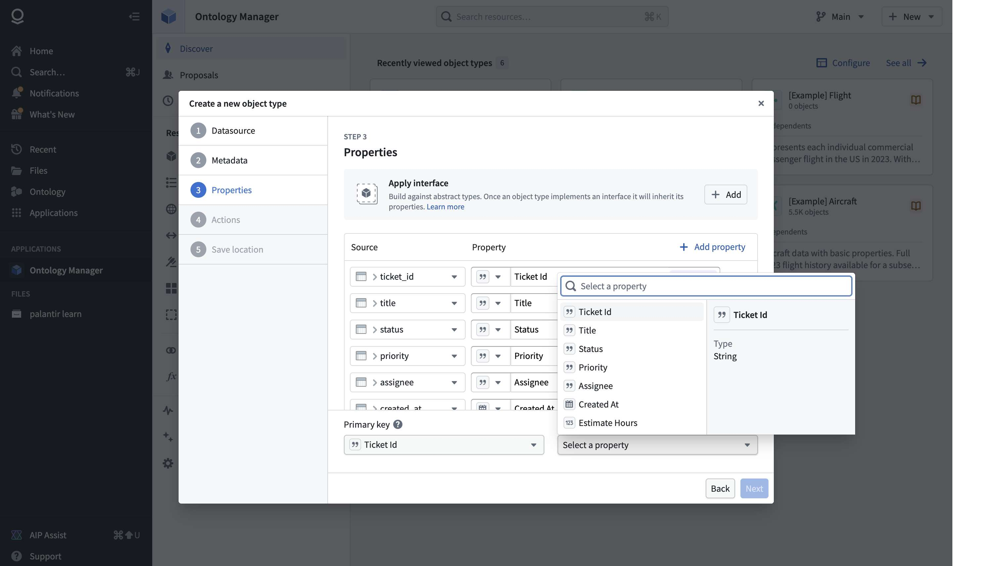

**2. Save**: the review screen shows each entity as a diff (display name, API name `NewObjectType` → `ReaTicket`, primary key `ticket_id`, title, backing datasource, edits enabled, save location), with *Warnings 1* ("with edits history disabled, edits will not surface in observability applications") and *Errors 0*. "Save to ontology…" → "Are you sure you want to save all changes?" → `v2/modify` → `v2/{rid}/diff` → history entries.

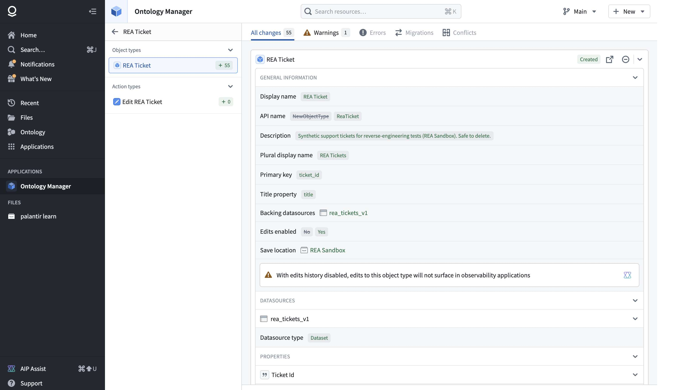

**3. Indexing**: the object type shows *Index status: Running initial*, 0 objects, then **Indexed, 30 objects** about a minute later.

**4. Running the action** from Object Explorer (object page → *Actions → Edit REA Ticket*): a form pre-filled with the object's current values; I changed Status from `open` to `resolved` → Submit → toast "**Edits successfully applied.**" and the object page shows `resolved`.

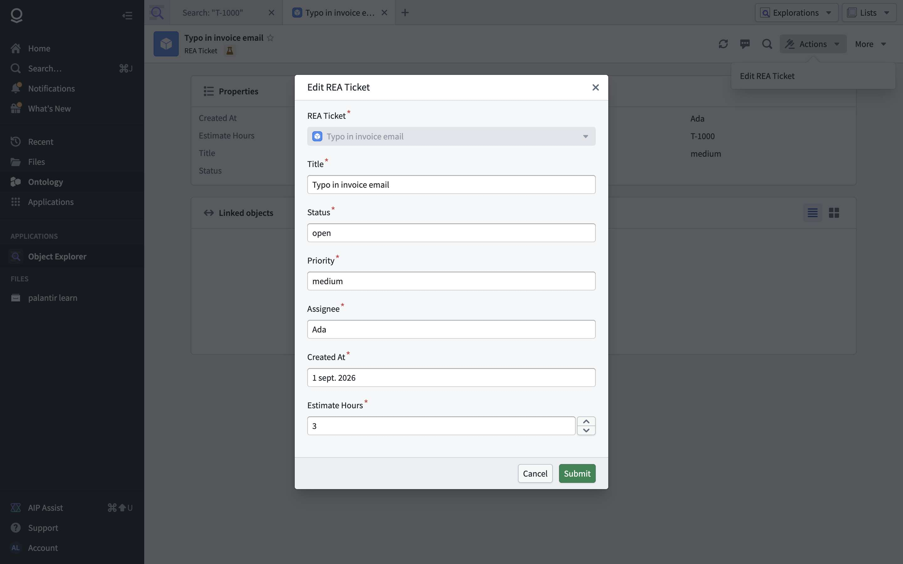

| # | Call | Shape (abridged) |
|---|---|---|
| 1 | `POST actions/api/actions/bulk-validate`, on open and on every change | request `{validationRequests: {[id]: {actionTypeRid, parameters: {[p]: value}}}, parametersPrefill}` → per parameter: `display {visibility, renderHint: dropdown / textInput / dateTimePicker, prefill}`, `required`, `allowedValues {objectQuery | text {minLength, maxLength, regex} | datetime {minimum, maximum}}`; plus `securityRequirementsResults`, `sectionResults` |
| 2 | **`POST actions/api/actionsV2`** | `{actionTypeRid, actionContext: {branchRid: null, loadActionEdits, owningRid}, parameters: {title: {type: 'string', string}, created_at: {type: 'date', date: {dateValue}}, ticket: {objectLocator: {objectTypeId, primaryKey: {ticket_id: {type: 'string', string: 'T-1000'}}}}, …}}` |
| 3 | response | `{outcome: {success: {actionRid, actionEdits: {editsData: {objectEdits: {[type]: {viewableEdits: [{objectLocator, objectEditType: {modifyObject}}], totalEditCounts: {MODIFY_OBJECT: 1}}}, linkEdits: {}, revertInformation}}, synchronouslyPropagated: boolean, returnValue: void}}, traceContext: {traceId, spanId}}` |
| 4 | `PUT object-set-service/api/objectSets/objects/top/initial` | reload of the object |

Notes for our version 🔵:
- **Objects are addressed by `{objectTypeId, primaryKey: {column: value}}`**, never by an internal ID: that's why a broken or unresolved primary key blocks everything downstream.
- **Validation is a separate, side-effect-free endpoint** called on every keystroke; apply re-validates server-side.
- **The apply response returns the edits** (`viewableEdits`, counts) and revert information, enough to show "what changed" and an undo.
- Validate at save time that `primaryKeys` reference an existing, mapped, non-null, unique column, and that object-reference parameters target a type with a resolvable key.

## 8. Coverage and unknowns

| Question | Status | Why / next step |
|---|---|---|
| Read screens of all sections | ✅ Covered | 57 screen kinds, 74 screenshots |
| Object type and link type definition schema | ✅ Covered | API shapes from `bulkLoadEntities` and `linkTypesForObjectTypes` |
| Action type definition schema | ⚠️ Partial | Served through `graphql-gateway/api/bulk`, whose responses weren't captured. The model in §2.2 comes from the screens. Next: capture GraphQL response shapes |
| **Write flows** (what Save sends) | ✅ Observed | §7bis: `v2/modify/dry-run` + `v2/modify` payloads, and the Create object type wizard (v0.3) |
| Running an action | ✅ Observed (v0.3) | `bulk-validate` + `actionsV2` on Main; on a branch it fails (see §7bis) |
| How edits made by actions coexist with re-indexing | 🟡 Inferred | The edit is applied immediately ("synchronouslyPropagated"). What happens when the dataset gets a new transaction afterwards wasn't tested |
| Proposals / branches flow | ❌ Not observed | No proposals exist in this org. Needs phase B |
| Value types, interfaces, shared properties | ⚠️ Lists only | None exist in this org |
| Usage response keys | ⚠️ Note | `getUsage` response maps are keyed by dates; the shape keeps those date keys (no data values) |

**Incidents during the crawl, for the record:** three clicks inside edit forms (action type parameters, submission criteria, link type key) created unsaved drafts. All three drafts were discarded (verified after reload). Nothing was ever saved to the ontology. The crawler now stops on any new draft and never clicks inside entity edit forms.
