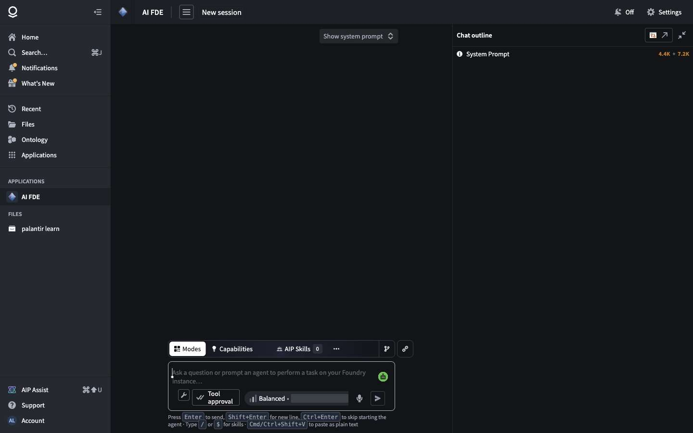
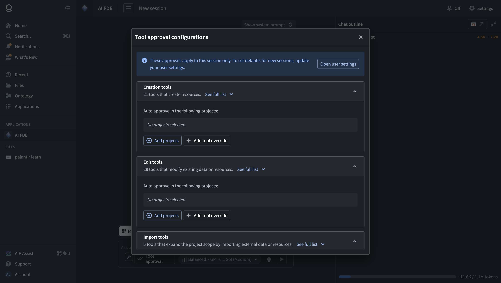
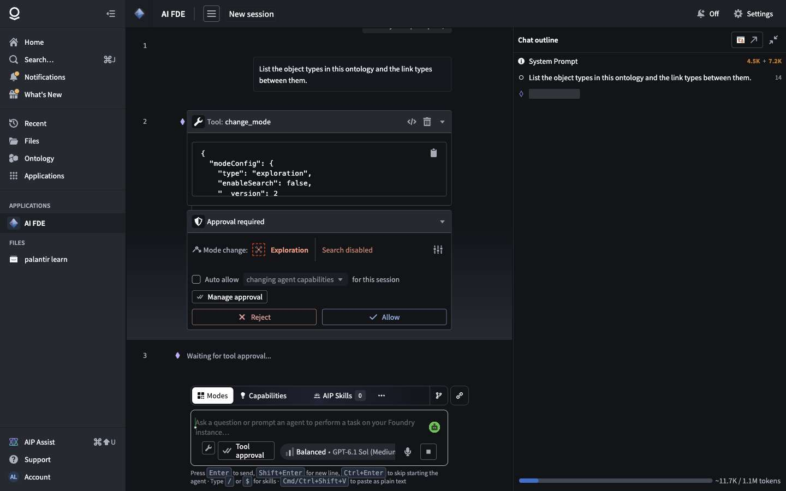
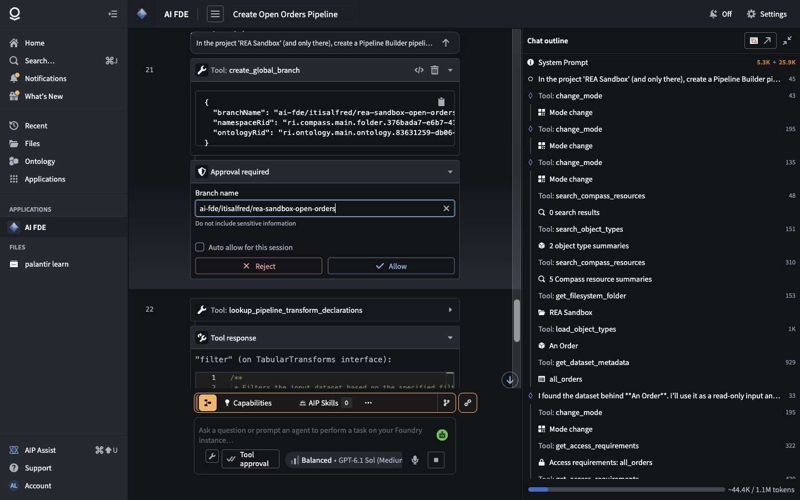
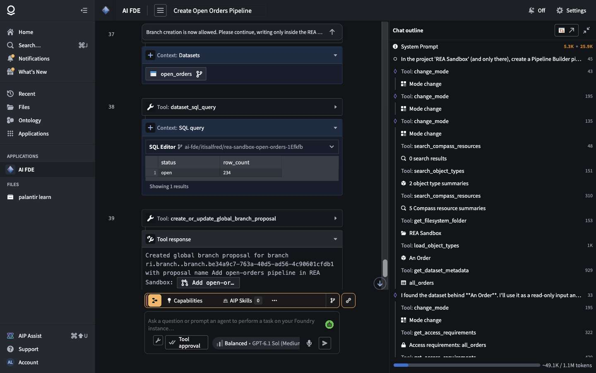
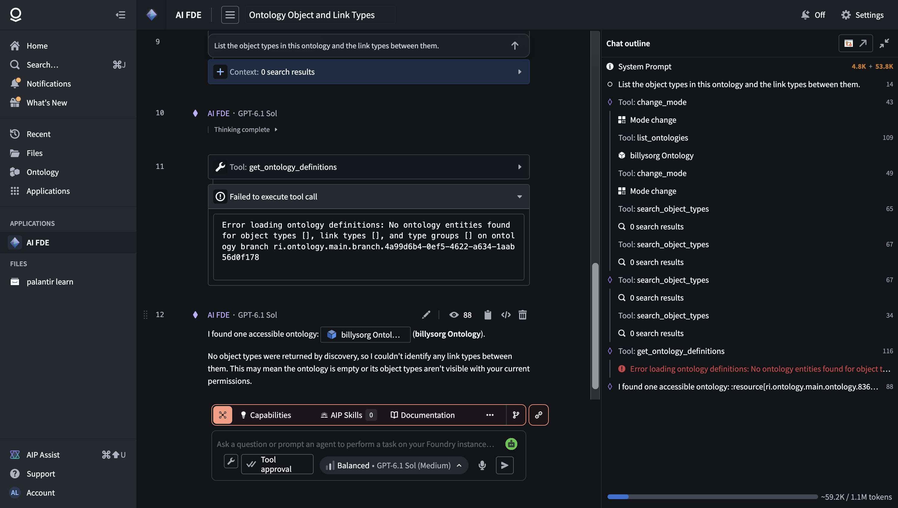
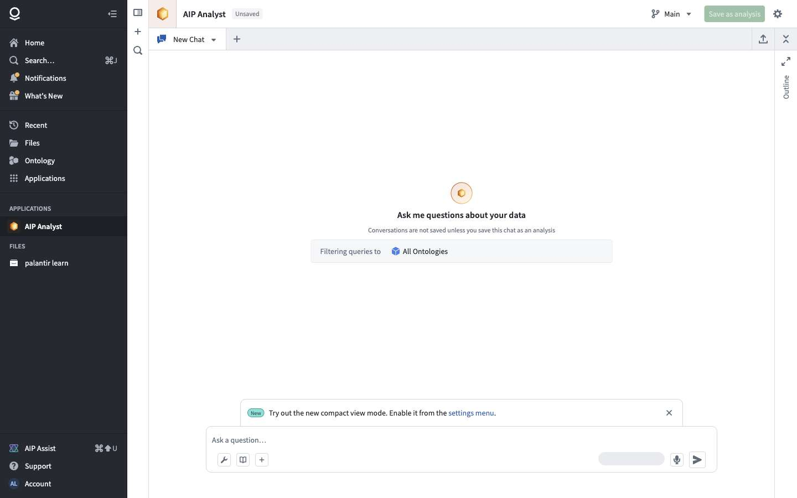
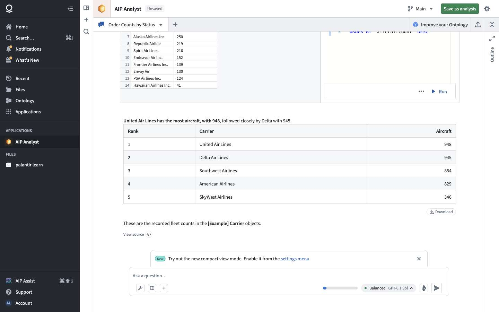
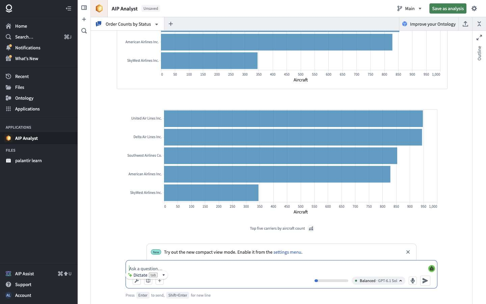

# Chapter 3 — AI agents: AI FDE and AIP Analyst

> **Status:** v0.2 (2026-10-21): §3.7 tool, mode and prompt architecture from the structure of the model requests (G1, G2)
> **Sources:** click-only crawl of `/workspace/ai-fde` and `/workspace/aip-analyst`; static extraction of the API operations declared in their loaded scripts (1 810 and 1 223 operations, 24.5 MB and 21.1 MB of JavaScript); 4 recorded agent scenarios (A1–A3 on AIP Analyst, F1–F2 read-only and F3 build task on AI FDE: 477 API calls, 55 LLM calls). Raw data: `crawl/out-b2/`, `crawl/out-scenarios/`.
> **Legend:** 🟢 observed · 🟡 inferred · 🔵 design choice for our version.

---

## 1. What they are for

| | AI FDE | AIP Analyst |
|---|---|---|
| Job | An **AI engineer**: builds and changes things in Foundry (pipelines, ontology, apps) from a request in plain language | An **AI analyst**: answers questions about data with queries, tables and charts |
| Typical request | "Create a pipeline in REA Sandbox that keeps only open orders" | "Which carriers have the most aircraft? Show it as a bar chart" |
| Writes to Foundry? | Yes, behind approvals and on a branch | No (only optional saving of the analysis) |
| Output | Resources on a branch + a review **proposal** | An answer with tables, charts, editable SQL, saved as an "analysis" |

Both are built on **the same agent engine** 🟢 (`AipAgentsSessionsService` is present in both apps: sessions, streamed continuation, per-session files, RAG context). Your version should have **one engine with two modes** 🔵.

## 2. The key architectural finding: the agent loop runs in the browser 🟢

In every scenario the timeline shows the same cycle, driven **by the page itself**:

```
browser ──► PUT language-model-service/api/llm/v3/completion/{model}/streamCompletionChunk   (LLM, streamed)
        ◄── the model answers with text and/or tool calls
browser ──► calls the Foundry service the tool needs, directly, with the user's credentials
            (ontology-metadata, object-set-service, eddie (Pipeline Builder), monocle (lineage), compass, branch-service, foundry-sql-server…)
browser ──► PUT ai-fde/api/threads/{id}/update   (persists the conversation state; AI FDE only)
        └─► next LLM call with the tool results … until the final answer
```

Evidence:
- **AI FDE embeds clients for ~150 Foundry services** (Pipeline Builder, Workshop, Ontology, Compass, Branches, Functions, Builds…) in its page code. Without them, executing tools locally would be impossible.
- `AgentEngineService.updateToolResult POST /sessions/{s}/messages/{m}/tool-calls/{t}/result` exists: the client posts tool results back.
- LLM calls average **4.6–6.3 s**. A single build task (F3) took **26 LLM calls, 289 API calls and 66 conversation saves**.

Why Foundry does it this way 🟡: tools run **with the user's own permissions**, approvals are a UI concern, and each tool reuses the app's existing client code.

**For our version** 🔵: run the loop **on the server** (it survives a closed tab, can run in the background, and is callable by API or by other agents), but keep the two Foundry principles that matter: **tools run under the end user's identity**, and **approval is a pause state** of the session, not a UI hack.

## 3. AI FDE

### 3.1 Screen 🟢



- **Conversation** with numbered items. Each tool call is a card showing the tool name, **its JSON arguments**, a "view code" button, a delete button, and the result (or "Failed to execute tool call" with the error).
- Per-message actions: **edit, copy, view source, delete, "Summarize above", "Remove below", "Fork session"**. The conversation is a tree, not a list.
- **Chat outline** (right panel): every item with its **token count**; the system prompt shows two figures (base + mode-specific: 4.5K + 7.2K, growing to 4.8K + 53.8K after a mode change); a context gauge ("~49.1K / 1.1M tokens").
- **Composer**: *Modes · Capabilities · AIP Skills · Documentation* tabs; skills invoked with `/` or `$`; **Tool approval** button; model tier *Fast / Balanced / Smart* (all GPT-6.1 Sol, different reasoning levels); voice dictation; a branch icon and a link icon; Ctrl+Enter "to skip starting the agent".
- "Show system prompt" toggle; sessions are auto-titled ("Create Open Orders Pipeline").

### 3.2 Tool approval policy 🟢



Per session (with user-level defaults), tools are grouped by **risk category**:

| Category | Tools | Rule |
|---|---|---|
| Read tools | (many) | Run without asking |
| Creation tools | 21 | Ask, unless the target project is in the auto-approve list |
| Edit tools | 28 | Same |
| Import tools (bring external resources into a project) | 5 | Same |
| Build & deploy tools | 6 | Same |
| Tag & publish tools (code repositories) | 5 | Same |
| Agent capability tools (the agent changes its own mode or tools) | 3 | Allow / Ask |
| Sensitive tools | 3 | Explicit per-tool rule only |

Each approval card offers **Reject / Allow**, an "Auto allow … for this session" checkbox, and for some tools **editable parameters** (the branch name could be edited before allowing).



### 3.3 Modes 🟢

The first tool the agent calls is `change_mode` (e.g. `{"type": "exploration", "enableSearch": false}`). A mode swaps the **system prompt section** and the **tool set**: the mode-specific prompt went from 7.2K to 53.8K tokens. Modes are themselves gated as *agent capability tools*. In F3 the agent changed mode 4 times before writing anything.

### 3.4 Tools observed 🟢

| Kind | Tools |
|---|---|
| Discovery | `list_ontologies`, `search_object_types`, `load_object_types`, `get_ontology_definitions`, `search_compass_resources`, `get_filesystem_folder`, `get_dataset_metadata`, `get_access_requirements`, `dataset_sql_query` |
| Authoring knowledge | `list_pipeline_blocks`, `lookup_pipeline_transform_declarations`, `lookup_pipeline_expression_declarations` |
| Write (gated) | `create_global_branch`, `create_pipeline_builder`, `put_pipeline_builder`, `add_missing_project_imports`, `deploy_pipeline_builder`, `create_or_update_global_branch_proposal` |
| Verification | `get_pipeline_builder_definition`, `preview_pipeline_builder_node`, `dataset_sql_query` |
| Self | `change_mode` |

**Pipelines are written as code** 🟢. The agent looks up typed **TypeScript declarations** of the transforms (`filter(args: { filterCondition: ExpressionInput<DataType.Boolean, …> })` on a `TabularTransforms` interface; `equals(left, right, nullSafe)`), then writes the pipeline with `put_pipeline_builder` as code (`PB.types.timestamp`, node positions). Interactive previews run through `eddie-logic-executor/api/execute-interactive-code`. This is the trick that makes an LLM good at building: **expose each authoring surface as a typed code API**, not as clicks.

### 3.5 The build protocol: branch → build → verify → proposal 🟢

From F3 ("create in REA Sandbox a pipeline that keeps only open orders"):

1. **Explore** (no approval): find the object type, its backing dataset, the target folder, access requirements.
2. **`create_global_branch`** (approval) → `ai-fde/<user>/rea-sandbox-open-orders-<suffix>`. **Every change happens on a branch.**
3. **`create_pipeline_builder`** in the target folder → **`put_pipeline_builder`** (the code) → **`preview_pipeline_builder_node`** (checks the output).
4. **`add_missing_project_imports`**: imports the source dataset into the project as a reference, so the pipeline may read it.
5. **`deploy_pipeline_builder`** on the branch → build runs → **`dataset_sql_query`** to verify ("234 rows, all with status open").
6. **`create_or_update_global_branch_proposal`**: a pull-request-like **proposal** with *Intent / Scope / Verification* sections. **Nothing is merged**; a human reviews.

When the branch creation was **rejected** (F3a), the agent stopped cleanly: "No changes were made — the required development-branch creation was declined", restated its plan, and asked to allow branch creation. It doesn't try a workaround.




### 3.6 Failure observed 🟢

In F1 ("list the object types and their link types"), all four `search_object_types` calls returned 0 results and `get_ontology_definitions` failed. The agent concluded the ontology was empty, **though it has 13 object types**. In F3 the same search found them. Likely cause 🟡: search was disabled in that mode (`enableSearch: false`), or the semantic index was cold. Lesson for our version 🔵: tool results that say "nothing found" should carry a reason (index not ready, filtered by mode, no permission), so the model doesn't draw a false conclusion.



### 3.7 Tools, modes and prompt: the architecture (v0.2) 🟢

Observed on 2026-10-21 by recording the **structure** of each request the page sends to the model (`crawl/llmcap.mjs`: tool names, parameter schemas with description *lengths*, instruction length and section headings, order of items; never message contents or prompt text). Two sessions: G1 read-only question, G2 "I'm not technical… object type + resolve action, show the plan, ask before creating". Raw: `crawl/out-g/G1-llm.json`, `G2-llm.json`, `crawl/out-scenarios/G1-readonly`, `G2-build-plan`.

**Request format.** Each call is an "OpenAI Responses"-style body: `instructions` (system prompt), `input[]` (user / assistant messages, `functionToolCall {callId, name, arguments}`, `functionToolCallOutput {callId, output}`, `reasoning {summary, encryptedContent}`), `tools[]` (`{name, description, parameters: JSON schema, strict}`), `toolChoice: auto`, `reasoning {effort, summary}`. Model `GPT_6_1_SOL`; a smaller model titles the session in parallel with a single `set_title` tool.

**Three stages of tool exposure:**

| Stage | Tools | Prompt | Purpose |
|---|---|---|---|
| **Router** (first call of a session) | 8 meta tools: load documentation / bundles, **request clarification from user**, change mode, manage context, enable / disable capabilities, load skill | ≈22.6K chars: base instructions + platform overview (architecture, data flow, glossary of terms) + security + context management | Forces a mode choice before any work |
| **Exploration mode** | 116 tools, read-only: search / load object types, links, actions, functions, interfaces, object sets, objects; dataset metadata, schedules, build history, lineage, transform logs; **dataset SQL and ontology SQL**; Workshop / Logic / Automate / pipeline definitions; Data Connection sources, syncs, egress policies; users, groups, access checks; documentation, skills, logs | ≈24.3K chars | Investigate safely |
| **Task mode, e.g. ontologyEditing** | 38 tools: the relevant reads + a few broad writes | ≈44.5K chars: adds an **ontology design guide** (overview, design principles, object type metadata, property base types and pitfalls, edit-only / shared / cipher properties, link types and constraints, action types: parameters, design guidelines, submission criteria, rules, scale limits; interfaces; **common failure modes**), branching rules | Build, with domain rules in context |

**The base system prompt, section by section** 🟢 (from the user's copy via "Show system prompt", 2026-10-21; summarized, text not kept):

| Section | What it does (our summary) | Idea for our version 🔵 |
|---|---|---|
| Output format | Answer in Markdown; Mermaid allowed for diagrams; **never write URLs**: reference every resource with a directive `:resource[rid]` plus an optional branch attribute (global branch, ontology branch or branch name), only for ids already seen; cite docs with a `:citation[title]{path, section}` directive, only for paths returned by a search | The UI turns ids into clickable chips that respect branches; the model can't invent links |
| Selected mode + mode guide | Explains modes (load tool categories + docs) vs **capabilities** (independent toggles that survive mode changes). States "no mode selected": switch mode instead of saying "I can't". Lists the 9 modes, each with a one-line purpose, when to prefer it, and the **tool categories** it loads (e.g. ontology editing → ontology, datasets, permissions, branching, filesystem) | Router stage with short mode cards; tell the model never to refuse for lack of tools |
| Capability list | 20 capabilities with one line each and their **default state**: on by default are change mode, request clarification, load documentation, manage context, manage capabilities, load skills; everything else (plan, to-do, subagents, execute action, filesystem, permissions view, Notepad, Contour, lineage graph, issues…) is off until the agent enables it. Two are marked "do not disable" | Small default tool set; the agent asks for more power explicitly (and risky ones are approval-gated) |
| Clarification | Use the clarification tool when the task is ambiguous or resources are missing | Built-in "ask the user" tool with multiple-choice, free-text and "pick a resource" questions |
| Platform overview | A compact architecture text (data layer, ontology layer, apps) with an ASCII data-flow line from sources to writeback, then a **glossary** grouped by layer (data, ontology, functions, apps, filesystem, AI), with items flagged "not supported in AI FDE"; includes a warning that namespaces, projects and folders share one id format and must not be mixed up | Our own glossary of our concepts, with "can't do" flags, and explicit warnings for confusing ids |
| Security | Keep logic and data separate so security controls propagate; check access requirements (markings, restricted views) before using sensitive data; don't copy protected data into less-protected resources; ask when in doubt | A short data-handling rule set, plus a read-only "access check" tool |
| Context management | States the window (≈1.05M tokens) but a **recommended limit of 200K** ("quality cliff"); every context item is tagged with id, type, token count and running total; the agent hides finished tool outputs (summary kept, id reusable), never hides its own messages or outputs that created resources | Tag tool outputs with sizes; give the agent a "hide/unhide item" tool and a target budget well below the model's maximum |
| Session facts | Today's date and the current user id | Inject date, user and project at the end of the prompt |

**Modes are configurations** (`change_mode {modeConfig}`), not names. Nine types with their own switches:

| Mode | Switches |
|---|---|
| `exploration` | enableSearch |
| `ontologyEditing` | includeObjectTypes, includeActionTypes, includeInterfaces, allowDeletion, enableAutomate, enableMachinery |
| `dataIntegration` | transformsType (code / no-code), branchingType (Foundry / local), objectTypeEditing, schedules, unstructuredData, externalTransforms, timeSeriesData, useLanguageModels, cipher |
| `functionsEditing` | functionsType, ontologyEditFunctions, allowObjectTypeEdits, externalFunctions, evals, enableAutomate, useLanguageModels |
| `applicationBuilding` | applicationType |
| `dataConnection`, `governance`, `machineLearning` (modelingType), `platformQna` | — |

In G2 the agent went router → exploration → **ontologyEditing (object + action types, no deletion)** → back to exploration to inspect, then answered.

**Capabilities** (`enable_capabilities`, an agent-capability tool): changeMode, requestClarification, loadDocumentation, manageContext, manageCapabilities, **generatePlan, managePlan, manageTodoList, subagents**, executeAction, filesystem, notepad, contour, solutionDesign, workflowLineage, resourceDocumentation, viewPermissions, foundryIssues, loadSkills, editSkills.

**Write tools in ontologyEditing mode** (few and broad):

| Tool | Parameters (required) | Note |
|---|---|---|
| `modify_ontology_definitions` | ontologyBranchRid, saveLocationFolderRid, saveMessage, importUserEditsFromMainBranchDuringInitialIndexing, **action** = `put {code}` (write a definition **as code**) or `edits {objectTypes[], linkTypes[], typeGroups[], edits[{searchValue, replacement, replaceAll}]}` (**search-and-replace on the code** of selected types) | The ontology is authored as code; the agent reads it (`get_ontology_definitions`) then patches it |
| `create_action_type` / `edit_action_type` | ontologyBranchRid, apiName, displayName, description, status, icon, **parameters[]** {parameterId, baseType, objectTypeRid, isRequired, isArray, defaultValue, validation, visibility, structFields}, **rules[]** (add object · modify object · delete object · create-or-modify · function rule · scenario rule), validationRules, layout, successMessage, **toolDescription** | Every action carries a description written for agents |
| `create_global_branch` → `activate_global_branch` → `create_or_update_global_branch_proposal` | branchName / namespace / ontology; globalBranchRid; proposal name + description | Branch-first protocol (§3.5) |
| `create_object_type_permissions_datasets`, `edit_object_type_conditional_formatting` | | Supporting writes |

**Behavior for a non-technical request** (G2, no write approved): (1) restates the request as a **numbered plan in plain language** and promises not to change anything; (2) inspects: searches datasets, finds the existing object type, reads dataset metadata and access requirements, runs **two SQL checks** (row count, uniqueness of the ID); (3) answers with a **proposal table** (item → what it will do), a **caveat in plain words** ("resolving updates the object in Foundry, not the source dataset or an external ticket system"), notes the existing similar type it will leave alone, and (4) ends with **one explicit approval question**. 9 model calls, ≈62K tokens of context at the end.

**For our version** 🔵 (feeds the build package):
- Same three stages: a small router tool set, a read-only exploration set, task modes that add a few broad write tools **plus a domain guide** in the prompt (our own text: how to model objects, keys, links, actions, common mistakes).
- Represent each buildable thing (ontology, app, automation, pipeline) as a **typed document the agent writes as code / JSON**, with a read tool that returns it and a patch tool (search-replace or JSON patch). Fewer, broader write tools beat many small ones.
- Built-in tools for **clarification questions**, **plan / to-do list**, and **SQL checks** for self-verification.
- Every action type has a `toolDescription` so later agents can use it.
- Approval: reads free; writes pause the session with the exact arguments, as in §3.2.

### 3.8 An approved build, card by card (G3, v0.2) 🟢

Continuation of G2 after the user approved "create the draft branch, the object type and the action, then check they work" (REA Sandbox, branch only). Recording: `crawl/out-scenarios/G3-approved-write` (12 screenshots), `crawl/out-g/G3b-llm.json`.

| # | Tool | Card? | What happened |
|---|---|---|---|
| 1 | `change_mode` → ontologyEditing | auto | |
| 2 | `create_global_branch` | **yes** (allowed) | Space-level branch `ai-fde/<user>/rea-open-ticket-resolution` |
| 3 | `get_ontology_definitions` | no | Reads the closest existing type **as code** to copy its style |
| 4 | `modify_ontology_definitions` (`put` code) | **no** | Object type created on the branch (dry-run, then save) |
| 5 | `create_action_type` | **no** | Action created on the branch |
| 6 | `enable_capabilities [executeAction]` | **yes** (allowed after asking the user) | |
| 7 | `ontology_sql_query` ×2, `load_object_types`, `load_action_types` | no | Checks: 14 objects load with 7 properties; status counts |
| 8 | `execute_action` (T-1000, branch) ×2 | **yes** ×2 (allowed) | Both failed: "object type … does not have a primary key property" (same branch limitation as batch A) |
| 9 | `dataset_sql_query`, `get_global_branch` | no | Confirms the source dataset is unchanged (14 open) and lists what the branch contains |
| 10 | `create_or_update_global_branch_proposal` | **yes** (rejected) | Proposal "Draft … execution test blocked": the card lets you **edit name and description**, and warns they're visible to the whole organization |

So in this session **creation and edit tools ran without a card when they targeted the agent's own branch**; cards appeared for the branch itself, capability changes, running an action and creating a proposal. After a rejection the card shows "Tool execution rejected" and the turn ends; the agent doesn't retry.

**Approval card** 🟢: tool name + full JSON arguments; a plain-language line ("Enable capability: Execute actions"); an "Auto allow … for this session" box; "Manage approval" (the policy of §3.2); **Reject / Allow**; for some tools, editable fields before allowing.

**The ontology as code** 🟢 (format, summarized): a TypeScript arrow function receiving a builder object; it declares datasets by id, then each object type with API name, display and plural names, description, icon, and a map of properties (property id, builder type such as string / date / integer, display name + description, source column; the primary key wrapped as a key column), plus primary key, title property, "allow edits" and the list of datasources. `get_ontology_definitions` returns the same format for existing types, so the agent **reads a sibling type and writes the new one in the same style**. The agent wrote a one-line, human description for **every** property.

**Actions as JSON** 🟢: one object parameter (`ticket`, required), one `modifyObject` rule (status ← "resolved"), a **validation rule** = a comparison tree (`parameter's object property ticket-status EQUALS static "open"`) with a failure message ("Only open tickets can be marked as resolved."), status `experimental`, and a `toolDescription` (≈140 chars) for future agents.

**Tool results carry context metadata** 🟢: each output is wrapped in a `context-item` tag with an id, its token count and the cumulative count, and resources are written as `:resource[rid]{branch…}` mentions that the UI renders as chips.

**The proposal it drafted** 🟢 had four sections: **Intent**, **Changes** (bullet per created item), **Verification** (what it checked and the numbers), **Blocking issue — do not merge** (the failed test, with the error).

**For our version** 🔵: (1) the agent's own draft is a free zone, so creating and editing there needs no card, while leaving the draft (merge, running actions on real data, calling outside systems, sharing) always does; (2) define the ontology in **our own** typed format (JSON schema, or a small builder API) with `read → patch → validate (dry-run) → save`; (3) verification = query the built objects + compare with the source; (4) make the final summary use Intent / Changes / Verification / Open issues; (5) failed checks must block "done", as here.

## 4. AIP Analyst

### 4.1 Screen 🟢



- Chat tabs (several analyses side by side), "Unsaved" badge, **Save as analysis** ("Conversations are not saved unless you save this chat as an analysis"), branch selector, export, settings.
- **Query scope**: "Filtering queries to: All Ontologies".
- Composer: tools button, documentation, add context / files, model chip "Balanced · GPT-6.1 Sol", context gauge, voice.
- Answers combine **text, step cards, tables (with Download), charts, "View source"** (links to the object type used), and an "**Improve your Ontology**" suggestion. Chats are auto-titled ("Order Counts by Status").




### 4.2 How it answers 🟢

Same browser-driven loop as AI FDE. The tools observed hit two query engines:

| Question | Tool call observed | Shape (abridged) |
|---|---|---|
| "How many orders per status?" | `PUT object-set-service/api/aggregate-v2` | `{ objectSet: {base: {objectTypeId}}, aggregation: { subAggregations: { groupedResults: { dimension: {propertyValue: {propertyApiName, bucketing: {exactValue: {maxBuckets}}}}, metrics: {count}, ordering: [...] }}}}` → `buckets.simpleKeyBuckets[{key, metrics.count}]` |
| "Which carriers have the most aircraft?" | `POST object-set-service/api/sql-endpoint/v1/queries/query` | `{ querySpec: { query, dialect, tableProviders: { Table1: { objectSet: {base: {objectTypeId}} } } }, executionParams: { rowLimit, resultFormat } }` |
| context for both | `ontology-metadata …/bulkLoadEntities`, `linkTypesForObjectTypesV2`, `objectSets/objects/top/initial` | loads the schema and a sample before writing the query |

So the Analyst's core idea is: **SQL over object sets** (the ontology exposed as tables named `Table1`… bound to object types) plus a structured aggregation API, chosen by the model, shown as editable cards ("Run" re-executes the SQL by hand).

### 4.3 Saving and sharing 🟢 (from the declared API)

`AipAnalystAnalysisService`: `createAnalysis`, `updateAnalysis`, `getAnalysis/{analysis}/{version}`, `getVersionHistory`: **versioned** analyses. `AnalysisLockService`: an edit lock per analysis session. `AipAnalystGroupSkillsService`: skills enabled per user group. `NotepadService`: export to a Notepad document.

### 4.x Context engineering in AIP Analyst (v0.2, capture A4) 🟢

One read-only question ("open vs resolved REA tickets by priority, as a small table"), recorded with `crawl/llmcap.mjs` (structure only): `crawl/out-g/A4-llm.json`, `crawl/out-scenarios/A4-context`.

**Shape: one agent, no modes.** 7 model calls: (1) a title call (1 tool, tiny prompt); (2–6) the working loop with **17 tools** and one **large prompt (≈80K characters)**; (7) a **post-answer pass** with a single tool, `submit_ontology_improvements_suggestion`.

**Tools (17):** object type search / lookup, interface lookup, object search / lookup, object set builder, import object set, **ontology SQL**, **ontology aggregation**, Vega charts, maps, clarifying questions, skill lookup + skills sub-agent, previous-analysis lookup, **context cleanup** (hide items by id), manage tools, chat title, improvement suggestions. **Every tool call carries a `rationale {title, description}`**: that's what the UI shows as step cards.

**Loop observed:** look up a type by name → `object_type_search_tool` (several queries at once, filtered by **visibility** prominent / normal / hidden and **status** endorsed / active / experimental / deprecated / example) → build an object set → run an aggregation → answer. 6 working calls for one question.

**Prompt sections (headings only):** tone and style · proactiveness · understanding the request and **reconciling it with what was loaded** · **rules for when to ask a clarifying question, when not to** · a **mandatory workflow** and per-turn execution requirements · **SQL vs aggregation vs visualization rules** · **filter value discovery** (look up real values before filtering) · error recovery · **stop conditions, incl. when "I cannot answer" is acceptable** · citations, metric and JSON data, response formatting · tool-by-tool guidance with many good/bad examples · general facts: dates, **user info and the user's recent resources**, time zones, data handling, links, inline visualizations, **hiding tool responses to manage the context window** (which responses are best to hide), colour theme, permissions, language.

**Semantics feedback loop:** after answering, a separate call offers the model `submit_ontology_improvements_suggestion {suggestions[]}`, each suggestion targeting an object type (description, display name, plural, **aliases**), a property (description, display name), a link type (description) or an action type, with a **suggested value and a rationale**. In this run no suggestion request was visible on the network.

**For our version** 🔵: an analyst agent can be a single mode with ~15 tools; put the effort in the prompt's **rules and examples** (clarify vs proceed, discover real filter values, SQL vs aggregation, when to stop); require a short rationale on every tool call (it doubles as the progress UI); and add the **post-answer metadata suggestion** step so every question improves the ontology's descriptions.

## 5. Shared engine: data model

### 5.1 Conversation storage, from the AI FDE thread payload 🟢

`PUT ai-fde/api/threads/{id}/update` after every round:

```ts
interface ThreadUpdate {
  currentVersion: Uuid;                 // optimistic concurrency
  itemIdsInOrder: Uuid[];               // the visible order (supports move / remove / fork)
  itemsToWrite: ContextItem[];          // only changed items
}
interface ContextItem {
  contextItemId: Uuid;
  typeAndVersion: { contextItemType: string; contextItemVersion: number };
  content: ContextContent[];
}
interface ContextContent {               // union, discriminated by `type`
  id: Uuid; type: string; createdAt: DateTime;
  prompt?: string;                                        // user message
  toolName?: string; toolRequest?: object;                // tool call + arguments
  toolResponse?: { state: string; contextItemIds?: Uuid[] };
  modeChange?: { request: ModeConfig; result: { status; value } }; prevModeConfig?: ModeConfig;
  response?: { status: string; content: { type: string; metadata: { type: string; reasoningId: string } }[] };  // model output incl. reasoning
  oldCode?: string; newCode?: string; saveMessage?: string;   // code edits shown as diffs
  pipelineBuilders?; datasets?; folders?; objectTypes?; globalBranches?; sqlQueries?;   // resources referenced
  model?: string; error?: unknown;
}
```

### 5.2 Engine API, from the declared operations 🟢

- **Sessions** (`AgentEngineService`): `createSession`, `insertUserMessage` on a **session branch**, `startSessionBranch` / `stopSessionBranch`, `moveMessage` / `removeMessage` / `replaceWithUserMessage`, `updateAgentState`, `updateToolResult`, `getLatestSessionSnapshot`, `updateSessionSettings`.
- **Threads** (`AiFdeThreadService`): create, fork, contents (v1–v3), metadata, list user threads.
- **Generic agent sessions** (`AipAgentsSessionsService`, both apps): create (inline or for a configured agent, or sandbox), `continue` / `continueAsync` / **`continue/stream`**, execution status, suggestions, title, **per-session filesystem** (upload / list / read files), RAG context.
- **Skills** (`AipSkillsService`): versioned skills with save / rebase / history; promoted skills per enrollment.

## 6. Feature list and verdicts

| # | Feature | Verdict | Why |
|---|---|---|---|
| G1 | Agent engine: LLM loop with tool calls, streaming | **Must** | The core |
| G2 | Conversation storage as ordered context items, persisted each round | **Must** | Resume, audit, debugging |
| G3 | Tool registry with risk categories + **approval as a session pause state** | **Must** | Safety; makes write tools acceptable |
| G4 | Auto-approve per project, per category | **Must** (simple) | Otherwise every build needs 10 clicks |
| G5 | **Write protocol: branch → build → verify → proposal**, never write to main directly | **Must** | Turns agent mistakes into rejected proposals |
| G6 | Typed code APIs as authoring surfaces (pipelines first) | **Must** | What makes the model effective |
| G7 | Read tools over the ontology and datasets (search, schema, SQL) | **Must** | Shared by both modes |
| G8 | Analyst mode: SQL over object sets + aggregation API + table/chart rendering | **Must** | AIP Analyst in one feature |
| G9 | Context outline with token counts, "Summarize above" compaction | Later, **plan the data model now** | Long sessions hit the context limit |
| G10 | Fork / edit / remove messages (conversation tree) | Later | Nice; the item-order model of G2 already allows it |
| G11 | Modes swapping prompt sections and tool sets | **Must** (2 modes: build, analyze) | Keeps prompts small and tools relevant |
| G12 | Saved, versioned analyses; export to documents | Later | Sharing |
| G13 | Skills (reusable instructions), per group | Later | Customization |
| G14 | Per-session filesystem (uploaded files) | Later | Useful for CSV/PDF questions |
| G15 | Model tiers (fast / balanced / smart) | Later | One good model first |
| G16 | Voice dictation, suggestions, auto-titles | Later / Drop | Polish |
| G17 | "Nothing found" results that explain why | **Must** (cheap) | Avoids F1-style false conclusions |

## 7. Pseudo-code for the must-haves 🔵

### 7.1 Server-side agent loop with approval pauses (G1–G4, G11)

```
function runTurn(session, userMessage):
    session.items.append({type: USER, prompt: userMessage})
    loop up to MAX_STEPS:
        prompt = assemblePrompt(session.mode, session.items)          // base + mode section + compacted history
        reply  = llm.stream(prompt, tools = toolsFor(session.mode), onToken = pushToClient)
        session.items.append({type: MODEL, response: reply})
        if not reply.toolCalls: save(session); return reply.text
        for call in reply.toolCalls:                                  // may be several in parallel
            tool = registry[call.name]
            decision = policy.decide(session, tool, call.args)         // ALLOW | ASK | DENY
            if decision == ASK:
                session.pending = call; session.state = AWAITING_APPROVAL
                save(session); notifyClient(call, tool.category); return PAUSED
            if decision == DENY: result = {error: "denied by policy"}
            else: result = tool.run(call.args, asUser = session.user)
            session.items.append({type: TOOL, toolName: call.name, toolRequest: call.args, toolResponse: result})
        save(session)                                                 // persist every round (G2)
    return {error: "step limit reached"}

function onApproval(session, decision, editedArgs?):
    call = session.pending; session.pending = null; session.state = RUNNING
    if decision == REJECT: session.items.append({type: TOOL, toolName: call.name, toolResponse: {state: REJECTED_BY_USER}})
    else: session.items.append({type: TOOL, toolName: call.name, toolRequest: editedArgs ?? call.args,
                                toolResponse: registry[call.name].run(editedArgs ?? call.args, asUser = session.user)})
    continue runTurn's loop (without a new user message)

function policy.decide(session, tool, args):
    if tool.category == READ: return ALLOW
    if tool.category == SENSITIVE: return session.rules[tool.name] ?? ASK
    target = tool.targetProject(args)                                 // every write tool must declare it
    if target in session.autoApprove[tool.category]: return ALLOW
    return ASK
```

### 7.2 Write protocol (G5)

```
// Enforced by the tools, not only by the prompt:
create_*/put_*/deploy_* tools require a `branch` argument that is not MAIN → otherwise error "work on a branch"
create_branch(name) → branch scoped to the session's projects
propose(branch, title, description) → Proposal{status: OPEN}            // a human merges; agents cannot call merge
merge is not exposed as an agent tool at all
```

### 7.3 Analyst query tool (G8)

```
tool sql_over_objects(query, objectTypes[]):
    tables = {f"Table{i+1}": objectSetOf(t) for i, t in objectTypes}
    check user can read each object type
    rows = sqlEngine.run(query, tables, rowLimit = 10_000, timeout = 30s)
    return {columns, rows (first 200), totalRows, sqlUsed: query}           // UI shows an editable SQL card + table + chart button

tool aggregate(objectType, groupBy, metric, orderBy, maxBuckets):
    return objectStore.aggregate(...)                                       // faster path for simple counts
```

### 7.4 Context compaction (G9)

```
when tokens(prompt) > 0.7 * modelContext:
    cut = oldest items until the last N user turns
    summary = llm.summarize(cut, keep = [decisions, resource ids, open questions])
    replace cut with one item {type: SUMMARY, text: summary, replaces: ids(cut)}   // "Summarize above"
```

## 8. Coverage and unknowns

| Question | Status | Why / next step |
|---|---|---|
| Agent loop location (browser) | ✅ Observed | Timelines of A1–A3, F1–F3 |
| Tool set and build protocol | ✅ Observed | F3 end to end |
| Conversation storage model | ✅ Observed | Thread update payload shapes |
| **Exact LLM request format** (messages, tool schemas, system prompt assembly) | ❌ Not captured | The streamed `streamCompletionChunk` bodies aren't exposed by Chrome to the recorder. Next: REA `capture_browser_scenario` with request bodies, or read the "Show system prompt" panel (structure only, not copied) |
| Content of `graphql-gateway/api/bulk` (used throughout) | ❌ Not captured | Event-stream GraphQL; same next step |
| AIP Analyst tool names | ⚠️ Partial | Calls observed, names not shown in its UI |
| Skills, saved analyses, session files | ⚠️ API only | Declared operations, not exercised |
| Proposal review and merge flow | ⚠️ Not exercised | A proposal exists (not merged): "Add open-orders pipeline in REA Sandbox" |

**Resources created during the scenarios** (your approval, all reversible): project **REA Sandbox**; on branch `ai-fde/<user>/rea-sandbox-open-orders-1Efkfb`: pipeline **Open Orders Pipeline**, dataset **open_orders**, a project import of the source dataset, and an **open proposal** (not merged). Nothing outside REA Sandbox was modified apart from the branch itself.
