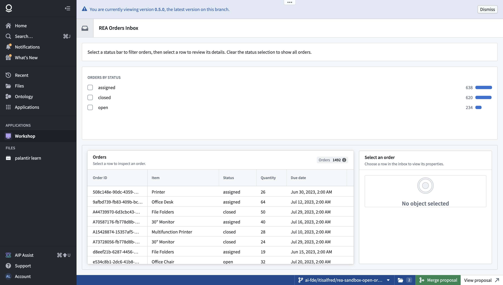
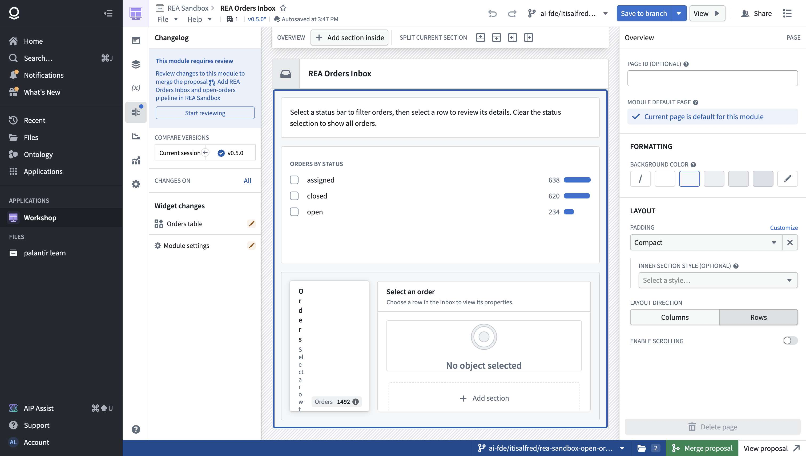
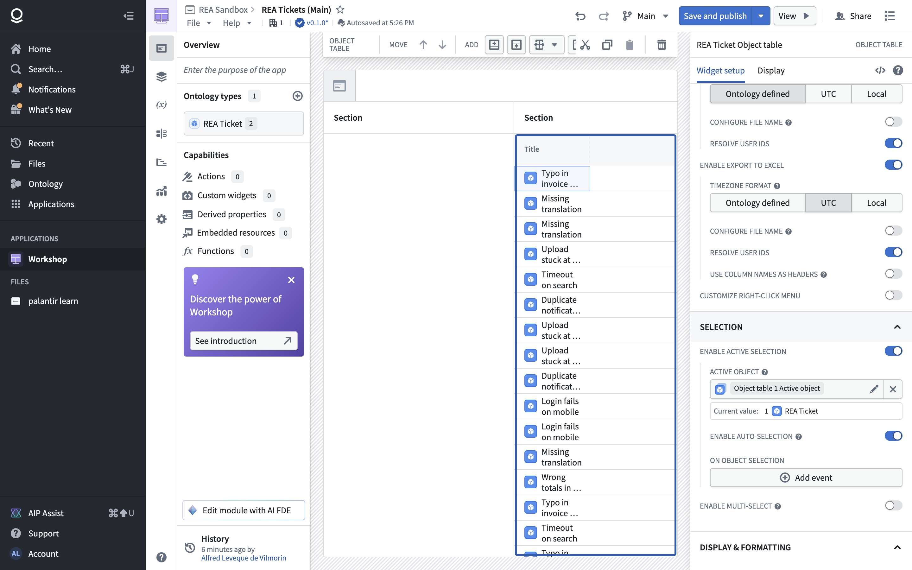
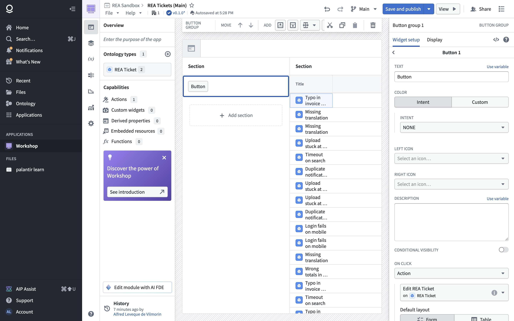
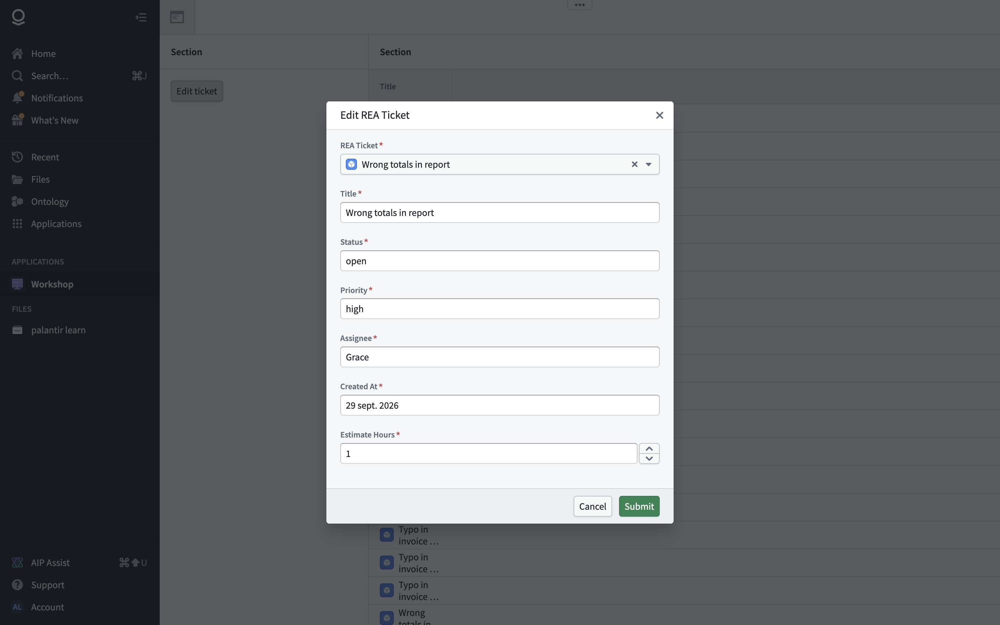

# Chapter 4 — Workshop

> **Status:** v0.2 (2026-10-21): §3.4 button → action, built by hand on Main
> **Sources:** click-only crawl of the Workshop home and of two modules (the tutorial's "Order Inbox", view mode only; the sandbox "REA Orders Inbox", view and editor); 1 670 API operations declared in the editor's scripts (26 MB of JavaScript); a recorded AI FDE scenario (W3) that **built a module in REA Sandbox on a branch**, capturing the module save payload. Raw data: `crawl/out-c/`, `crawl/out-c2/`, `crawl/out-scenarios/W3/`.
> **Legend:** 🟢 observed · 🟡 inferred · 🔵 design choice for our version.

---

## 1. What it is for

Workshop is the **no-code app builder on top of the ontology**. An app ("module") is a page of **widgets** (object table, filters, charts, property panel, buttons…) wired together by **variables** (object sets, filters, selections, aggregations). End users get an operational screen ("triage incoming orders") without anyone writing frontend code. In the minimal version, this is where users actually work, which is why it ranks right after the ontology.



## 2. Core concepts and data model

### 2.1 Concepts 🟢

| Concept | What it is | Example in REA Orders Inbox |
|---|---|---|
| **Module** | The app: a versioned resource in a project folder | "REA Orders Inbox" in REA Sandbox |
| **Layout** | Tree of pages → sections (rows / columns, flex or fixed sizes, scroll) → widgets | Header, guidance text, status bars, then table + detail side by side |
| **Widget** | A typed UI component with a config | `objectTable`, `filterList`, `propertyList`, `metricCard`, `markdown` |
| **Variable** | A named reactive value: object set, filter, number, string, selection | `all Orders`, `Status filter`, `filtered Orders`, `Selected order`, `filteredOrderCount` |
| **Transform** | Derives a variable from others | `filtered Orders = all Orders ∘ filter(Status filter)`; heading = `ifElse(isObjectSetEmpty(Selected order), "Select an order", "Selected order")` |
| **Event / action** | What a click does: set a variable, open a page, run an ontology action | (not used here; editor shows "Add event") |
| **Version** | Each save is a version (v0.1.0 … v0.5.0); one version is **published** | Users see the published one; the branch shows its latest |
| **Draft** | The editor **autosaves a server-side draft** ("Autosaved at 3:47 PM", "v0.5.0\*") until "Save" creates a version | |
| **Branch** | A module can have versions per Global Branch; merged with a proposal | "Merge proposal" / "View proposal" bar |

### 2.2 Module definition, from the save payload 🟢

`PUT /carbon-server/api/modules/v4/{rid}` (simplified; field names are Foundry's):

```ts
interface SaveModuleRequest {
  branch?: { type: string; rid: Rid };
  expectedVersion: string;                  // optimistic concurrency
  enforceTrackCompatibility: boolean;
  metadata: unknown;
  definition: ModuleDefinition;
}
interface ModuleDefinition {
  layout: {
    baseLayer: { id; displayName;
      layoutDefinition: { type: 'rowV1' | 'columnV1' | /*…*/ string;
        rowV1?: { rows: { height: { type: 'flex' | 'absolute' | 'autoWithMax'; flex?: {flex: number}; absolute?: {pixels: number} };
                          content: { body: { id; displayName; atom: { type: 'widget' | 'layout'; widget?; layout? }; conditionalVisibility: unknown | null } } }[];
                  layoutDisplay: { type: 'compact' | /*…*/ string }; enableScroll: boolean } };
      backgroundColor: { type; baseLayoutColor } };
    pages: Page[]; layers: Layer[]; activePage: string | null;
    header: { height; leftAlignedComponents; rightAlignedComponents; /*…*/ };
  };
  widgets: Record<WidgetId, { widgetType: string; commonConfig: { displayName: string }; config: { type: string; [widgetType: string]: unknown } }>;
  variableDefinitions: Record<VariableId, {
    id: Uuid; displayName: string;
    type: { type: 'objectSet' | 'objectSetFilter' | 'number' | /*…*/ string };
    value: { type: string;
      objectSet?: { input: { type: 'base' | 'variable'; base?: { objectTypeId: string }; variable?: { variableId: Uuid } };
                    transforms: { type: 'filter'; filter: { type; objectSetFilterVariableId: Uuid } }[] };
      numericAggregation?: { objectSetVariableId: Uuid; metric: { type: 'count' | /*…*/ string } } };
    version: unknown; promoted: unknown | null;   // 🟡 "promoted" = exposed as a module input
  }>;
  variableFolders; derivedProperties; templatedValues; translations;
  routeConfiguration; routeDefinition;           // 🟡 URL parameters / deep links
  configuration; installationConfiguration;      // 🟡 Marketplace packaging
  autoRefresh; customTheme; customFont; savedColors;
}
```

Every create/save also sends a **`versionManifest`**: app version, ontology version, server API version and **one version per widget type**, so a module records which widget versions it was built against.

### 2.3 The builder API as code 🟢

AI FDE doesn't click through the editor. It writes the module as **TypeScript against a builder library `W`**, then saves it with `edit_workshop_module`. Observed pieces:

```ts
(W: WorkshopBuilder) => {
  const allOrders      = W.variable.objectSet("all Orders", …)               // base object set
  const statusFilter   = W.variable.objectSetFilter("Status filter", …)
  const filteredOrders = W.variable.objectSet("filtered Orders", …)          // allOrders + filter
  const selectedOrder  = W.variable.objectSet("Selected order", …)
  const count          = W.variable.objectSetAggregation({ … })               // count of filteredOrders
  const heading        = W.variable.variableTransformation((t) => t.ifElse(…t.isObjectSetEmpty(t.variable(selectedOrder))…))
  const table   = W.widget.objectTable({ … })      // also: filterList, propertyList, metricCard, markdown, vegaChart, chartXy
  return { layout: W.layout.page(W.ui.vstack({ children: [ … W.layout.section(W.ui.flex({ children: table }), W.layout.section.subheader({ title: W.layout.staticOrVariable.static("Orders"), … })) … ] })),
           moduleHeader: { title: W.layout.staticOrVariable.static("REA Orders Inbox"), logo: W.layout.moduleHeader.logo.icon("inbox"), … } };
}
```

Layout primitives: `W.ui.vstack / hstack / flex / box({width: {px}})`, `W.layout.section` (+ `subheader`, `headerHeight`, `display.compact / noPadding`, `resizableSize.px` for resizable panels). Texts are either `staticOrVariable.static("…")` or `.variableReference(variable)`, so **any label can be bound to a variable**. Data types: `W.dataType.string / numeric / timestamp`.

## 3. Screens

### 3.1 Home 🟢
"Create new module" with **templates** (Blank, Inbox, Map, Metrics), recent modules (Module · Creator · Last edited by · Last viewed), reference examples (Vega charts, geospatial operating picture, custom object view, bulk edit with a Loop layout…).

### 3.2 Editor 🟢



- **Top bar:** breadcrumb (project / module), File, Help, version ("v0.5.0\*" = unsaved draft), "Autosaved at …", undo / redo, **branch selector**, **Save to branch** (with menu), **View** (preview), Share.
- **Left rail:** Changelog ("Widget changes: Orders table, Module settings", *Compare versions* "Current session ↔ v0.5.0", "This module requires review → Start reviewing"), layers / outline, **variables `(x)`**, widgets, metrics, settings.
- **Canvas:** the live page; section toolbar *Add section inside / Split current section* (above, below, left, right).
- **Right panel (selected element):** for a page: Page ID, default page, background color, padding, layout direction (columns / rows), scrolling. For a widget: *Widget setup* and *Display* tabs (dimensions, formatting), plus *Add column*, *Add all properties*, *Enable active selection*, *Export to CSV / Excel*, *Add event*, *Use variable*, *Copy / Remove widget*.

### 3.3 View mode 🟢
The app as users see it, with a version banner ("You are currently viewing version 0.5.0, the latest version on this branch"). When on a branch, a bottom bar shows the branch, *Merge proposal*, *View proposal*. Interactions are pure variable updates: clicking a status bar sets the filter variable, the table re-queries, and selecting a row sets `Selected order`, which fills the detail panel.

### 3.4 Building an app by hand: table + button → action (v0.2) 🟢

Built in the editor on **Main** in REA Sandbox ("REA Tickets (Main)"), then used in view mode. AI FDE refused to do it: *"my operating instructions require creating and using a global branch for changes"*.

1. **Workshop home → Blank module** → "Save as…" (name + location, pre-filled with the current project) → editor with a 2-section page and a "Try a layout template" tip (Details, Grid, Inbox, Overview, Settings).
2. **Select a section → Add widget** → catalog with tabs *All · Properties & links · Visualize · Media · Filter · Writeback · Foundry & custom apps* and *Suggested* (Object table, Metric card, Button group, Filter list, Chart XY, Vega, Map).
3. **Object table → Input data → New object set variable → Select starting object set** → picker with a **preview** of the object type (count, key, properties) → **Select**. The variable then shows "Current value: 30 REA Tickets"; the left panel lists "Ontology types 1".
4. **Selection** (on by default): *Enable active selection* → output variable "Object table 1 Active object" (current value: 1 REA Ticket), *auto-selection*, *on object selection → Add event*, *multi-select*.
5. **Button group → Button 1 → On click: Action** (other choices: Event, Export, Scenario event, Function-backed export, Export media, Command) → **Edit REA Ticket**. Options: form or table layout, **parameter defaults** (here *REA Ticket ← Object table 1 Active object*; the other parameters default to the object's current values), visibility per parameter (visible, disabled, hidden), "hide form and apply immediately if valid", custom title, **button state if invalid** (*Disabled* / *Hidden*), events on start, success and failure, output object set.
6. **Save and publish** → v0.2.0.
7. **View mode**: select "Wrong totals in report" → the button becomes active → the form opens **pre-filled for that ticket** → change status → Submit → "Edits successfully applied." (`actions/api/actionsV2`).





Stored configuration (from `PUT carbon-server/api/module-draft/{rid}/update`, the **autosave on every change**; publishing uses `PUT modules/v4/{rid}`):

```ts
objectTable: { configV37: {
  objectSet: { type: 'variable', variableId },
  activeObjectConfig: { activeObjectSet: { type: 'variable', variableId }, enableAutoSelection: boolean, onObjectSelect: { eventLocators: [] } },
  tableColumnConfig; defaultSort: { propertySort: [] }; rightClickMenuConfig: { exportCsv, exportExcel };
  numLinesPerRow; numFrozenColumns; groupBy; emptyState; dragAndDropConfig; …
} }
buttonGroup: { configV38: {
  buttonConfigs: [{ displayConfig: { text: {type: 'static', static}, color: {type: 'intent', intent}, description },
                    clickConfig: { type: 'foundryAction' | 'workshopEvent' | …,
                                   foundryAction: { action /* type, parameter defaults */, onStart, onSubmit, scenarioApply },
                                   workshopEvent: { eventLocators: [] } } }],
  layoutConfig: { buttonBarConfig }, displayConfig: { orientation, style }
} }
```

Each widget config is **versioned by its own schema** (`configV37`, `configV38`), consistent with the per-widget `versionManifest` in §2.2: widgets evolve independently and a module records which config version each one uses.

**Why the button stayed disabled on the branch** (§8): the button's "state if invalid" is *Disabled*, and the action's object parameter never became valid there because the branch-only object type couldn't be resolved by the runtime. On Main, the same wiring works.

## 4. Widget catalog (80 types) 🟢

From the `versionManifest` sent at creation. Grouped, with a minimal-version verdict:

| Group | Widgets | Verdict |
|---|---|---|
| **Object display** | object-list, object-table *(objectTable)*, property-list, object-title, object-links, objects-selector, object-dropdown, resource-list | **Must**: object-table, property-list, object-title |
| **Filters and inputs** | filter-list-section, exploration-search-bar-section, exploration-filter-pills-section, string-input, numeric-input, date-input, datetime-picker, string-dropdown, checkbox, user-select | **Must**: filter-list, string-input, string-dropdown, date-input |
| **Actions** | button, button-group, inline-action-form, create-action-panel, editable-table-section, workshop-edits-history, action-log-timeline-section | **Must**: button (→ action), inline-action-form |
| **Charts and metrics** | chart, pie-chart, waterfall-chart, gantt-chart, timeline, workshop-vega-chart, metric-card, pd-pivot-table, status-tracker | **Must**: chart (bar/line), metric-card. Later: pivot, gantt |
| **Layout and text** | app-header, header-text-section, markdown, tabs, stepper, conditional-callout-widget, mobile-navbar, broadcast, auto-refresh | **Must**: markdown, tabs. Later: the rest |
| **Media and documents** | image-section, image-preview, image-annotation, media-preview, pdf-viewer, video-viewer, audio-preview, audio-recorder, spreadsheet-preview, iframe, qr-code-reader | Later |
| **AI** | aip-terminal-widget, aip-generated-content, quiver-aip-generate | Later (an "agent panel" widget is cheap once chapter 3's engine exists) |
| **Embedding other apps** | embedded-slate, embedded-notepad, notepad-export, notepad-references, quiver-dashboard, vulcan, workshop-embedded-module, custom-widget, workshop-plugin-media-uploader | Later: embedded module and custom widget. Drop: the rest |
| **Specialized** | map-widget, allocation-table, scheduling-table, scenario-* (creator, list, selector, summary), rule-preview, proposal-reviewer, prominent-terms, current-location, bellaso-text-input-encrypter, object-set-builder | Drop for now |

## 5. API surface

### 5.1 Observed 🟢

| Area | Endpoints |
|---|---|
| Module lifecycle (`carbon-server`, "WorkshopModuleConfigurationService") | `POST modules/v2` (create, with versionManifest) · `POST modules/v2/{rid}/versions-latest` (load, per branch) · `PUT modules/v4/{rid}` (save a version) · `versions/{version}`, `versions-published`, `…/publish` · `duplicate`, `move`, `revert` · `templates` |
| Drafts | `module-draft/{rid}` get / update / clear |
| Branches | `modules/{rid}/branches`, `rebase/{branchRid}`, `merge/{branchRid}`, `branch/deployed-modules` |
| Per-user state | `modules/state` (create / get / update): 🟡 saved filters or selections per user |
| AI | `llm/v1/generateWidgets`, `generateVariables`, `updateWidgets`, `select` |
| Data at runtime | object-set-service (load objects, aggregations), ontology-metadata (types, properties, links) |
| Other | kiosk mode (session grants, allow lists), usage metrics (actions, layouts), current editors |

### 5.2 Proposed minimal API 🔵

```
POST   /apps                          {name, folderId, template?}            → app + v0 draft
GET    /apps/{id}?version=latest|published|N&branch=
PUT    /apps/{id}/draft               {definition}                           → autosave (debounced)
POST   /apps/{id}/versions            {definition, expectedVersion, message} → new version
POST   /apps/{id}/versions/{n}/publish
GET    /apps/{id}/versions            → changelog
POST   /apps/{id}/runtime/query       {variableId, inputs}                   → object set page / aggregation (server evaluates)
```

## 6. Feature list and verdicts

| # | Feature | Verdict | Why |
|---|---|---|---|
| W1 | App definition = layout tree + widgets + variables (JSON, versioned) | **Must** | The core |
| W2 | Variables: object set (base + filter transforms), filter, selection, count aggregation, simple transforms (if/else, isEmpty) | **Must** | What makes widgets interact |
| W3 | Widgets: object table, filter list, property list, metric card, chart, markdown, button → action, inline action form | **Must** | Enough for inbox / triage apps |
| W4 | Layout: rows / columns, flex or fixed sizes, sections with header, resizable panels | **Must** | |
| W5 | Editor: canvas + outline + right config panel + variables panel, undo / redo | **Must** | |
| W6 | Server-side autosaved draft + explicit "save version" + publish | **Must** | Avoids losing work; the published version stays stable |
| W7 | Labels bindable to variables (static or variable) | **Must** (cheap) | |
| W8 | Templates (blank, inbox) | **Must** (2 templates) | Fast start |
| W9 | **App definition editable as code** (builder API), for agents | **Must** | It's how AI FDE builds apps; plan the JSON for it |
| W10 | Versions compare / changelog | Later | |
| W11 | Branches + merge proposals for apps | Later | Reuse chapter 3's branch model |
| W12 | Per-user saved state | Later | |
| W13 | Events (on click → set variable / navigate / action) | **Must** (3 event types) | Needed for buttons and selection |
| W14 | Multi-page apps, layers / overlays, routes | Later | |
| W15 | Theming, fonts, translations | Later / Drop | |
| W16 | Other 60+ widgets, kiosk mode, Marketplace packaging | Drop for now | |

## 7. Pseudo-code for the must-haves 🔵

### 7.1 Reactive runtime (W1–W3, W13)

```
// The app runtime is a small dataflow graph: variables are nodes, widgets read and write them.
function loadApp(def):
    graph = {}
    for v in def.variables: graph[v.id] = node(v, deps = referencedVariables(v))
    order = topoSort(graph)                            // reject cycles at save time
    for v in order: v.value = evaluate(v)             // object sets stay lazy (a query, not rows)
    render(def.layout, graph)

function evaluate(v):
    match v.kind:
        OBJECT_SET:  q = v.base ? Query(objectType = v.base) : graph[v.input].value
                     for t in v.transforms: q = q.filter(graph[t.filterVar].value)      // filters compose into the query
                     return q
        FILTER:      return v.state ?? EMPTY_FILTER                                   // set by filter-list widgets
        SELECTION:   return v.state ?? EMPTY_SET                                      // set by table row clicks
        AGGREGATION: return server.aggregate(graph[v.objectSet].value, v.metric)
        TRANSFORM:   return interpret(v.expression, graph)                            // ifElse, isEmpty, string…

function setVariable(id, value):                       // called by widget events
    graph[id].state = value
    for v in downstream(id) in topo order: v.value = evaluate(v); rerender(widgetsUsing(v))
```

### 7.2 Widgets read queries, the server pages them (W3)

```
objectTable.render(props):
    page = server.queryObjects(props.objectSet.value, columns = props.columns, sort, pageToken)   // never load all rows
    onRowClick(row) → setVariable(props.selectionVariable, ObjectSet.of(row.pk))

filterList.render(props):
    buckets = server.aggregate(props.objectSet.value, groupBy = props.property, metric = count)
    onToggle(bucket) → setVariable(props.filterVariable, toggle(current, eq(props.property, bucket.key)))

button.onClick → match props.event:
    RUN_ACTION: openActionForm(props.action, prefill = resolveParams(props.paramBindings, graph))  // chapter 2 §7.5
    SET_VARIABLE / NAVIGATE: …
```

### 7.3 Draft, version, publish (W6)

```
editor.onChange(def):  debounce(1s) → PUT /apps/{id}/draft {def}       // "Autosaved at …"; version shows "vN*"
editor.save(message):  validate(def)  // unknown variable refs, cycles, missing object types, widget config schema
                       POST /apps/{id}/versions {def, expectedVersion: current}   // 409 if someone saved meanwhile
                       clear draft
publish(n):            app.publishedVersion = n                         // viewers load the published version
```

## 8. Coverage and unknowns

| Question | Status | Why / next step |
|---|---|---|
| Module data model and save payload | ✅ Observed | `PUT modules/v4` shapes from W3 |
| Widget catalog | ✅ Observed | 80 types from the versionManifest |
| Variables and transforms | ✅ Partly | 4 variable kinds and 4 transforms seen; others (string, date, user…) not used here |
| Per-widget config schemas | ⚠️ Partial | Only the 5 widgets used; the rest are declared in a TypeScript interface the agent can look up |
| **Events and actions from widgets** (button → action form) | ✅ Observed (v0.2) | §3.4: built by hand on Main, the button runs "Edit REA Ticket" on the selected row. On a branch (AI FDE's "REA Tickets") the same wiring stayed disabled because the branch-only object type couldn't be resolved |
| Workshop events (on select, on success…) | ⚠️ Screens only | "Add event" seen, not configured |
| Publish flow, version compare | ⚠️ API only | Not exercised |
| Editor right-panel options per widget | ⚠️ Partial | The crawl was blocked by a "What's new" dialog |

**Resources created** (with your approval, REA Sandbox only, on branch `ai-fde/<user>/rea-sandbox-open-orders-1Efkfb`): Workshop module **REA Orders Inbox** (v0.5.0); the existing proposal was updated to include it (**not merged**). **The editor crawl left an unsaved server-side draft** on this module ("v0.5.0\*": changes to "Orders table" and "Module settings"). It isn't saved as a version and only affects this sandbox module.
