# Chapter 5 — Pipeline Builder, Builds, Schedules, Lineage

> **Status:** v0.1 (2026-10-20)
> **Sources:** click-only crawls of the Pipeline Builder home, Builds (job tracker), Build Schedules and Data Lineage (`crawl/out-d/`); a small-budget crawl of the editor on the sandbox-branch pipeline "Open Orders Pipeline" plus hand selection of its three graph nodes (`crawl/out-d2/`, `out-scenarios/D1-nodes`); 1 750 API operations declared in the editor's scripts (29 MB, `out-d2/static-endpoints.json`, key services in `out-d2/services-d.txt`); three recorded scenarios on **Main in REA Sandbox**: build a pipeline by hand, deploy it and add a schedule (`D2-pipeline-main`), trigger the schedule with new data (`D3-schedule-test`), repair the input dataset (`D4-repair`). Digest: `data/pipeline-builder-digest.md`.
> **Legend:** 🟢 observed · 🟡 inferred · 🔵 design choice for our version.

---

## 1. What it is for

This is the **transformation layer** between raw datasets (chapter 1) and the ontology (chapter 2). A user draws a **pipeline**: input datasets → transform steps (filter, join, aggregate…) → **outputs** (datasets, or directly object types / link types). **Deploying** a pipeline makes its logic live and **builds** the outputs; a **build** is a run of one or more **jobs**, each writing a new transaction to an output dataset. **Schedules** rerun builds automatically (on new input data or on a timer). **Lineage** shows which dataset comes from which.

For the minimal version this matters because almost every real ontology is fed by at least one cleaning pipeline, and schedules are what keep it fresh without anyone clicking.

## 2. Core concepts and data model

### 2.1 Concepts 🟢

| Concept | What it is | Observed detail |
|---|---|---|
| **Pipeline** | A file in a project (`ri.eddie.main.pipeline.<uuid>`), type **Batch** or **Streaming**; batch compute **Standard** (Spark), **Faster** (DataFusion) or **External** | Created from the home with a name + location (§3.2) |
| **Sandbox** | A working copy of the pipeline; the editor URL is `/builder/{pipeline}/sandbox/{uuid}`. Each sandbox has a `backingBranch`, `fallbackBranches`, a current `version` and flags `isPublished`, `isArchived` | One sandbox per pipeline per branch here (Main, or the AI FDE global branch) |
| **Work state** | The **unsaved draft** of a sandbox, stored server-side while you edit (`POST work-state/{pipeline}/{sandbox}` on each change) | The header button turns from "Saved" into **Save** |
| **Snapshot / version** | What **Save** stores: the full pipeline logic (`push` to the sandbox), giving a new version id; listed in the **History** view with deployments | History menu per version: "Create branch", "Reset to this version" |
| **Transform** | One step: `{id, transformId, transformVersion.major, arguments{…}}`; arguments are typed values (dataset, column expression, literal…) | Catalog of transforms in ~20 categories (Aggregate, Array, Cast, Datetime, Geospatial, Numeric, Regex, String, Struct…), each versioned |
| **Expression** | Column logic inside a transform: `{id, expressionId, expressionVersion, arguments}`, nested (e.g. filter conditions = composite of comparisons) | "Keep rows that match all conditions: `status` is equal to `open`" |
| **Target (output)** | Where results go: Dataset, Object type, Link type, Time series sync, Media set, Virtual table, Files. A dataset target lists `columns[{name, type}]`, `relativePathToCreateAt`, `expectationChecks` | "Output will be created after first build"; 7/7 columns mapped |
| **Deployment** | Making a sandbox version live: `deploy-v2 {currentVersionId, targetBuildSelection: all, acknowledgements}` → `deploymentId` | Preceded by `check-deployable` (warnings, state breaks, required targets) |
| **Build → Job → Stage** | A build has jobs (one per output dataset); a job reads input transactions and writes one output transaction; jobs have stages, logs, metrics | §3.6 |
| **Schedule** | `trigger` (when) + `action` (what to build) | §2.5 |
| **Lineage link** | Per resource: dataset links (upstream / downstream) and ontology links (object types backed by it) | `monocle/api/links` |

### 2.2 Pipeline definition, from the preview and save payloads 🟢

The same structure is sent for previews (`preview/request-v5`), drafts (`work-state`) and saves (`push`). Abridged, keys and types only:

```
pipeline logic
  transforms[]          {id, transformId, transformVersion{major},
                         arguments{ <name>: {type, primitive{dataset{rid, readMode{snapshot}}
                                                         | expression{columnExpression{id, expressionId, expressionVersion, arguments{…}}}
                                                         | literal{boolean|integer|…}}}}}
  groups[], groupedExpressions[]
  targets[]             {id, target{dataset{columns[{name, type{types[{physicalType}]}}],
                                            relativePathToCreateAt | datasetRid, expectationChecks[]}},
                         source{transform{instantiatedTransformId, outputParameterId}}, unmarkings[]}
  outputs[], arguments{}
  backendSettings       {computeProfile{computeProfileId}, configuration{…typed flags…}}
  samplingStrategies, skippedTransforms[], persistedTransforms[]

preview request adds:  nodeToPreview, branch, fallbackBranches, pinnedInputs[{dataset, startTransactionRid,
                       endTransactionRid, schemaId}], rowLimit, backend, scope{pipelineRid}
preview response:      {jobId} (pending) → poll preview/result {jobId}
                       → results{<outputId>: tabular{header[{name, type}], rows[[…]]}}, warnings, expectations
```

What this tells us: 🟡 a pipeline is a **DAG stored as a flat list of typed, versioned function calls**, wired by ids; the graph layout is display-only. Every value (even a boolean setting) is wrapped as `{type, primitive{literal{…}}}` so any argument can later become an expression or a parameter.

### 2.3 Editing lifecycle 🟢

```
create pipeline ──► sandbox v0 (empty)
     edit ─► work-state autosave (draft, per user/session)      "Save" button lit
     Save ─► push snapshot → new sandbox version, draft deleted  "Saved"
   Deploy ─► check-deployable → deploy-v2 → build of selected outputs
                                                         node badge "Deployed and built"
```

Previews never write anything: they compute sample rows from pinned input transactions. A heartbeat (`session-heartbeat` about every 20 s) tells the server who has the sandbox open.

### 2.4 Builds and jobs 🟢

`GET job-tracker/api/builds/{rid}`:

```
build  {buildId, user, startedTime, finishedTime, buildStatus, outputDatasets[{datasetRid}],
        jobs[{jobId, jobSpecId, inputDatasetRids[], outputTransactions[{datasetRid, transactionRid}],
              jobStatus, branchId, projectRids[], securedProperties{jobType, transformType}}]}
job (build2 info/jobs3) {jobRid, buildRid, jobSpecRid, resolvedInputSpecs, resolvedOutputSpecs,
        startedTime, finishedTime, retryCount, jobStatus, jobStatusReason, jobResults, isDetached}
```

- A **job spec** is the stored recipe per output dataset (written by deploy); a build resolves it against the current input transactions. 🟡
- If nothing changed upstream, a build is **"up to date"** and the job **"did not run"** (seen when the crawler pressed Rebuild by accident, §8).
- Job page tabs: Preview, Logs (driver log), Metrics, Stages (Spark query plan); "Compare with most recent successful job".

### 2.5 Schedules 🟢

`POST scheduler/api/scheduler/create-schedules`:

```
schedule {name, description, projectRids[],
          trigger: {or{triggers[ {event{event{transactionCommitted{datasetRid, branch}}}} ]}}   // or a time trigger
          action:  {runBuild{branch, jobSpecSelections[{single{datasetRid}}], branchFallbacks[],
                             retries…, notifications…, simultaneousRunsStrategy…}}}
→ {rid, versionRid, trigger, action, attribution, creatorAttribution, …}
```

In the editor form: name, description, **outputs to build** (pick output nodes → Add), **When to build**: *when specific resources update* (pick input nodes → Add) or *at a specific time*. The Build Schedules app shows each schedule with Overview, **Run history** (total runs, succeeded, failed, median duration), Versions, Health. Schedules are versioned (`get-schedule-versions`).

### 2.6 Lineage 🟢

`POST monocle/api/links {resourceIdentifiers[], branch, fallbacks}` → per node `links[{datasetLink{direction, resourceIdentifier} | ontologyLink{direction, objectTypeId, cardinality}}]`. The Data Lineage app is an empty canvas until resources are added; it has a Data health panel, layout actions, branch fallbacks and settings. In Pipeline Builder, a selected dataset node shows its inputs, outputs and the object types built on it.

## 3. Screens

### 3.1 Home 🟢
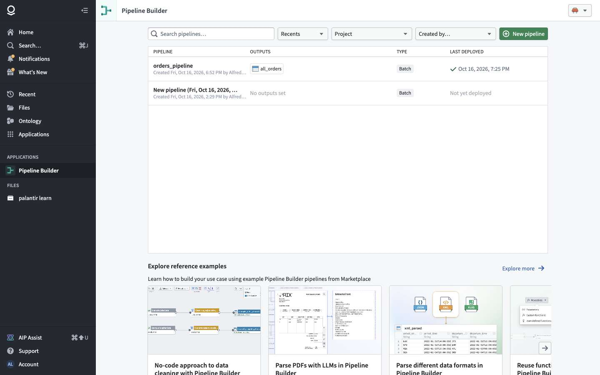
List of pipelines (name, outputs, type Batch, last deployed), filters (Recents, Project, Created by), **New pipeline**, reference examples (installable tutorials).

### 3.2 Create pipeline 🟢
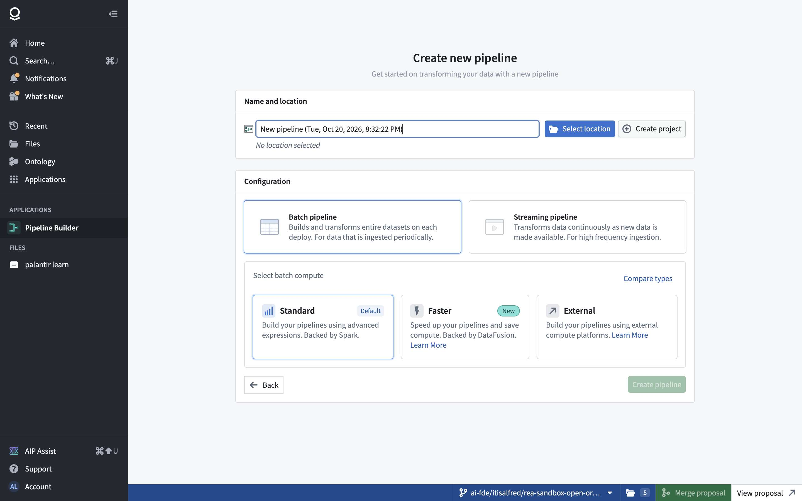
Name (pre-filled with a timestamp) + location picker; Batch vs Streaming; batch compute Standard / Faster / External. ⚠️ The global-branch selector in the bottom bar is **sticky**: it was still on the AI FDE branch and had to be switched to Main first.

### 3.3 Editor: graph 🟢
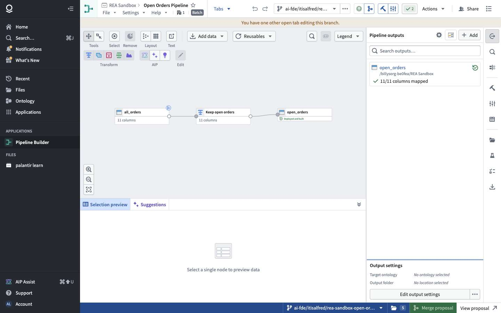
Top: File / Settings / Help, Graph · Proposals · History, undo / redo, branch selector, Saved/Save, Proposals, **Deploy**, build settings, checks. Toolbar: Tools (pan, select), Remove, Layout, Text, **Add data**, Reusables, **Transform** (transform table, join, union, split, model), **AIP** (LLM transform, generate from natural language, explain). Right rail: Pipeline outputs, search, changes, deploy, build settings, **build schedules**, file tree, evaluation suites, unit tests, sources. Bottom: Selection preview / Preview / Transformations / Suggestions.

Selecting a node opens a floating "add next step" toolbar beside it and a data preview below.
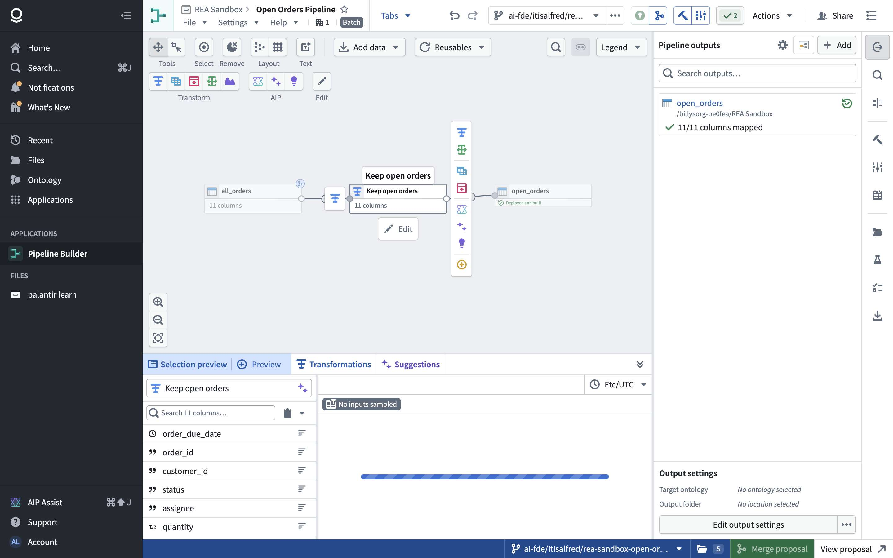

### 3.4 Transform board 🟢
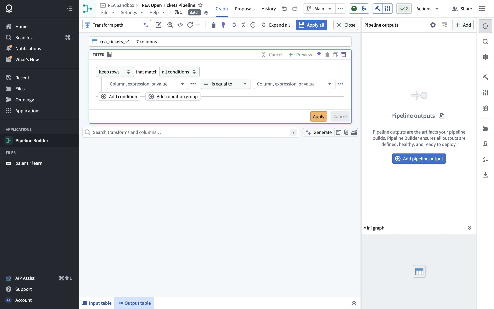
Opened from a node ("Transform selected table"). Start with columns (optional) → choose a transform from the catalog (search, categories) → form. Filter form: Keep / Remove rows · match all / any · `[column, expression or value] [operator] [column, expression or value]`, add condition / group. Per step: Preview, Cancel, Apply; board-level **Apply all**, Close; input / output table at the bottom.

### 3.5 Outputs, deploy, schedule 🟢
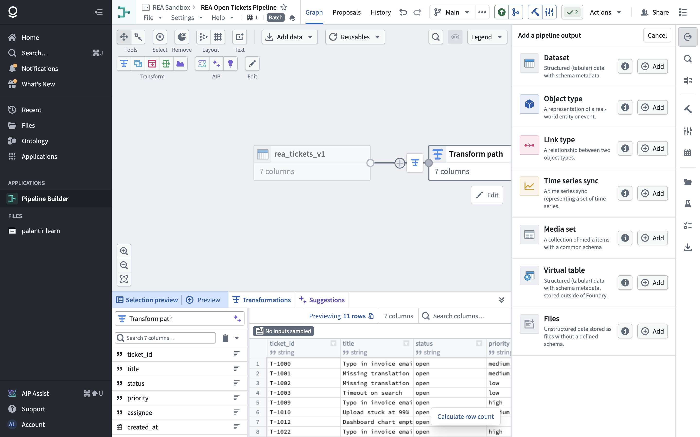
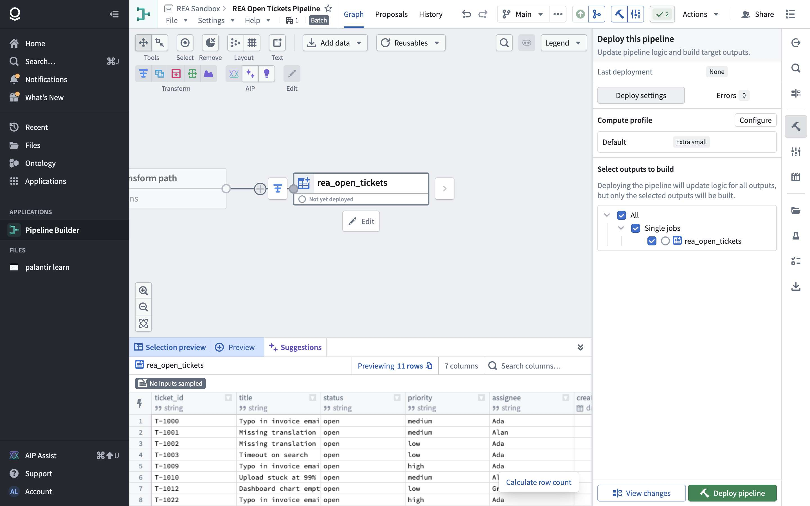
Deploy panel: last deployment, Deploy settings / Errors (count), compute profile (Default, "Extra small"), **outputs to build** (tree with checkboxes), View changes, Deploy pipeline.
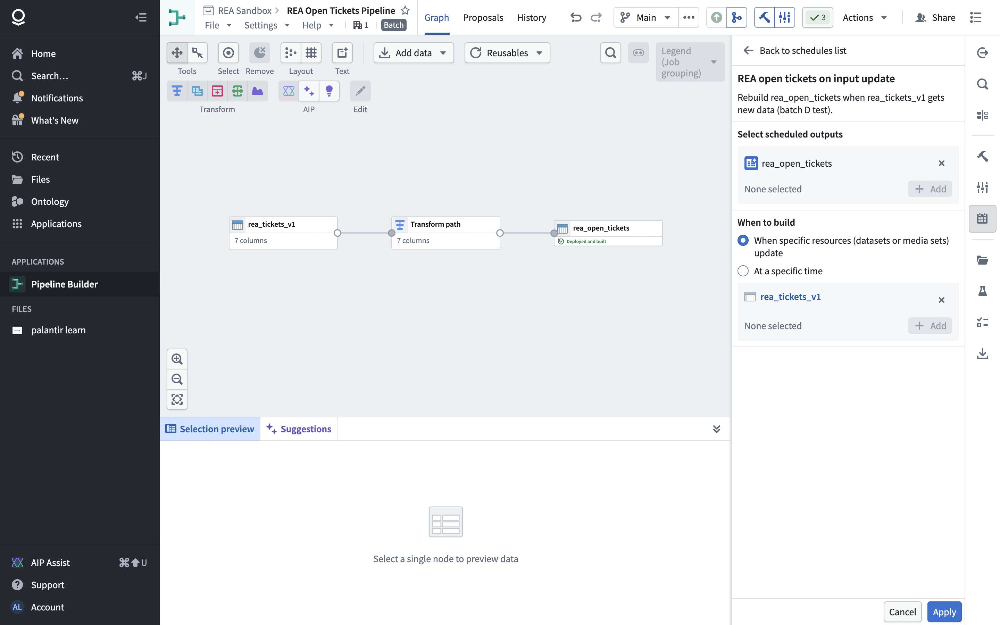

### 3.6 History, builds, schedules, lineage 🟢
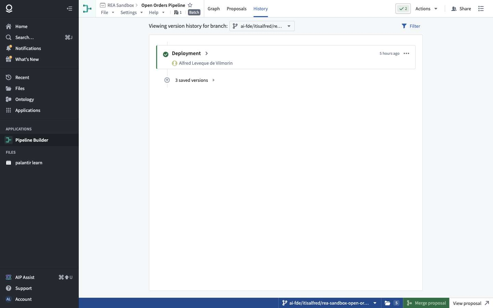
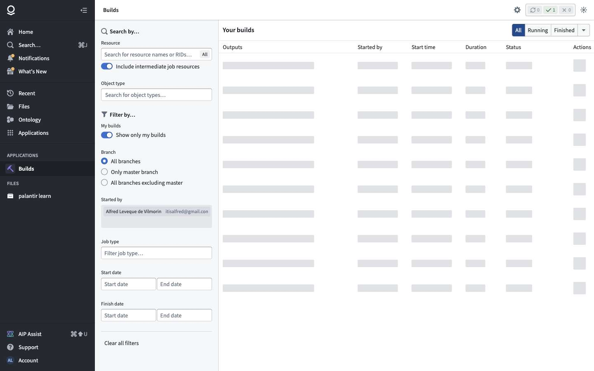
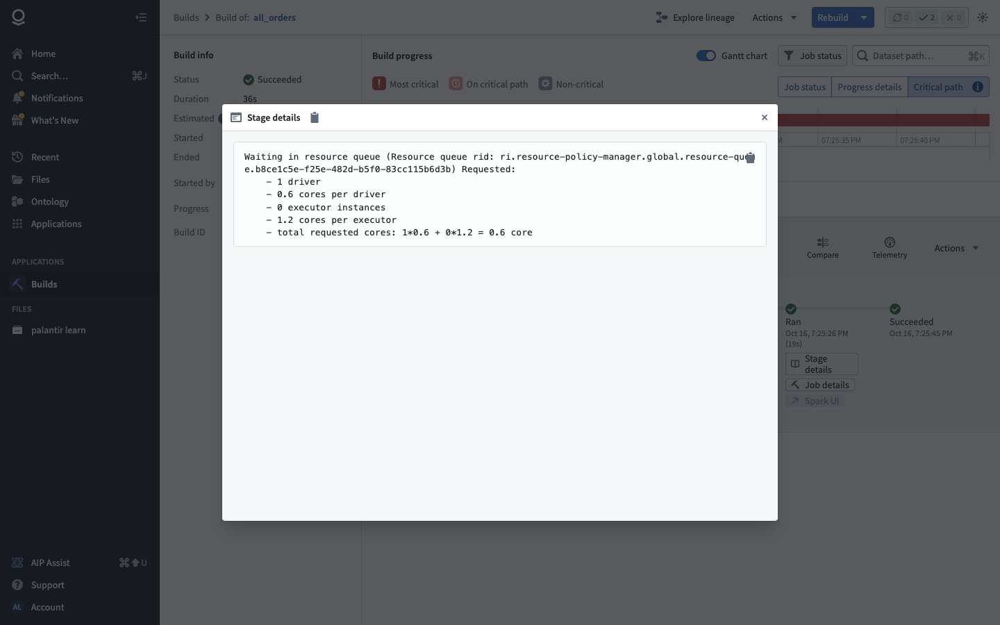
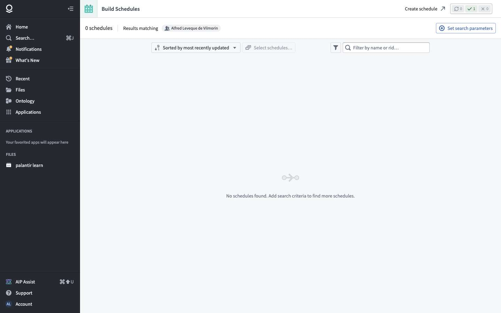
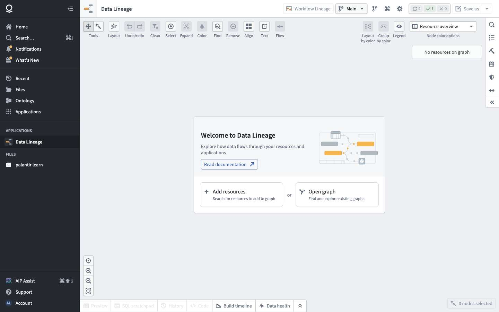

## 4. Journeys observed

### 4.1 Build a pipeline by hand on Main (D2) 🟢

| # | User step | Requests |
|---|---|---|
| 1 | New pipeline → name, location REA Sandbox, Batch / Standard → Create | `compass …/checkName` → `POST eddie/pipelines-v2/create-with-initial-display {name, parentFolder, backend}` → `{pipeline, initialSandbox}` |
| 2 | Add Foundry data → pick `rea_tickets_v1` → Add to selection → Add data | `input-resolution/resolve-v2`; `work-state` (draft) |
| 3 | Select the node → Transform → Filter rows → `status` = `open` → Apply | `preview/request-v5` → `preview/result`; `work-state` |
| 4 | Add pipeline output → Dataset → rename `rea_open_tickets` (7/7 columns mapped) | `work-state`; target with `relativePathToCreateAt` |
| 5 | Save | `POST …/sandboxes/{id}/push {snapshot}` → `DELETE work-state` |
| 6 | Deploy → Deploy pipeline | `check-deployable` → `deploy-v2` → `deployment/…/targets/status` (polled) |
| 7 | Build | ~40 s → dataset created in REA Sandbox, 11 rows; node "Deployed and built" |
| 8 | Build schedules → Create new schedule → outputs `rea_open_tickets`, when `rea_tickets_v1` updates → Apply | `scheduler/create-schedules` → "Successfully created schedule" |

### 4.2 Schedule fires on new data (D3, D4) 🟢

A new transaction on `rea_tickets_v1` started a build of `rea_open_tickets` within seconds, with no click: run history went to 1 run, then 2 runs, both succeeded (median 42 s). The output followed the input each time (3 rows, then 14).

**Ontology edits vs pipeline input** 🟢: after replacing `rea_tickets_v1`, the REA Ticket object type re-indexed to 35 objects, and the two tickets resolved earlier through actions (T-1000, T-1028) **stayed resolved**. The edits live in the object layer, keyed by primary key, so a dataset snapshot doesn't erase them. But the pipeline reads the **dataset**, so those two tickets still count as open in `rea_open_tickets`.

### 4.3 Compared with AI FDE (chapter 3, F3) 🟢

AI FDE builds the same kind of pipeline as **code** (typed builder calls such as a table filter), always on a global branch: `create_pipeline_builder` → `put_pipeline_builder` (code) → `preview_pipeline_builder_node` → `deploy_pipeline_builder`, via `eddie/api/pipelines-v2/…`, `eddie/api/deployment…` and an interactive code executor. By hand on Main the result is the same structure (§2.2), saved by `push` and deployed by `deploy-v2`.

## 5. API surface

### 5.1 Observed 🟢

| Area | Service (declared ops) | Main operations |
|---|---|---|
| Pipelines and sandboxes | PipelineBuilderServiceV2 (54) | `pipelines-v2/create`, `create-with-initial-display`, `{rid}`, `all-information`, `sandboxes/create-v3`, `…/push`, `…/rebase(-v2)`, `…/fast-forward`, `…/hard-reset`, `…/timeline`, `sandboxes/publish/{id}`, `set-published`, archive / unarchive, `…/fallback-branches`, heartbeats, `settings`, `can-create-schedule`, `schedule` |
| Drafts | work-state | `GET work-state/{rid}/{sandbox}/v2`, `POST` (autosave), `DELETE` (after save) |
| Preview | PreviewService (8) | `preview/request-v5|v6`, `result`, `status`, `cancel`, `dataset-preview`, `warm` |
| Deployment | DeploymentService (12) | `…/check-deployable`, `check-proposed-deployable`, `deploy(-v2)`, `cancel`, `acknowledge`, `deployments(/v2)`, `…/targets/status` |
| Proposals | PipelineProposalServiceV2 (19), PipelineDiffService (5) | `proposals/create`, update, `merge(-v2)`, `by-created-at`; `diff-tests/compute-for-snapshots` |
| Transforms catalog | TransformsService (13), `transformations/all`, `available-logical-types` | Definitions `{id, version, displayName, description, aliases, arguments{name: {type, isOptional}}, typeVariables}` |
| Builds | BuildService (8), BuildInfoService (21), BuildStateService (5), JobSpecService (28), `job-tracker` | `POST builds` (trigger), `builds/{rid}/abort`, `manager/rerun-build {buildId, excludeSucceededJobs}`, `info/builds`, `info/jobs3(/runs)`, `builds/bulkV2`, `jobspecs/get-jobspecs-for-datasets`; logs via telemetry, plans via spark-reporter |
| Schedules | SchedulerService (46) | `create-schedules`, `update-schedules`, `enable/disable-schedules`, `delete-schedules`, `get-schedules`, `get-schedules-by-input-dataset|affected-dataset|project|user`, `schedules/{rid}/run|rerun`, `get-next-run-times`, `recent-runs-bulk`, `get-schedule-versions`, `validate-cron-expression` |
| Lineage | monocle | `links`, `settings`, `settings/monitored-items`, `refresh/status` |

### 5.2 Proposed minimal API 🔵

```
POST   /pipelines                         {name, folderId}                       → pipeline + main draft
GET    /pipelines/{id}?version=latest|N
PUT    /pipelines/{id}/draft              {logic}                                → autosave
POST   /pipelines/{id}/versions           {logic, expectedVersion}               → version n
POST   /pipelines/{id}/preview            {logic, nodeId, rowLimit}              → {jobId}; GET /preview/{jobId}
POST   /pipelines/{id}/deploy             {version}                              → deployment + build
GET    /transforms                        → catalog (id, version, args schema)

POST   /builds                            {datasetIds[], branch}                 → build
GET    /builds/{id}                       → status, jobs[{output, inputTxns, outputTxn, status, logsUrl}]
POST   /builds/{id}/abort

POST   /schedules                         {name, trigger, action}               → schedule (versioned)
PATCH  /schedules/{id}                    {enabled | trigger | action}
GET    /schedules/{id}/runs

GET    /lineage?resourceId=&direction=up|down&depth=
```

## 6. Feature list and verdicts

| # | Feature | Verdict | Why |
|---|---|---|---|
| P1 | Pipeline = DAG of typed, versioned transforms + targets (JSON) | **Must** | The core; same JSON for preview, draft, save |
| P2 | Graph editor: add data, add step, connect, select → preview | **Must** | |
| P3 | Transforms: filter, select / rename columns, cast, join, union, aggregate, derive column (expression) | **Must** (≈10) | Covers most cleaning; the rest later |
| P4 | Expression builder (column / value / expression, and / or groups) | **Must** | Filters and derived columns need it |
| P5 | Preview on a sample (row limit, pinned input versions) | **Must** | Users check each step before deploying |
| P6 | Draft autosave + explicit Save version + History (reset to version) | **Must** | Same pattern as Workshop (ch. 4) |
| P7 | Deploy = freeze version as job specs + build selected outputs | **Must** | |
| P8 | Outputs: dataset (create on first build) | **Must** | Object-type outputs: Later (use ch. 2 wizard instead) |
| P9 | Builds: status, jobs, input/output transactions, logs, abort | **Must** | Needed to debug |
| P10 | "Up to date" skip when inputs unchanged | **Must** (cheap) | Saves compute |
| P11 | Schedules: on input update (transaction committed) + cron time trigger, or-combined | **Must** | Keeps data fresh |
| P12 | Schedule run history (runs, success / failure, duration) | **Must** | |
| P13 | Lineage API (up / downstream datasets, object types) + simple graph view | **Must** (API) / Later (canvas app) | Cheap from job specs |
| P14 | Branches, proposals, rebase, merge for pipelines | Later | Reuse the global-branch model of ch. 3 |
| P15 | Streaming pipelines, Faster / External compute | Drop for now | |
| P16 | AIP steps (LLM transform, generate from text), unit tests, evaluation suites, expectations / data health | Later | |
| P17 | Markings / security propagation | Later | Single-tenant first |
| P18 | Compute profiles, retries, notifications on schedules | Later | Defaults only |

## 7. Pseudo-code for the must-haves 🔵

### 7.1 Pipeline logic and execution (P1, P3, P7)

```
type Value = {literal: any} | {column: string} | {expr: Expr} | {dataset: DatasetId}
type Expr  = {fn: string, version: int, args: {[name]: Value}}          // e.g. fn "eq", "and"
type Step  = {id, fn: string, version: int, args: {[name]: Value | {step: StepId}}}
type Target = {id, from: StepId, dataset: {path | datasetId, columns[]}}
type PipelineLogic = {steps: Step[], targets: Target[]}

deploy(pipeline, version):
  logic = load(pipeline, version)
  check(logic)                              // types, unmapped columns, cycles
  for t in logic.targets:
     jobSpec[t.datasetId ?? createDataset(t.dataset.path)] =
        {pipeline, version, subgraph: upstream(logic, t.from), inputs: datasetsIn(subgraph)}
  return build(targets(logic))

runJob(spec):
  inputs = {d: latestTransaction(d) for d in spec.inputs}
  if inputs == lastSuccessfulInputs(spec): return DID_NOT_RUN          // "up to date"
  frame = evaluate(spec.subgraph, inputs)                              // one SQL/dataframe plan
  tx = openTransaction(spec.output, SNAPSHOT); writeFiles(tx, frame); commit(tx)
  record(spec, inputs, tx)
```

### 7.2 Preview (P5)

```
preview(logic, nodeId, rowLimit=300):
  sub = upstream(logic, nodeId)
  inputs = pinLatestTransactions(datasetsIn(sub))
  job = enqueue(evaluate(sub, sample(inputs, rowLimit)))     // async, cancellable
  return job.id                                              // client polls /preview/{id}
```

### 7.3 Schedules (P11, P12)

```
on transactionCommitted(dataset, branch):
  for s in schedules where s.enabled and matches(s.trigger, dataset, branch):
     startRun(s)
every minute:
  for s in schedules with time trigger where cronDue(s.trigger.cron, now): startRun(s)

startRun(s):
  if s.runningBuild and s.overlap == "skip": record(s, IGNORED); return
  b = build(s.action.datasets, s.action.branch)
  record(s, run{buildId: b.id, startedAt}) ; on finish: update run status, duration
```

## 8. Coverage and unknowns

| Question | Status | Why / next step |
|---|---|---|
| Pipeline logic data model | ✅ Observed | Preview, work-state and push payload shapes |
| Editing lifecycle (draft → save → deploy) | ✅ Observed | D2 |
| Transform catalog | ✅ Shape, ⚠️ partial content | Categories and definition shape seen; only Filter used |
| Join / aggregate / expression forms | ⚠️ Not exercised | Next scenario if needed |
| Builds, jobs, "up to date" | ✅ Observed | Including an accidental rebuild (below) |
| Schedules on input update | ✅ Observed end to end | D2 create, D3 / D4 runs |
| Time-based schedules, cron | ⚠️ API only | `validate-cron-expression` declared |
| Lineage graph app | ⚠️ Empty canvas only | Add REA Sandbox datasets to the graph next time |
| Proposals / merge for pipelines | ⚠️ API only | Never merge without the user |
| Object-type outputs from a pipeline | ⚠️ Screens only | Output type list seen |
| Streaming | ❌ Not explored | Dropped for now |

**Resources created** (with your approval, REA Sandbox, **Main**): pipeline **REA Open Tickets Pipeline** (filter step label left as the default "Transform path"); dataset **rea_open_tickets** (14 rows); schedule **REA open tickets on input update** (runs when `rea_tickets_v1` gets new data; no timer). `rea_tickets_v1` got two extra SNAPSHOT transactions (an accidental 5-row replace, then the 35-row repair); it now holds 35 tickets.

**Incidents:** (1) the Builds crawl pressed **Rebuild** on the tutorial dataset `all_orders` (outside REA Sandbox): the build was up to date and the job did not run, so no data changed; the crawler now refuses rebuild / rerun. (2) In the upload dialog, ticking "Keep existing schema" switched Add to Replace; repaired with your OK. Both are in `HANDOFF.md` §11.
