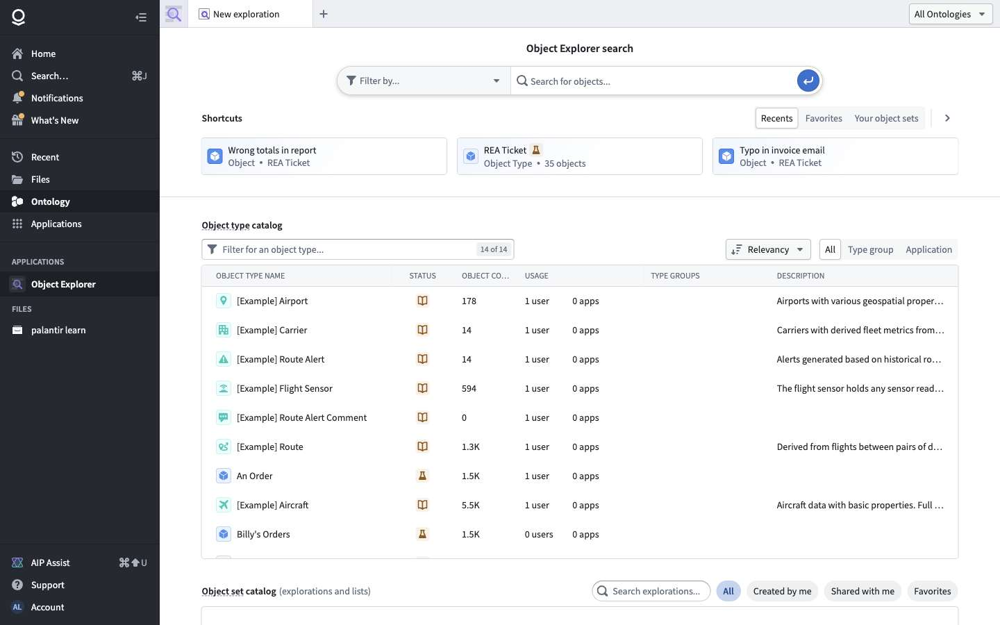
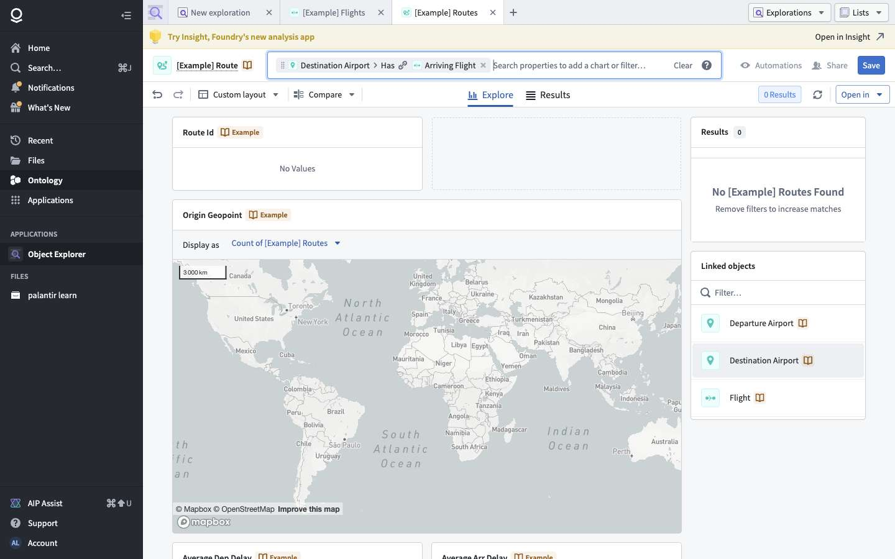
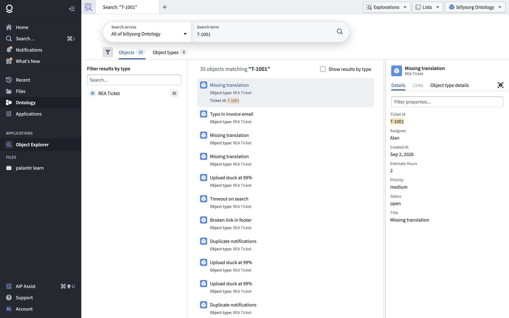
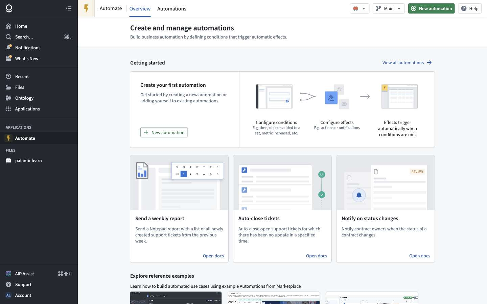
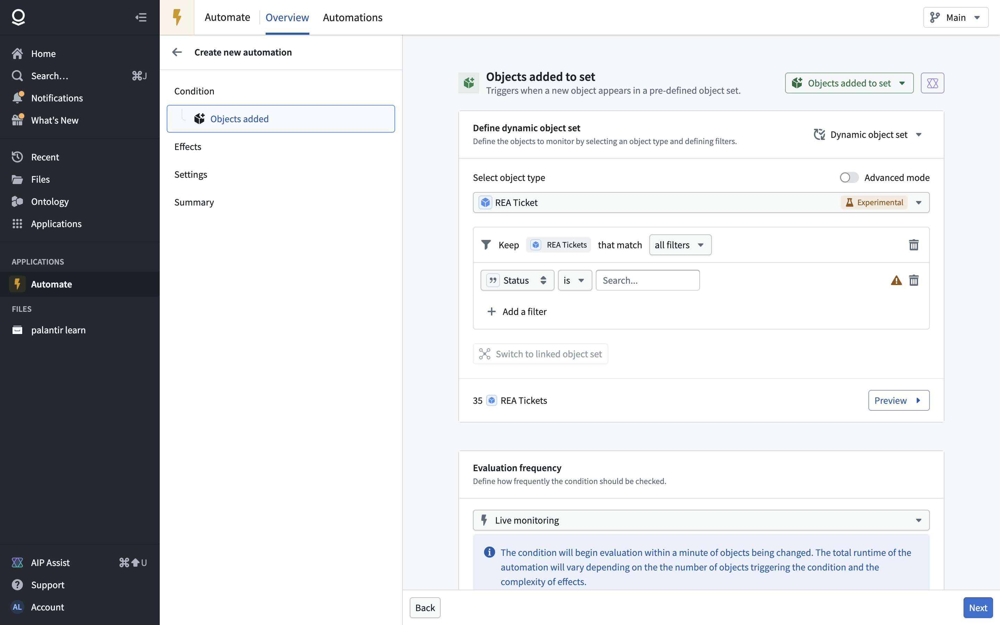
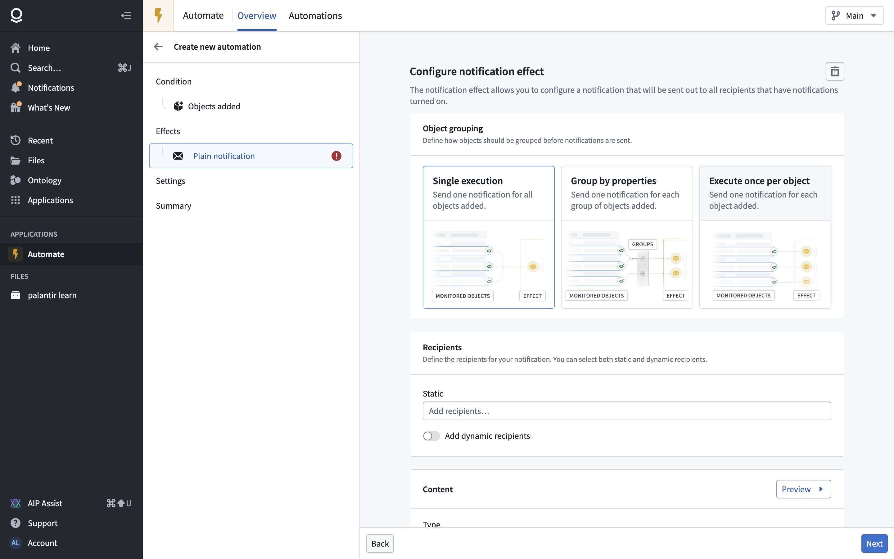
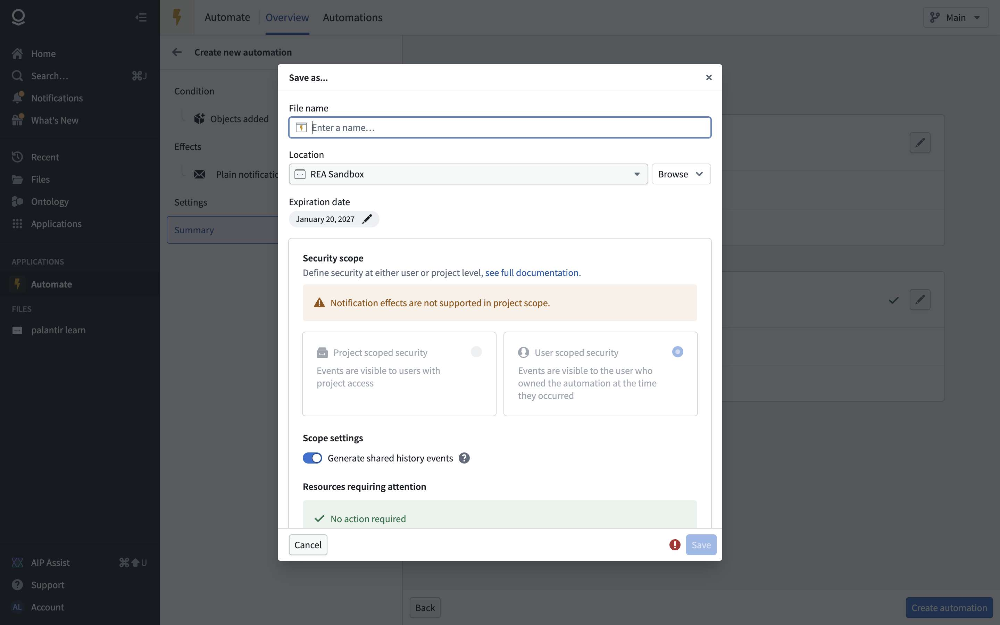
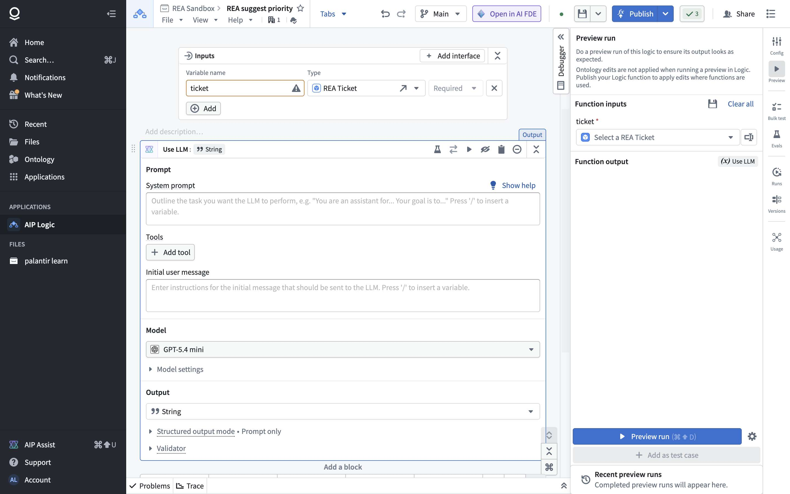
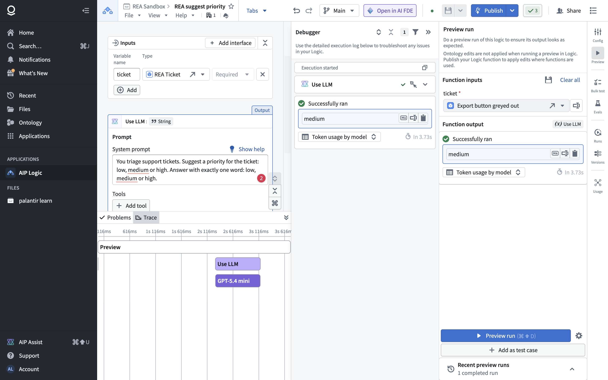

# Chapter 6 — Object Explorer, Automate, AIP Logic

> **Status:** v0.1 (2026-10-20)
> **Sources:** click-only crawls of Object Explorer (41 screen kinds), Automate and AIP Logic homes (`crawl/out-e/`); API operations declared in each app's scripts (1 171–1 349 per app, key services in `out-e/services-e.txt`); four recorded scenarios on **Main in REA Sandbox**: a read-only look at the New automation wizard (`E0-automate-peek`), an automation built, triggered and paused (`E1-automate`), a ticket edited through an action from Object Explorer (inside E1), and an AIP Logic function built and preview-run three times (`E2-logic`). Digest: `data/object-explorer-automate-logic-digest.md`.
> **Legend:** 🟢 observed · 🟡 inferred · 🔵 design choice for our version.

---

## 1. What they are for

Three apps that make the ontology (chapter 2) **useful day to day**, without building a Workshop app:

- **Object Explorer**: search and browse objects of any type; filter, chart, follow links to related objects, open one object and run its actions. It's the "spreadsheet + Google" of the ontology.
- **Automate**: "**when** something happens to objects (or at a time) **then** do something": run an action, run an AIP Logic function, run a function, or notify people.
- **AIP Logic**: a no-code editor for **functions** made of blocks, the main one being "Use LLM". A function takes ontology objects as inputs and returns a value (or proposes edits), and can be called from Automate, Workshop or actions once published.

For the minimal version: Object Explorer gives every object type a free UI; Automate is the cheapest way to show "the system reacts"; Logic is where the AI meets the data.

## 2. Core concepts and data model

### 2.1 Object sets: the shared query language 🟢

All three apps (and Workshop, ch. 4) describe "which objects" with the same **object set** tree, sent to `object-set-service`:

```
objectSet = {type: "base",         base: {objectTypeId}}
          | {type: "static",       static: {objectRids[]}}
          | {type: "filtered",     filtered: {objectSet, filter{…}}}
          | {type: "searchAround", searchAround: {objectSet, relationId, relationSide}}   // follow a link type
          | {type: "intersected",  intersected: {objectSets[]}}   (also union / subtract 🟡)
POST objectSets/temporary {objectSet}            → {objectSetRid}        // cache a set, reuse its id
PUT  objectSets/objects/top/initial {objectSet, …} → results[{objectRid, objectTypeRid, primaryKey{k: typedValue},
                                                    title, properties{k: {type, string|integer|double|date|timestamp|
                                                    geoPoint|geoShape|long}}, runtimeDerivedProperties}]
```

An object is always addressed as `{objectTypeId, primaryKey}` (seen again in Logic, §2.4, and in actions, ch. 2).

### 2.2 Exploration 🟢

An exploration = an object set + a **layout** (per object type) of charts and a list:

```
exploration {objectSetRid{temporaryObjectSetRid | unversionedObjectSetRid},
             layoutLocator{layout{objectTypeRid,
                                  charts[{positionInGrid{colSpan},
                                          chartDefinition{chartTypeId, commonConfig, config{<kind>{configV0{propertyType, sortConfig, bucketingConfig…}}}}}]}}}
chart kinds: LISTOGRAM (value counts), TIMELINE, DISTRIBUTION, SUMMARY_STAT_TABLE, SINGLE_STAT_CARD,
             PIE_CHART, GRID_PLOT, CHOROPLETH_MAP, GEOHASH_MAP, OBJECTS_LIST
```

**Every view is autosaved** server-side as session state: `POST hubble-server/api/autosaved/{session}/{stateId}/0 {exploration}` → `{locator{sessionId, secureStateId, version}}`, and the URL becomes `/exploration/autosaved/{session}_{stateId}_0`, so any view can be shared or restored. Explicitly **saved** explorations, lists and per-type default layouts are separate (`ExplorationService`: save / update exploration, save / set default layout, comparison views). Recently opened items appear in **Recents**.

### 2.3 Automation 🟢

From `POST object-sentinel/api/registry/v0/monitors` (abridged):

```
automation {name, parentRid (folder), markings[], publishOnCreate,
  logic: {event: {eventType: {notSavedObjectSetEvent: {objectSetRid, eventType: {added | removed | modified}}}}}  // the condition
  metadata: {
    subscribers[{subscriberType{user{userId}}, triggerEffects{<effectId>: {notification}}, recoveryEffects{}}],
    renderingV2{<effectId>: {notificationEffectRendering{plainText{shortContent{heading, message, links[]}, emailContent, attachments}},
                             executionMode{perBatchOfObjects | perObject | groupBy}, recipients, executionSettings{branchSettings}}},
    expiry{expireOn}, muted{forUsers[]}, disabled?,
    liveConfig{…}, globalEffectExecutionSettings{batchSize, rateLimitConfig, enableAdaptiveParallelism, doNotMuteAutomationOnFailures},
    cycleDetectionSettings, triggerExecutionSettings, scopedTokenEffects{onBehalfOf{user}, additionalScope{actionTypeRids, functionRids, objectTypeRids, …}}}}
```

- **Conditions** (11): Time (cron-like), Objects added to set, Objects removed from set, Objects modified in a set, Run on all objects (periodic), Threshold crossed, Automation dependency, Time series, Stream, Dataset updated (beta), Metric changed (sunset).
- **Evaluation frequency**: *Live monitoring* ("begins evaluation within a minute of objects being changed") or scheduled.
- **Effects** (4): Action, Logic (stage or apply generated actions), Function (no ontology edits), Notification (static or property-based recipients, heading/message with `/` variables, optional email config and attachments; grouping: single execution / group by properties / once per object).
- **Settings**: event retries, who gets warnings (owner + recipients, or named administrators), scenario runs, auto-mute when ≥ 80 % of the last 30 events fail, adaptive parallelism.
- **Save**: name, location, **expiration date** (default ≈ 3 months), **security scope** (project scoped vs user scoped; notification effects require user scope), shared history events, third-party app ownership.
- **Lifecycle**: Active → **Pause** / Mute for everyone / Mute for me / Duplicate / Move to trash; versions with publish; ownership transfer. Every edit in the wizard calls `validation/v0/validate-create` or `{rid}/validate-update` (separate from save).
- **History**: events per run (`MonitorEvents`), effect logs, "Last triggered", "All events executed / All changes processed".

### 2.4 AIP Logic function 🟢

- A **logic file** (`ri.eddie.main.logic.<uuid>`) is stored like a pipeline (ch. 5): one **sandbox** per branch, a server-side **work state** draft (`logic-work-state`), **Save** = `…/sandboxes/{id}/push`, versions, proposals, **Publish** (to make it a callable function). Checks run on every change (`logic/checks/check`).
- **Inputs**: name + type (String, Integer, Double, Boolean, Date, Timestamp, Array, Struct, Object, Object list, Object set, Media reference, Model, Geopoint, Geoshape, Markings…), required or optional, or a *functional interface*.
- **Blocks**: Use LLM, search / retrieval, apply action, create / modify objects (ontology edits), variables, control flow (conditionals, loops), calculations; templates (RAG, entity extraction).
- **Use LLM block**: system prompt, tools (actions, object queries, functions…), initial user message with `/` variables (object properties picked individually: we sent only `Title`), **model** (≈ 50 offered: GPT, Claude, Gemini, Grok, Llama; default GPT-5.6 Sol), model settings, **output type** (String, struct…), structured output mode, validator.
- **Preview run** ("ontology edits are not applied when running a preview"): pick input objects, run, see the output, token usage by model and duration; **Debugger** (each block's result) and **Trace** (timeline of blocks and model calls); "Add as test case"; Bulk test, Evals, Runs, Versions, Usage tabs.
- **Execution over a WebSocket**:

```
send    {execute: {arguments{<argId>: {primitive{object{idBasedLocator{objectTypeId, primaryKeyValues{ticket_id}}}}}},
                   function{configuration{executionMode{direct}, executionRuntime{direct}, canExecuteOnOntologyTransaction},
                            definition{id, displayName, description, arguments{<id>{apiName, type{object{requiredObjectTypeRid}}, isOptional}},
                                       argumentOrdering[], ontologyBinding},
                            implementation{…}}}}
receive (stream, ~22 frames per run) {tracingStarted{traceId}} · debug{openSpan{spanType: execution | transform | callModel}, closeSpan,
         enterTransform, exitTransform{output{literal{string{value}}}}, llmMessage{system | user | assistant, structured parts}}
```

🟡 So the editor runs the **unpublished draft** by sending its definition inline; the server executes block by block and streams a trace, which the UI turns into the Debugger and Trace views.

## 3. Screens

### 3.1 Object Explorer 🟢

Home: search bar, shortcuts, Recents, Favorites, "Your object sets", **object type catalog** (count of objects, dependents, apps), type groups, saved explorations and lists.

Exploration of one type: filters, charts grid (value counts, timeline…), object list; link navigation ("Arrival Airport → Arriving Flight → …", each hop a `searchAround`); "Open in → Analyze as dataset in Contour"; object page (properties, links, **Actions** menu).

Keyword search across the ontology: results by type, side panel with all properties; double-click opens the object page.

### 3.2 Automate 🟢

Overview (getting started, templates such as "Send a weekly report") and Automations list (filters: space, status, referenced resources). Wizard: **Condition → Effects → Settings → Summary**.



Automation page: status (Active / Paused), frequency, expiry, last triggered, evaluation and execution status, automation flow (condition → effects), metadata, monitoring rules ("alerts for failing automations").

### 3.3 AIP Logic 🟢

Home lists logic files (creator, last edited, last viewed) and reference examples. Editor: Inputs · blocks · Output in the middle; Block / Graph views; undo / redo, branch, Open in AI FDE, Save, **Publish**; right rail Config, Preview, Bulk test, Evals, Runs, Versions, Usage.


## 4. Journeys observed

### 4.1 Automation: "REA ticket resolved → notify" (E1) 🟢

| # | Step | Requests |
|---|---|---|
| 1 | New automation → Objects added to set → object type REA Ticket → filter Status is `resolved` (14 objects), live monitoring | object-set counts; `validation/v0/validate-create` on each change |
| 2 | Effects → Notification → single execution → recipient: the user → heading + message | |
| 3 | Settings (defaults) → Summary → Create automation → name, location REA Sandbox, expiry, **user scope** → Save | `POST registry/v0/monitors` → automation page "Active" |
| 4 | Object Explorer → search "T-1001" → object page → Actions → Edit REA Ticket → Status `resolved` → Submit | `actions/bulk-validate` → `actionsV2` → "Edits successfully applied" |
| 5 | Within a minute: "Last triggered 9:36 PM · All events executed"; notification "REA ticket resolved" in the user's Notifications panel | (server side) |
| 6 | Actions → Pause | `POST registry/v0/disable/{rid}` → "Paused" (kept after reload) |

Comparison with chapter 5: a pipeline **schedule** reacts to new dataset transactions; an **automation** reacts to object changes, including a single action edit.

### 4.2 Logic: "REA suggest priority" (E2) 🟢

New logic → name + location (REA Sandbox) → `logic/create` → input `ticket: REA Ticket` → Use LLM (system prompt: suggest low / medium / high, one word; user message: the ticket's Title) → model GPT-5.4 mini → output String → Save (`push`, not published) → 3 preview runs:

| Ticket | Title | Priority in the dataset | Suggestion | Time |
|---|---|---|---|---|
| T-1030 | Export button greyed out | medium | medium | 3.7 s |
| T-1031 | Wrong timezone in report | high | medium | 5.2 s |
| T-1032 | Slow login page | low | medium | 1.7 s |

A small model with a title-only prompt plays safe; for the book what matters is the loop (inputs → block → model → output, with trace).

## 5. API surface

### 5.1 Observed 🟢

| Area | Service (declared ops) | Main operations |
|---|---|---|
| Object queries | ObjectSetService / V2 / Versioned / Scroll | `objectSets/temporary`, `objects/top/initial`, `objectTypes`, `resultTypes`, aggregations, suggest |
| Explorations | ExplorationService (22), hubble-server | save / update / get exploration (per versioned object set), layouts (save, update, set default), comparison views; `autosaved/{session}/{state}`, user preferences |
| Object views | hubble-server, objects-data-funnel, ontology-metadata | `object-views/v8/configuration/has-permissions`, `view/currentV4` (index snapshot per type), `actionTypesForObjectType`, `linkTypesForObjectTypesV2` |
| Automations | MonitorRegistry (30) | `monitors` (create), `monitors/{rid}` (update), versions + `publish`, `disable/{rid}`, mute for self / on behalf, take ownership, `monitors-search`, `getNextExecution`, `get-automation-changes`, `rebase-automation` |
| Automation runs | MonitorExecutor (12), MonitorEvents (17) | `monitors/{rid}/execute`, `batchExecute`, `retryEvents`, `executionEffectSummary`; `monitors/{rid}/events`, `events/{id}/effect-logs`, `latest-events`, `seen-events` |
| Validation | object-sentinel validation | `validate-create`, `{rid}/validate-update` |
| Alert rules | MonitoringServiceV2 (26) | monitoring views and rules on automations (alert when an automation fails), subscribe to notifications per severity |
| Logic files | LogicBuilderService (21), LogicProposalService (11) | `logic/create`, sandboxes create / push / rebase / merge, `versions/{v}`, `history`, `publish/{rid}/{sandbox}`, settings, `validateModelSwap`; proposals create / review / close |
| Logic drafts and checks | eddie | `logic-work-state/{rid}/{sandbox}` (POST / DELETE), `logic/checks/check`, `logic/transformations/all/v2` |
| Function execution | FunctionExecutorService (13), WebSocket | `functions/{rid}/versions/{v}/execute(Async|BatchInputs)`, async result / cancel; editor preview over a WebSocket `execute` message with trace frames |
| Models | LlmService, ModelManagementService | `llm/v3/completion/{model}(/stream|/streamCompletionChunk)`, registered models |
| Evals | EvaluationSuiteConfiguration / Execution | suites per target, runs |

### 5.2 Proposed minimal API 🔵

```
POST /objects/query           {objectSet, select[], orderBy, pageSize, pageToken}   → objects page
POST /objects/aggregate       {objectSet, groupBy[], metrics[]}                    → buckets
GET  /objects/{type}/{pk}     → properties + links + available actions
POST /explorations            {name, objectSet, layout}  · GET/PUT /explorations/{id}

POST /automations             {name, folderId, condition, effects[], expiresAt}    → automation (active)
POST /automations/{id}/pause | /resume
GET  /automations/{id}/events → [{at, objects[], effects[{type, status, log}]}]

POST /functions               {name, folderId}           → logic draft
PUT  /functions/{id}/draft    {inputs[], blocks[], output}
POST /functions/{id}/versions · POST /functions/{id}/publish
POST /functions/{id}/preview  {inputs}  → stream of trace events (SSE), last one = output
POST /functions/{id}/execute  {version, inputs}  → output (+ proposed edits)
```

## 6. Feature list and verdicts

| # | Feature | Verdict | Why |
|---|---|---|---|
| X1 | Object set tree (base, filter, link traversal, intersect / union) shared by all apps | **Must** | One query model everywhere |
| X2 | Object Explorer: type catalog, keyword search, list + filters, object page with properties, links and actions | **Must** | Free UI for every type |
| X3 | Exploration charts: value counts, timeline, stats | **Must** (3 kinds) | Most of the value; maps later |
| X4 | Shareable view state (autosaved, URL) | Later | Nice; plain URL query params first |
| X5 | Saved explorations / lists, default layouts | Later | |
| A1 | Automation = condition + effects + settings, versioned, pause / resume, expiry | **Must** | |
| A2 | Conditions: objects added / removed / modified in a set (live, < 1 min), time (cron) | **Must** | Covers "react to change" and "every Monday" |
| A3 | Effects: action, notification (in-app; email later), run function | **Must** | |
| A4 | Event history with per-effect logs; "last triggered" | **Must** | Trust and debugging |
| A5 | Validation endpoint separate from save | **Must** (cheap) | Same pattern as ontology and pipelines |
| A6 | Threshold, time series, stream, dependency conditions; grouping modes; auto-mute; adaptive parallelism; third-party ownership | Later | |
| A7 | Security scopes (user vs project) | **Must** (simple) | Who sees the events, on whose behalf effects run |
| L1 | Logic function = typed inputs + blocks + output, draft / version / publish | **Must** | |
| L2 | Use LLM block: system prompt, user message with variables, model, typed output (string / struct) | **Must** | The core AI building block |
| L3 | Tools in the LLM block (query objects, run action) | **Must** (2 tools) | Lets the model act on data |
| L4 | Preview run with streamed trace (Debugger + Trace) | **Must** | Same stream design as ch. 3 agents |
| L5 | Proposed ontology edits from functions, applied only when published / via action | **Must** | Safe by default |
| L6 | Bulk test, evals, test cases | Later | |
| L7 | Many models / per-block model choice | Later | One good model + one cheap one |
| L8 | Control flow blocks, RAG / entity templates | Later | |

## 7. Pseudo-code for the must-haves 🔵

### 7.1 Object set evaluation (X1)

```
eval(set):
  match set.type
    base:         return sql("SELECT * FROM objects_{type}", set.base.objectTypeId)
    static:       return byIds(set.static.ids)
    filtered:     return where(eval(set.objectSet), compile(set.filter))
    searchAround: L = linkType(set.relationId)
                  return join(eval(set.objectSet), L, side=set.relationSide)   // FK or join table
    intersected:  return intersect(map(eval, set.objectSets))
```

### 7.2 Live automations (A1–A4)

```
on objectsChanged(type, changes):                      // emitted by the action / index writer
  for a in automations where a.active and a.condition.type in {added, removed, modified}
                          and a.condition.set.baseType == type:
     before = memberIds(a)                              // cached membership
     after  = ids(eval(a.condition.set) ∩ changedIds)
     delta  = diff(before ∩ changedIds, after, a.condition.type)
     if delta: enqueue(event{automation: a.id, objects: delta})
     updateMembership(a, changedIds, after)

worker(event):
  for e in automation.effects:
     try   run(e, event.objects, runAs = automation.scope)   // action | notify | function
     log(event, e, ok | error)
  automation.lastTriggered = now
```

### 7.3 Logic preview with a streamed trace (L1, L2, L4)

```
preview(fn, inputs) -> stream:
  emit(tracingStarted(traceId))
  env = bind(fn.inputs, load(inputs))                  // objects by {type, pk}
  for b in fn.blocks:
     emit(enter(b.id))
     if b.kind == LLM:
        msgs = [system(render(b.system, env)), user(render(b.user, env))]
        emit(callModel(b.model)); out = llm(b.model, msgs, tools=b.tools, schema=b.outputType)
     else out = runBlock(b, env)
     env[b.id] = out; emit(exit(b.id, out))
  emit(result(env[fn.output]))                         // edits are returned, never applied in preview
```

## 8. Coverage and unknowns

| Question | Status | Why / next step |
|---|---|---|
| Object set model, object query results | ✅ Observed | Shapes from Object Explorer |
| Exploration layout and charts | ✅ Shape | Chart configs only abridged |
| Aggregation requests behind charts | ⚠️ Partial | Mostly via `graphql-gateway/api/bulk` (contents not captured) |
| Automation definition, validation, run, pause | ✅ Observed end to end | E1 |
| Time conditions, action / function / logic effects | ⚠️ Screens only | Next automation could run "Edit REA Ticket" as its effect |
| Automation event log contents | ⚠️ Partial | Overview status seen; events tab not opened |
| Logic definition, draft, save, preview | ✅ Observed | E2 |
| Logic publish, call from Automate / Workshop | ⚠️ API only | Not published on purpose |
| Logic tools (actions, queries) inside the LLM block | ⚠️ Screens only | |
| Exact LLM messages | 🚫 Not recorded | Only structure kept, by design |

**Resources created** (with your approval, REA Sandbox, **Main**): automation **REA ticket resolved → notify** (now **Paused**, expires 2027-01-20); AIP Logic **REA suggest priority** (saved, not published, model GPT-5.4 mini); ticket **T-1001** set to `resolved` through the Edit REA Ticket action. Object Explorer's Recents for the user now include items opened by the crawler.
