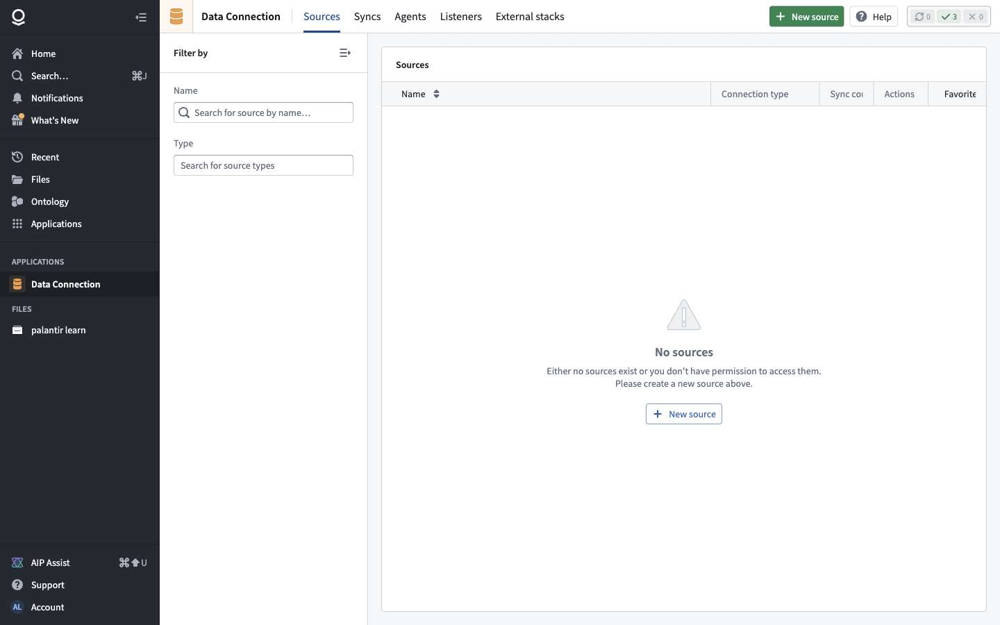
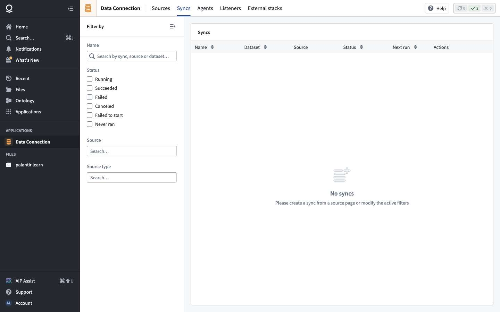
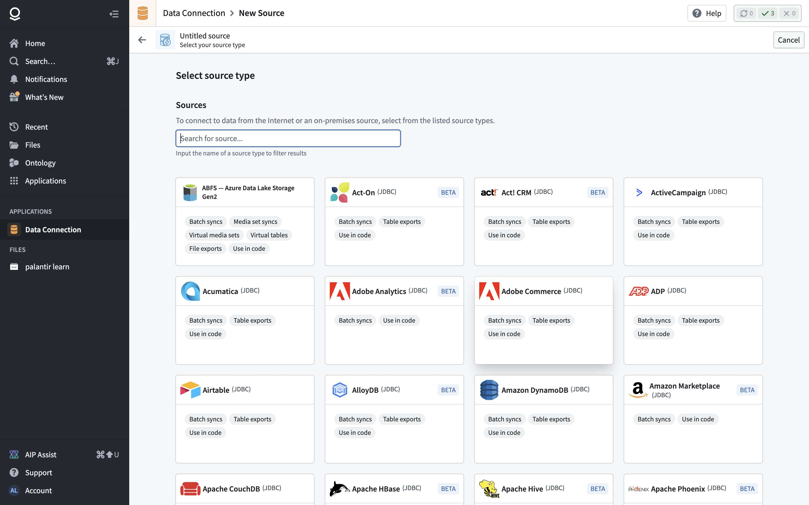
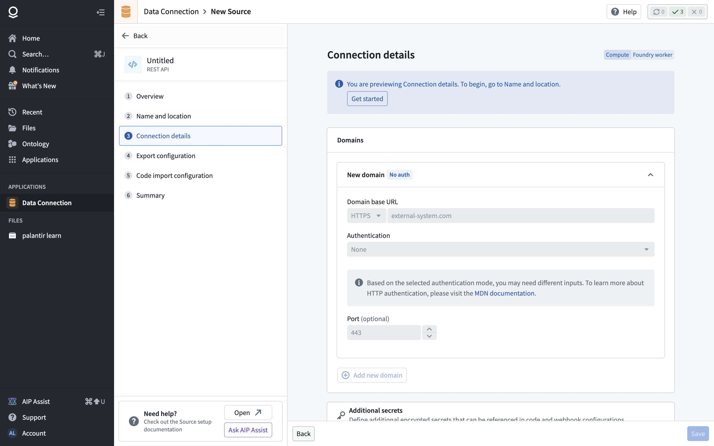
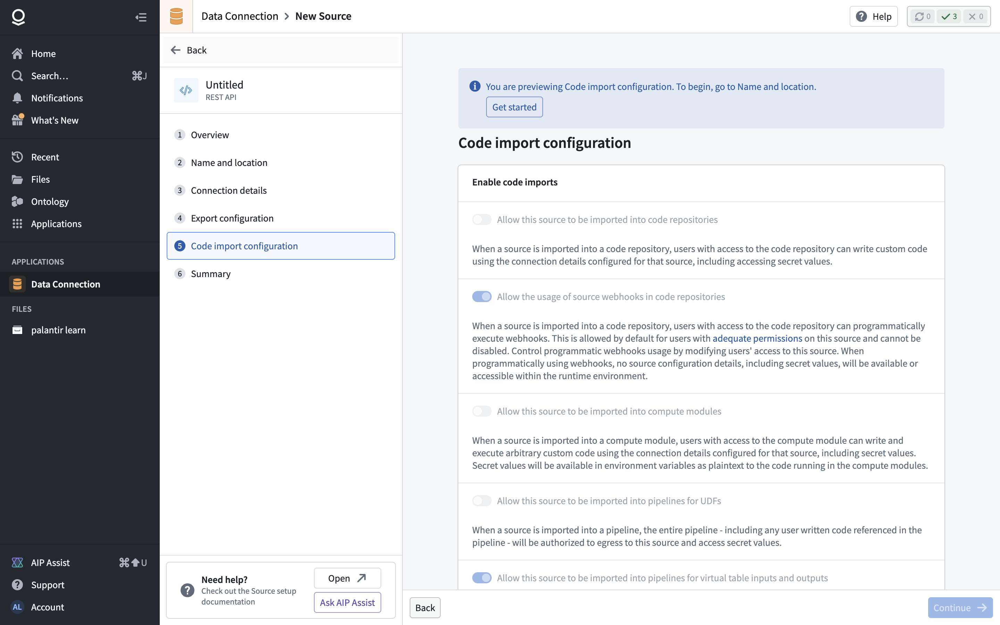
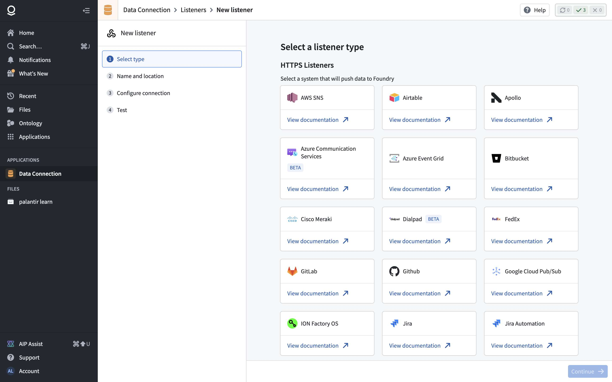
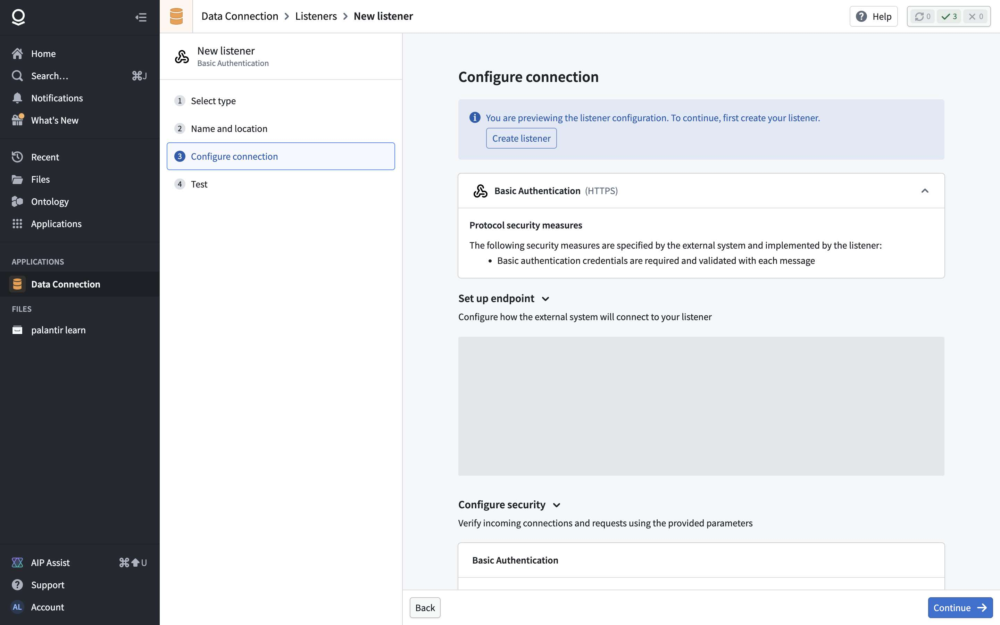
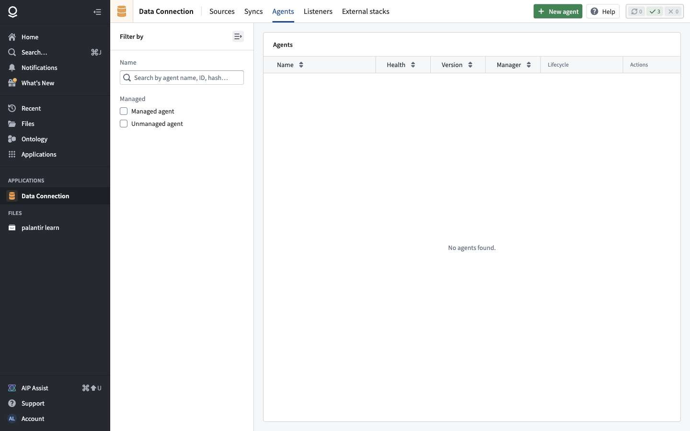

# Chapter 7 — Data connection: sources, syncs, webhooks, listeners, exports

> **Status:** v0.1 (2026-10-21)
> **Sources:** click-only crawl of the Data Connection app (`crawl/out-f/`); read-only previews of the New source catalog (231 types, `out-f/source-catalog.json`), the REST API source wizard, the listener catalog and the custom, GitHub and email listener wizards, the New agent wizard and a dataset's actions menu (recordings `out-scenarios/F0-peek`, `F1-peek`: no writes); 1 078 API operations declared in the app's scripts (`out-f/services-f.txt`); the public documentation pages on core concepts, batch syncs, exports, webhooks, HTTPS listeners, CDC and virtual tables (summarized in our own words). Digest: `data/data-connection-digest.md`.
> **Not exercised:** no source, sync, webhook or listener was created: every outside connection needs a **network egress policy**, a security setting the user chose not to create for now.
> **Legend:** 🟢 observed in the app · 📄 from the public docs · 🟡 inferred · 🔵 design choice for our version.

---

## 1. What it is for

This is how data **enters and leaves** the platform. Chapter 1 covered manual upload; real deployments connect to databases, cloud storage, SaaS apps and event sources, keep the copies fresh on a schedule, push results back, call outside APIs from apps, and receive events pushed from outside. For the user this is the most important missing piece of the reduced version: without it, data only arrives by hand.

## 2. Core concepts and data model

### 2.1 Concepts 🟢📄

| Concept | What it is | Notes |
|---|---|---|
| **Source** | One connection to one outside system: connector type, address, credentials, network policy, runtime. A file in a project 🟢 | Created at step 2 of its wizard ("Create source and continue") 🟢 |
| **Connector (source type)** | The kind of system; 231 in the catalog, each declaring its **capabilities** 🟢 | §2.2 |
| **Worker / runtime** | Where the connection code runs: **Foundry worker** (containers inside Foundry, the default) or **agent worker** (legacy, on the customer's host) 📄 | 🟢 "Compute: Foundry worker" on the REST form |
| **Agent** | A Java program installed on a Linux server inside the customer's network (min. 4 cores, 16 GB RAM) to reach systems not on the internet 🟢 | Wizard: overview → server setup → name and location → download and configure → summary 🟢 |
| **Network egress policy** | An allow-rule for an outside address: **direct** (Foundry reaches it over the internet) or **agent proxy** (through an agent) 📄. Required for any outside source 🟢 | Can be requested ("pending approval") or created by someone allowed to administer network controls 🟢 (API) |
| **Secrets** | Passwords, tokens, keys stored encrypted on the source (or on the agent); some sources use OIDC or cloud identities instead 📄 | "Additional secrets" referenced from code and webhooks 🟢 |
| **Sync** | A scheduled import from a source into a dataset: **batch** (file or table), **streaming**, **CDC**, **media** 📄 | Created only from a source page 🟢; statuses Running / Succeeded / Failed / Canceled / Failed to start / Never ran 🟢 |
| **Virtual table** | A pointer to a table that stays in the outside system (S3, ADLS, GCS, BigQuery, Databricks, Snowflake…), queried in place 📄 | No versioning or branching; may be slower 📄 |
| **Export** | Push data out: **file**, **table** or **streaming** export 📄 | Must be enabled on the source (export settings, markings checks) 🟢📄 |
| **Webhook** | A defined outbound request to a system, tied to one source, with typed inputs and captured outputs; run from actions, functions, Workshop, SDK 📄 | REST API source = webhooks + code only 🟢 |
| **Listener** | A Foundry endpoint that receives pushed events: HTTPS, email or WebSocket; each event becomes a row in a **stream** 🟢📄 | ≈100 requests/s, 1 MB per event 📄 |
| **Code use** | A source can be imported into code repositories, compute modules or pipelines (for custom code), which then gets its connection details and secrets 🟢 | Each permission is a separate switch on the source 🟢 |

### 2.2 Connector catalog 🟢

231 source types. Capability counts (one connector can have several):

| Capability | Count | Examples |
|---|---|---|
| Use in code | 216 | almost all |
| Batch syncs | 208 | Postgres, SQL Server, Oracle, Snowflake, BigQuery, Databricks, S3, SFTP, SharePoint, Salesforce, HubSpot, Google Sheets… |
| Built on a standard database driver (JDBC) | 172 | most SaaS connectors (Airtable, ADP, Asana-like tools…) |
| Table exports | 122 | databases, many SaaS |
| Beta | 100 | |
| Streaming syncs | 8 | Kafka, Kinesis, Google Pub/Sub, Azure Service Bus, SQS, Solace, Foundry, Cursor-on-Target |
| Virtual tables | 7 | S3, ADLS, GCS, BigQuery, Databricks, Snowflake, Foundry |
| Webhooks | 6 | REST API, Jira, Slack, Asana, Twilio, SAP ERP |
| File exports | 6 | S3, GCS, ADLS, SFTP, SharePoint, SMB |
| CDC syncs | 4 | PostgreSQL, SQL Server, Oracle, DB2 |
| Media set syncs | 4 | S3, ADLS, SAP ERP, Foundry |
| Streaming exports | 3 | Kafka, Kinesis, Pub/Sub |

**The REST API source has no batch sync**: pulling data from an API goes through a webhook (called from a function or action) or custom code 🟢.

### 2.3 Source definition 🟢

REST API wizard, step by step:

```
source {name, apiName (alias for code), projectRid,
        connector: "rest",
        connection: {domains[{baseUrl, protocol: HTTPS, port?, auth: none | basic | bearer | … }],
                     additionalSecrets[{name, encryptedValue}],
                     runtime: foundryWorker | agent,
                     egressPolicies[policyRid],
                     advanced{clientCertificates?, serverCertificates?}},
        exports: {enabled, withoutMarkingsValidation, exportableMarkings[], exportableOrgs[]},
        codeImports: {codeRepositories, webhooksInCode (always on), computeModules, pipelineUDFs}}
```

API 🟢: `source-store/source/v3` (create), `…/{id}/config` (update), `…/api-name`, `…/runtimePlatform`, `getSourceConfigWithPlaintextSecretValues` (for runtimes), table exploration `explore/table-based/{source}/get-tables | preview-table`.

### 2.4 Sync definition 📄

```
batchSync {sourceId, outputDataset (created with the sync, next to the source by default),
           kind: file {subfolder?, filters[] (name pattern, modified since, exclude already synced…)}
               | table {query, incremental?: {column (strictly increasing), lastValue}},
           transactionType: SNAPSHOT | APPEND,
           schemaChanges: disallowed (default) | allowed, naiveTimestampHandling,
           buildPolicy?, maxDuration?   // Foundry workers stop runs after ≈48 h
           schedule → the build scheduler of ch. 5 (Data Lineage / Build Schedules)}
preview: file list, or ≤ 20 table rows
```

A sync run **is a build job** (🟡 consistent with `build2` services in the app's API), so its history, logs and schedules reuse chapter 5.

### 2.5 CDC 📄

A CDC sync streams row changes from a database whose change log is enabled; it only captures changes from its start (historical rows need a backfill), and must be restarted after changes. Each output carries **changelog metadata**: primary key column(s), numeric ordering column(s) (largest = latest) and a boolean deletion column. **Current state** = group by key, keep the row with the highest ordering value, drop it if deleted. Pipelines keep the metadata as long as those columns survive; object types fed by streams index in arrival order, so reorder upstream if needed.

### 2.6 Exports 📄

| Kind | Target | Rules |
|---|---|---|
| File | S3, SFTP, GCS… (no schema) | Incremental by default (files changed since the last successful export) |
| Table | databases (schema) | Columns and types must match an existing table; Parquet inputs; no array / map / struct; six write modes from incremental append to full mirror with truncation |
| Streaming | Kafka, Kinesis, Pub/Sub | Start / stop; resumes from last offset |

Exports are enabled on the source (needs owner + a security-officer role), only export the main branch, apply no transformations, check markings, and run as build jobs with a History tab. From a dataset page the only built-in "export" is **Download as CSV** 🟢.

### 2.7 Webhooks 🟢📄

```
webhook {rid, sourceRid, apiName, version,
         request: {method, path (with input placeholders), headers, query, body template},
         inputs[{name, type}], outputs[{name, jsonPath | header | status}],
         limits{timeout, concurrency, rateLimit}}
use: action side effect · function (publish webhook as function) · Workshop / SDK via functions · code
run: POST executor/v1/synchronous (wait for result) | executor/v0/asynchronous (fire and forget)
     executor/v1/synchronous/unsaved (test an unsaved draft) · executor/v0/{rid}/executions (history)
```

🟢 API: `WebhookRegistry` (create, versions, publish, duplicate, API name, create / publish a function for the webhook, outbound-application usage), `WebhookExecutor` (sync, async, unsaved test, statuses, executions).

### 2.8 Listeners 🟢📄

```
listener {name (also the output stream's name), project,
          type: https{system: github | slack | stripe | jira | shopify | zendesk | pagerduty | … (30) | custom},
              | email (Foundry-provided address, beta) | websocket,
          security: basicAuth{username, password (chosen by the user)}
                  | signature{sharedSecret}       // e.g. GitHub: HMAC of the body, checked per event
                  | provider-specific,
          output: stream (backed by a dataset; 1 event = 1 row)}
wizard: select type → name and location (creates it) → configure connection → test (start, send event, see messages + logs)
limits: ≈100 requests/s, 1 MB per event; above that use streaming syncs or the streaming API
downstream: Automate, streaming pipelines, batch jobs on the backing dataset
```

## 3. Screens


Home: three entry points (connect to an external system, upload static data → Pipeline Builder, input or generate data), recents, reference examples (S3, Postgres, "register an LLM through a webhook"). Tabs: **Sources** (name, connection type, sync count), **Syncs** (name, dataset, source, status, next run), **Agents** (name, health, version, manager, lifecycle), **Listeners** (name, output, status), **External stacks**.


New source: searchable catalog, each type tagged with its capabilities and Beta / JDBC badges.

REST API wizard: Overview · Name and location · **Connection details** (domains + auth, secrets, egress policy: use existing / create new / suggested, advanced certificates) · Export configuration · **Code import configuration** · Summary.





## 4. API surface

### 4.1 Observed 🟢

| Area | Service (declared ops) | Main operations |
|---|---|---|
| Sources | SourceStore (34), SourceStoreV2 (9), ManagedSourcesService | add source v2 / v3, update config / description / API name / runtime, delete, agents assigned, sources using egress policies, plaintext-secret fetch for runtimes |
| Exploration | TableBasedSourceExplorationService, CustomSourceExplorationService, PreviewSourceAdapterService | list tables, table metadata, preview table |
| Network | NetworkEgressPolicyService (28) | create, create pending approval, approve / disapprove, revoke, permissions, TLS inspection, transport protocol, bucket policies, policies per project / enrollment / agent |
| Agents | AgentInfoService (17), AgentHealthService, AgentCertificateService, Bootvisor* | create, enable / disable, update versions, public key, health |
| Webhooks | WebhookRegistry (22), WebhookExecutor (6) | §2.7 |
| Streams | StreamCatalogService (30), StreamingTaskService (9) | streams behind streaming syncs and listeners |
| Certificates | SourceCertificateService | client / server certificates |
| Syncs / exports | via build services (BuildService, JobSpecService, SchedulerService, ExtractStoreService, RunningExtractsStatusService) | 🟡 a sync or export is a job spec run by the build system |

### 4.2 Proposed minimal API 🔵

```
GET    /connectors                                   → [{type, capabilities[], configSchema (JSON schema)}]
POST   /sources                 {type, name, folderId, config, secrets{}}   → source (secrets write-only)
POST   /sources/{id}/test                            → {ok, error?}
GET    /sources/{id}/explore?path=                   → tables | files ; POST /sources/{id}/preview {table|query}
POST   /syncs                   {sourceId, kind, spec, transactionType, outputDatasetId?, schedule?}
POST   /syncs/{id}/run          → buildId (ch. 5 builds)
POST   /exports                 {sourceId, datasetId, kind, mode, schedule?}
POST   /webhooks                {sourceId, name, request, inputs[], outputs[], limits}
POST   /webhooks/{id}/call      {inputs, async?}     → {outputs} | {executionId}
GET    /webhooks/{id}/executions
POST   /listeners               {name, folderId, type, security}   → {endpointUrl, streamId}
POST   /listeners/{id}/start|stop ; GET /listeners/{id}/messages
POST   /egress-policies         {host, port, protocol}   → pending approval (admin approves)
```

## 5. Feature list and verdicts

| # | Feature | Verdict | Why |
|---|---|---|---|
| C1 | Source = connector + config + write-only secrets + test connection, saved in a project | **Must** | |
| C2 | Connector **plugin interface** with a JSON config schema and declared capabilities | **Must** | 231 connectors are mostly the same shape; build the interface, not the catalog |
| C3 | First connectors: **Postgres** (table, incremental), **S3-compatible** (files), **REST** (webhooks + a "pull" sync), **SFTP** | **Must** | Covers most hackathon and SME cases |
| C4 | Batch syncs: file or table, SNAPSHOT / APPEND, incremental column, preview, output dataset created with the sync | **Must** | |
| C5 | Syncs run as **build jobs** with schedules and history (reuse ch. 5) | **Must** | One run model |
| C6 | **Webhooks**: request template + typed inputs / outputs, sync or async, execution history, test on a draft; usable as action side effect, function, automation effect | **Must** | The "data out" path for apps |
| C7 | **HTTPS listener** (custom: basic auth or HMAC signature) → stream / dataset, with test page and logs | **Must** | The "events in" path; feeds Automate |
| C8 | **Egress allowlist** with admin approval | **Must** (simple) | Safe default; mirrors Foundry |
| C9 | Table and file **exports** (append / full, scheduled) | **Must** (2 modes) | Push results back to the source DB / bucket |
| C10 | Source exploration (browse tables / files) | Later | Nice for setup |
| C11 | REST pull sync (paginated GET into a dataset) | **Must** (our addition) | Foundry has none, but it's what most APIs need 🔵 |
| C12 | CDC syncs (Postgres logical replication) with changelog metadata → current state | Later | Plan the metadata now (fits C2 of the docs comparison) |
| C13 | Streaming syncs / exports (Kafka…) | Later | |
| C14 | Virtual tables (query in place) | Later | |
| C15 | Named listeners (GitHub, Stripe, Slack…) | Later | Same code as C7 with a signature profile |
| C16 | Email and WebSocket listeners | Later / Drop | |
| C17 | On-prem agents | Later | Hosted-first |
| C18 | Markings checks on exports, code-import permission switches | Later | |
| C19 | 200+ SaaS connectors, media syncs, HyperAuto | Drop for now | |

## 6. Main journeys (our version) 🔵

1. **Postgres → dataset → objects:** create source (host, db, user, secret) → test → explore tables → table sync `tickets`, incremental on `updated_at`, APPEND, hourly → dataset → object type (ch. 2).
2. **App calls Jira:** REST source for the Jira domain + token → webhook "create issue" (inputs title, description; output issue key) → action "Escalate ticket" with webhook side effect → button in Workshop (ch. 4).
3. **Stripe pushes payments:** listener (signature secret) → stream → automation "payment failed → notify" (ch. 6).
4. **Results back to the warehouse:** pipeline output `rea_open_tickets` (ch. 5) → table export to Postgres `open_tickets`, full mirror, nightly.

## 7. Pseudo-code for the must-haves 🔵

### 7.1 Connector interface (C2, C3)

```
interface Connector {
  type; capabilities: {batchFiles?, batchTables?, webhooks?, export?}
  configSchema: JSONSchema            // drives the setup form; secrets flagged writeOnly
  test(config, secrets) -> ok | error
  listTables?(config, secrets) -> [{name, columns}]
  readTable?(config, secrets, query, sinceValue?) -> rowStream
  listFiles?(config, secrets, prefix, filters) -> [{path, modifiedAt, size}]
  readFile?(…) -> byteStream
  writeTable?(config, secrets, table, rows, mode) ; writeFile?(…)
  httpRequest?(config, secrets, request) -> response      // REST, used by webhooks
}
```

### 7.2 Batch sync as a build job (C4, C5)

```
runSync(sync):
  src = sources[sync.sourceId]; c = connectors[src.type]; checkEgress(src)
  tx = openTransaction(sync.outputDataset, sync.transactionType)
  if sync.kind == table:
     since = sync.incremental ? state(sync).lastValue : null
     rows = c.readTable(src.config, secrets(src), sync.query, since)
     writeParquet(tx, rows); if sync.incremental: state(sync).lastValue = max(rows[sync.incremental.column])
  else:
     for f in c.listFiles(src.config, secrets(src), sync.prefix, sync.filters) if not alreadySynced(sync, f):
        copy(c.readFile(f), tx, f.path); markSynced(sync, f)
  validateSchema(tx, allowChanges = sync.schemaChanges)
  commit(tx)        // failure → abort(tx); the run is a job in the builds service (ch. 5)
```

### 7.3 Webhook call (C6)

```
callWebhook(id, inputs, async=false):
  w = webhooks[id]; validate(inputs, w.inputs)
  req = render(w.request, inputs)               // placeholders → values; secrets injected server-side only
  checkEgress(sources[w.sourceId], req.url); rateLimit(w)
  exec = log(start(w, inputs))
  run = () => { res = connectors.rest.httpRequest(src.config, secrets(src), req)
                out = extract(res, w.outputs); log(finish(exec, res.status, out)); return out }
  return async ? enqueue(run) & {executionId: exec.id} : withTimeout(run, w.limits.timeout)
```

### 7.4 HTTPS listener (C7)

```
POST /listen/{listenerId}:
  l = listeners[listenerId]; if !l.running: 503
  if size(body) > 1 MB: 413 ; rateLimit(l, 100/s)
  verify(l.security, headers, body)             // basic auth or HMAC(sharedSecret, body) == signature header
  appendToStream(l.streamId, {receivedAt: now, headers: safe(headers), body})
  emit(event("listener.message", l.id))         // Automate / streaming pipelines subscribe
  200
```

## 8. Coverage and unknowns

| Question | Status | Why / next step |
|---|---|---|
| Connector catalog and capabilities | ✅ Observed | 231 types |
| Source configuration (REST) | ✅ Screens | Not saved (needs an egress policy) |
| Egress policies | ⚠️ API + screens | Creating one is a security setting: user's decision |
| Batch sync form and run | 📄 Docs only | Needs a source; then observe in the app |
| Webhook editor and execution payloads | 📄 Docs + API names | Needs a source + egress policy |
| Listener endpoint, secret handling, messages | ✅ Screens (3 types) | Creating one needs a user-chosen password or secret |
| Exports | 📄 Docs | Needs a source with exports enabled |
| CDC, virtual tables, streaming | 📄 Docs | Later |
| Agents | ✅ Screens | Needs a Linux host |

**Resources created:** none in this chapter. Observation recordings only.

**To finish this chapter in the app** (when you're ready): you create **one egress policy** for a public test address (e.g. an echo service). I then create a REST source, a webhook used as an action side effect, and a custom listener (you type its password), and record the request shapes. That turns the 📄 rows above into 🟢.
